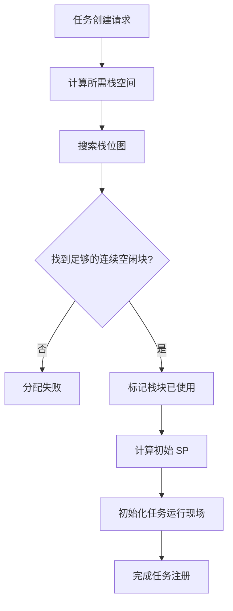
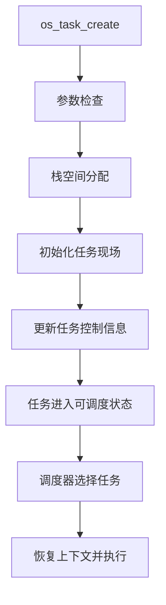
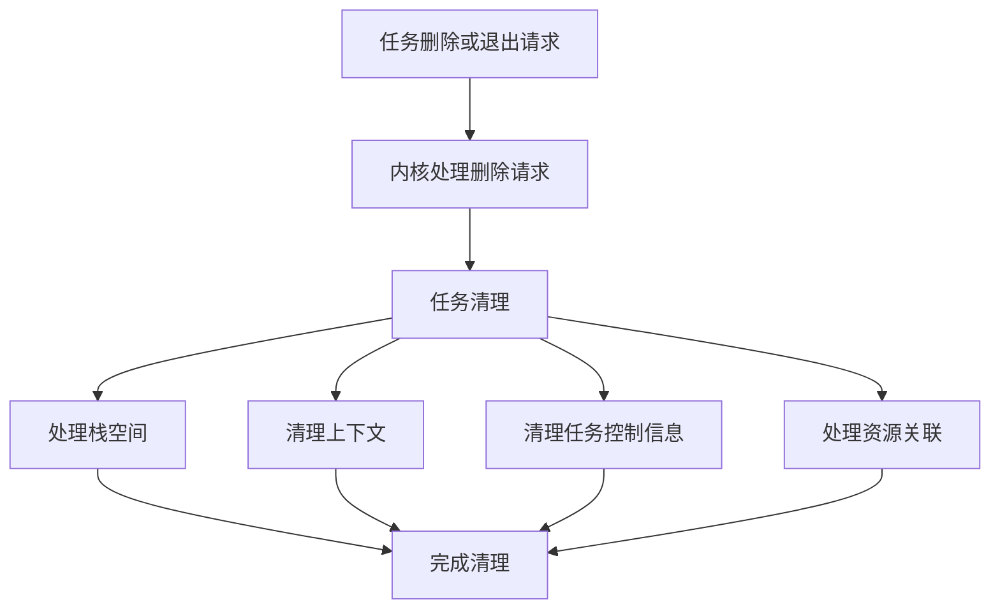

# HRTOS 任务管理

## 模块介绍

任务管理模块负责标准任务的创建与注册、任务状态管理、优先级调整、任务挂起与恢复、任务删除以及任务栈空间管理，并与内核调度器协同完成任务切换。

HRTOS 支持标准任务和快速任务两种任务执行机制。标准任务使用统一的任务控制块和等待机制，快速任务使用独立的上下文保存区域及延时控制变量。中断处理程序由独立的中断管理机制控制，不属于标准任务 ID 范围。

## 主要职责

- 任务创建与注册
- 任务状态查询与转换
- 任务优先级查询与调整
- 任务挂起、恢复与主动让出 CPU
- 任务删除与退出
- 任务栈空间分配与释放
- 任务上下文保存与恢复
- 任务等待状态及相关资源的清理
- 快速任务的独立控制与调度协同

## 任务类型

### 标准任务

标准任务使用任务 ID `0–15`，最多支持 16 个标准任务。任务优先级范围为 `0–7`，使用统一任务控制块 `OS_TCB`，并通过标准任务上下文保存区域保存任务现场。

标准任务的主要控制数据包括：

- `OS_PROCESS_OK`：任务状态及配置编码
- `OS_JINCHENG_SP`：标准任务 SP 记录
- `OS_JINCHENG_JILU_SP`：标准任务 SP 备份
- `OS_TASK_CONTEXT`：标准任务上下文保存区域
- `OS_TASK`：标准任务控制块数组

任务栈空间通过位图进行分配和管理。

### 快速任务

快速任务使用 ID `16–17`，最多支持 2 个快速任务，调度优先级为 8。

快速任务使用独立的上下文保存区域和延时控制变量，主要控制数据包括：

- `OS_KUAI_PROCESS_A`、`OS_KUAI_PROCESS_B`：快速任务控制标志
- `OS_KUAI_SP`：快速任务 SP 记录
- `OS_FAST_CONTEXT`：快速任务上下文保存区域
- `OS_WAIT_DI2`：快速任务延时控制数组
- `OS_SP_KUAI_BEI`、`OS_SP_KUAI_BEI2`：快速任务 SP 相关记录

快速任务与标准任务采用不同的上下文保存机制，不使用标准任务的统一等待机制。

### 中断处理程序

中断处理程序由中断管理机制控制，不占用标准任务 ID `0–15` 或快速任务 ID `16–17`。

中断处理使用独立的中断栈和现场保护区域，并通过中断管理接口完成中断退出及相关调度处理。

## 主要文件

### 源文件

| 文件 | 主要职责 |
|---|---|
| `Src/kernel/task_create.c` | 创建并注册任务 |
| `Src/kernel/task_cleanup.c` | 清理任务状态及相关资源 |
| `Src/task/task_delete.c` | 发起任务删除 |
| `Src/task/task_exit.c` | 当前任务退出 |
| `Src/task/task_is_valid.c` | 检查任务 ID 是否有效 |
| `Src/task/task_resume.c` | 恢复挂起任务 |
| `Src/task/task_scheduler.c` | 任务调度相关处理 |
| `Src/task/task_self.c` | 获取当前任务 ID |
| `Src/task/task_state.c` | 查询任务状态 |
| `Src/task/task_suspend.c` | 挂起指定任务 |
| `Src/task/task_suspend_self.c` | 当前任务主动挂起 |
| `Src/task/task_yield.c` | 主动让出 CPU |
| `Src/task_priority/task_get_priority.c` | 获取任务优先级 |
| `Src/task_priority/task_set_priority.c` | 设置任务优先级 |
| `Src/task_priority/lock.c` | 锁定任务注册 |
| `Src/task_priority/unlock.c` | 解除任务注册锁定 |
| `Src/task_priority/lock_query.c` | 查询任务注册锁定状态 |

### 头文件

| 文件 | 主要职责 |
|---|---|
| `Inc/task.h` | 任务管理 API 声明 |
| `Inc/config.h` | 任务配置及任务控制块定义 |
| `Inc/hrtos_internal.h` | 内核内部变量与接口声明 |

## 核心数据结构

### OS_TCB

`OS_TCB` 是标准任务的任务控制块，定义如下：

```c
typedef struct {
    u8 base_prio;   /* 基础优先级 */
    u8 cur_prio;    /* 当前优先级 */
    u8 state;       /* 任务状态 */
    u8 wait_type;   /* 等待类型 */
    u8 wait_flag;   /* 等待结果标志 */
    u8 wait_obj;    /* 等待对象 ID */
    u16 wait_tick;  /* 等待计时 */
} OS_TCB;
```

`OS_TCB` 不包含任务 ID 字段。任务 ID 通过任务在 `OS_TASK` 数组中的索引表示。

主要字段说明：

- `base_prio`：任务基础优先级。
- `cur_prio`：任务当前优先级，可用于记录优先级调整后的值。
- `state`：任务状态。
- `wait_type`：任务等待类型。
- `wait_flag`：等待结果标志。
- `wait_obj`：任务等待的对象 ID。
- `wait_tick`：等待计时数据。

### 任务状态控制数组

```c
volatile unsigned char xdata OS_PROCESS_OK[OS_PROCESS_MAX];
```

`OS_PROCESS_OK` 每个元素对应一个标准任务，采用位字段保存任务状态和配置：

| 位 | 含义 |
|---|---|
| bit 0 | 状态标志 |
| bit 1–3 | 优先级级别 |
| bit 4–6 | 栈大小 |
| bit 7 | 保留位 |

任务状态控制数组与 `OS_TCB` 配合使用，分别承担任务运行控制及任务状态、等待信息的管理职责。

### 栈指针记录

```c
volatile unsigned char xdata OS_JINCHENG_SP[OS_PROCESS_MAX];
volatile unsigned char xdata OS_JINCHENG_JILU_SP[OS_PROCESS_MAX];
```

- `OS_JINCHENG_SP`：标准任务 SP 记录。
- `OS_JINCHENG_JILU_SP`：标准任务 SP 备份记录。

两组数组均按标准任务数量配置，每个任务占用一个字节的记录空间。

### 上下文保存区域

```c
volatile unsigned char xdata
    OS_TASK_CONTEXT[OS_PROCESS_MAX][OS_JINCHENG_SHENDU];

volatile unsigned char xdata
    OS_FAST_CONTEXT[OS_FAST_TASK_MAX][OS_KUAI_SHENDU];
```

标准任务与快速任务分别使用独立的上下文保存区域。

| 区域 | 配置容量 | 总空间 |
|---|---:|---:|
| `OS_TASK_CONTEXT` | 16 × 13 字节 | 208 字节 |
| `OS_FAST_CONTEXT` | 2 × 5 字节 | 10 字节 |

上下文区域用于保存相应任务切换机制所需的现场数据。

### 快速任务控制数据

```c
volatile bit OS_KUAI_PROCESS_A;
volatile bit OS_KUAI_PROCESS_B;

volatile unsigned char xdata OS_KUAI_SP[OS_FAST_TASK_MAX];
volatile unsigned char xdata OS_SP_KUAI_BEI[OS_FAST_TASK_MAX];
volatile unsigned char xdata OS_SP_KUAI_BEI2[OS_FAST_TASK_MAX];
```

快速任务控制标志分别对应两个快速任务。SP 相关数组保存快速任务的栈指针及相关记录。

## 核心函数

### os_task_create()

**位置：** `Src/kernel/task_create.c`

**功能：** 创建并注册任务。

该接口负责检查创建参数、处理任务注册、分配所需栈空间、初始化任务运行现场，并建立任务对应的内核控制信息。

任务创建涉及以下主要步骤：

- 检查任务创建参数。
- 检查任务注册状态。
- 搜索可用栈空间。
- 更新栈空间分配位图。
- 初始化任务 SP。
- 初始化任务入口及相关上下文。
- 更新任务控制信息。
- 完成任务注册。

标准任务与快速任务采用不同的上下文保存机制，具体初始化操作由相应任务类型的处理逻辑完成。

### os_task_cleanup()

**位置：** `Src/kernel/task_cleanup.c`

**功能：** 清理任务及其相关资源。

任务清理涉及任务状态、栈空间、上下文和等待信息等内容。任务删除后，需要完成对应资源的清理，避免已删除任务继续参与调度或残留资源占用。

清理内容包括：

- 检查待清理任务。
- 处理任务栈空间。
- 更新栈空间分配位图。
- 清理任务上下文及控制信息。
- 清理任务等待状态。
- 处理任务与内核资源之间的关联。

### 任务状态管理

**位置：** `Src/task/task_state.c`

**功能：** 查询任务状态。

任务状态查询用于获取指定任务当前的状态信息，为任务监控和应用层控制提供依据。

### os_task_suspend()

**位置：** `Src/task/task_suspend.c`

**功能：** 挂起指定任务。

任务挂起后不再作为普通就绪任务参与调度。恢复操作由 `os_task_resume()` 完成。

### os_task_resume()

**位置：** `Src/task/task_resume.c`

**功能：** 恢复已挂起的任务。

任务恢复后重新具备参与调度的条件，具体执行时机由调度器决定。

### os_task_delete()

**位置：** `Src/task/task_delete.c`

**功能：** 发起任务删除。

任务删除接口负责发起删除处理。任务状态和相关资源的最终清理由内核任务清理机制完成。

### os_task_exit()

**位置：** `Src/task/task_exit.c`

**功能：** 当前任务主动退出。

当前任务退出后，由内核调度及任务清理机制完成后续处理。

### os_task_yield()

**位置：** `Src/task/task_yield.c`

**功能：** 当前任务主动让出 CPU。

该接口触发调度处理，使调度器有机会选择其他符合运行条件的任务。

### 任务优先级管理

**设置优先级：** `Src/task_priority/task_set_priority.c`

用于调整指定任务的优先级，并更新相应任务控制信息。

**获取优先级：** `Src/task_priority/task_get_priority.c`

用于获取指定任务的优先级信息。

**任务注册锁：** `Src/task_priority/lock.c`、`Src/task_priority/unlock.c`、`Src/task_priority/lock_query.c`

用于控制和查询任务注册锁定状态。该机制用于任务注册控制，不应与任务优先级调整混为一谈。

## 栈空间管理

### 用户任务栈区域

当前内存布局中，用户任务栈区域为：

| 项目 | 地址或容量 |
|---|---|
| 起始地址 | `0x42` |
| 结束地址 | `0x7F` |
| 总容量 | 62 字节 |
| 分配块大小 | 2 字节 |
| 可分配块数 | 31 块 |
| 位图空间 | 4 字节，位于 XDATA |

栈空间管理使用位图记录分配状态。分配时搜索连续空闲块，满足任务所需空间后标记相应块；释放时清除对应分配标记。

### 栈空间分配流程



## 任务生命周期

### 创建与运行



### 删除与清理



### 状态转换

标准任务的生命周期涉及创建、就绪、运行、等待、挂起和删除等状态。等待任务可在等待条件满足或等待处理结束后重新进入可调度状态；挂起任务通过恢复接口重新进入可调度流程。

任务状态查询的具体返回值及内部状态编码，应与对应 API 的实现保持一致。

## 设计特点

### 静态资源布局

任务控制数组、任务上下文保存区域和任务栈管理数据采用固定布局，核心资源容量由编译配置决定。

### 独立上下文机制

标准任务与快速任务分别使用独立的上下文保存区域，以适配不同的任务切换路径。

### 统一任务控制

标准任务通过 `OS_TCB` 管理任务状态、优先级及等待信息，并配合 `OS_PROCESS_OK` 完成任务控制。

### 栈空间复用

任务栈空间通过位图进行分配和释放，使已清理任务占用的栈块能够重新用于后续任务注册。

## 系统约束

- 标准任务最多 16 个，任务 ID 为 `0–15`。
- 快速任务最多 2 个，任务 ID 为 `16–17`。
- 标准任务优先级范围为 `0–7`。
- 快速任务调度优先级为 `8`。
- 中断处理使用独立的中断管理机制。
- 标准任务和快速任务使用不同的上下文保存区域。
- 用户任务栈空间受固定 RAM 区域及位图分配结果限制。
- 任务注册锁用于控制任务注册过程。

## 内存布局

### 内部 RAM

| 地址范围 | 用途 |
|---|---|
| `0x15` | 中断嵌套临时变量 `OS_IRQ_NEST_TEMP` |
| `0x30–0x34` | 中断保护、SP 及内核临时变量 |
| `0x35–0x39` | 系统堆栈保护区域 |
| `0x3A–0x41` | 中断堆栈区域 |
| `0x42–0x7F` | 用户任务栈区域 |
| `0xDB–0xE0` | 中断现场保护区域 |
| `0xE1–0xE2` | Timer0 计数器相关数据 |
| `0xE3–0xE7` | 当前任务、前一任务、调度源、时间片及临界区嵌套变量 |

上述地址对应当前内核布局，修改固定地址、数组长度或相关编译配置时，需要同步检查是否发生内存区域重叠。

### XDATA

系统全局数据池的固定范围为 `0x0200–0x03FF`，总容量 512 字节。当前布局中，任务管理相关区域包括：

| 起始地址 | 数据对象 | 容量 |
|---|---|---:|
| `0x0200` | `OS_PROCESS_OK` | 16 字节 |
| `0x0210` | `OS_JINCHENG_SP` | 16 字节 |
| `0x0220` | `OS_KUAI_SP` | 2 字节 |
| `0x0222` | `OS_FAST_CONTEXT` | 10 字节 |
| `0x022C` | `OS_TASK_CONTEXT` | 208 字节 |
| `0x02FC` | `OS_MEMORY` | 4 字节 |
| `0x0300` | `OS_JINCHENG_JILU_SP` | 16 字节 |
| `0x0336` | `OS_TASK` | 128 字节 |

任务管理相关数组与其他内核全局对象共同占用系统 XDATA 数据池，固定地址及偏移定义集中在内核内部配置中。