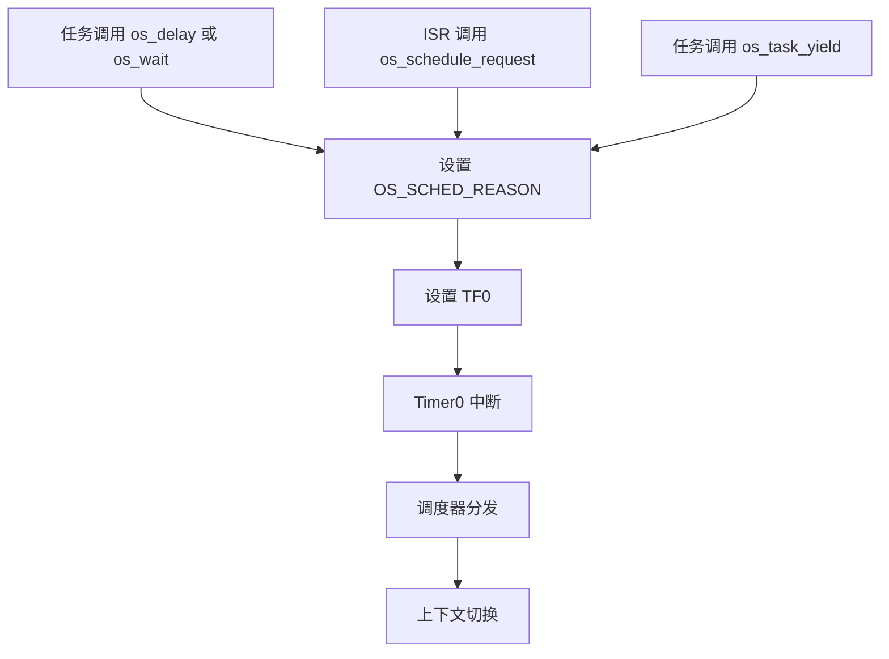
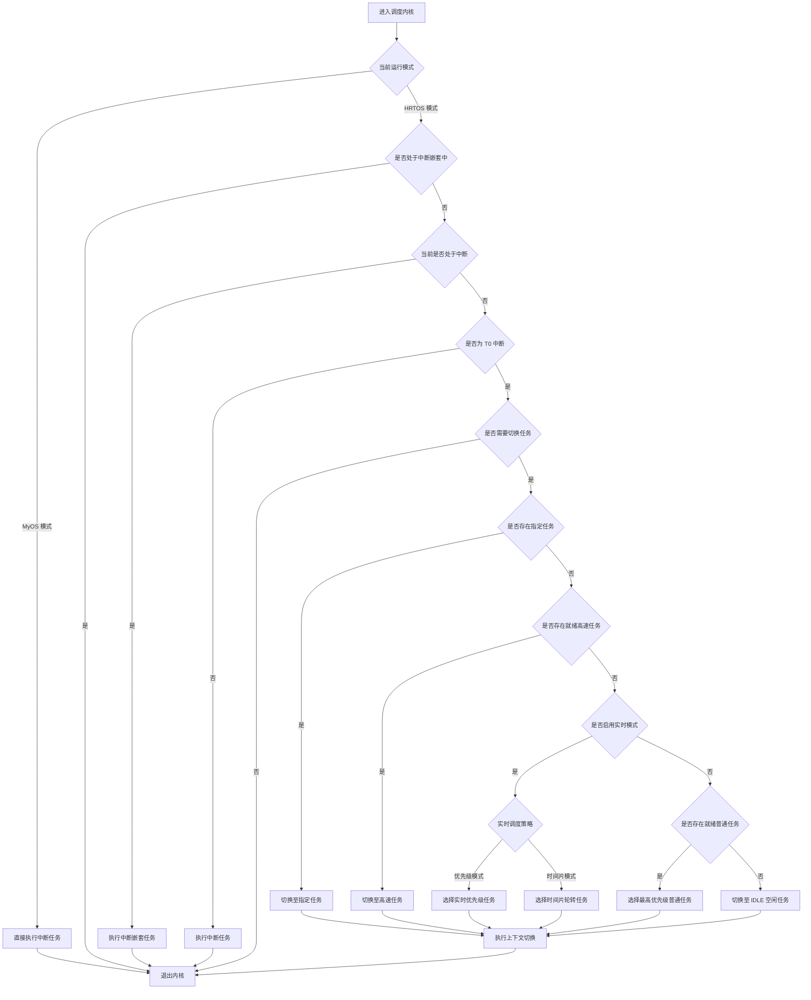

# HRTOS 调度器设计

## 模块介绍

HRTOS 调度器负责根据任务优先级、任务状态和调度条件选择运行任务，并完成任务调度与上下文切换。

调度器支持基于优先级的抢占式调度、时间片管理、高速任务调度和中断相关调度处理，并支持 HRTOS 与 MYOS 两种调度模式的切换，以满足不同应用场景下的任务执行需求。

## 主要职责

- **优先级调度**：根据任务优先级选择可运行任务。
- **抢占式调度**：在满足调度条件时切换当前运行任务。
- **时间片管理**：维护时间片计数并处理时间片到期事件。
- **高速任务调度**：支持高速任务的独立调度与快速切换。
- **中断调度处理**：处理来自中断服务程序的调度请求。
- **调度模式管理**：支持 HRTOS 与 MYOS 调度模式之间的运行时切换。

## 主要文件

### 源文件

| 文件 | 主要职责 |
|---|---|
| `Src/kernel/scheduler.c` | 调度器模式选择与切换 |
| `Src/kernel/scheduler_dispatch.c` | 任务分发机制 |
| `Src/kernel/scheduler_mode.c` | 调度模式配置与切换处理 |
| `Src/kernel/task_create.c` | 任务注册及调度信息初始化 |
| `Src/task/task_scheduler.c` | 任务调度逻辑 |
| `Src/task/task_yield.c` | 任务主动让出 CPU |
| `Src/interrupt/schedule_request.c` | 中断上下文中的调度请求 |

### 头文件

| 文件 | 主要职责 |
|---|---|
| `Inc/kernel.h` | 调度器及内核 API 声明 |
| `Inc/config.h` | 调度级别、任务数量等配置定义 |

## 数据结构

### 调度级别定义

调度级别定义于 `Inc/config.h`：

```c
/*
 * 调度级别定义：
 * 0-7   普通任务优先级
 * 8     高优先级任务
 * 9     中断级
 * 10    中断嵌套级
 */
#define OS_SCHED_LEVEL_MAX 10
```

调度级别说明：

| 级别 | 含义 |
|---|---|
| 0–7 | 普通任务优先级 |
| 8 | 高速任务级别 |
| 9 | 中断级 |
| 10 | 中断嵌套级 |

普通任务、高速任务和中断处理具有不同的执行层级，调度器根据相应规则完成任务选择及执行切换。

### 任务调度信息

位于 `Src/kernel/os_core.c` 的调度相关变量：

```c
volatile unsigned char idata OS_CURRENT_TASK;  /* 当前运行任务 */
volatile unsigned char idata OS_PREV_TASK;     /* 前一个任务 */
volatile unsigned char idata OS_TIME_XY;       /* 当前时间片计数 */
volatile unsigned char idata OS_DISPATCH_ID;   /* 分发触发源 */
volatile unsigned char xdata OS_TIME_ONCE;     /* 时间片计数配置 */
```

| 变量 | 说明 |
|---|---|
| `OS_CURRENT_TASK` | 记录当前运行任务 |
| `OS_PREV_TASK` | 记录前一个运行任务 |
| `OS_TIME_XY` | 维护当前时间片相关计数 |
| `OS_DISPATCH_ID` | 记录任务分发相关信息 |
| `OS_TIME_ONCE` | 保存时间片计数配置 |

### 任务状态数组

```c
volatile unsigned char xdata OS_PROCESS_OK[OS_PROCESS_MAX];
```

`OS_PROCESS_OK[id]` 使用位字段保存任务相关状态信息：

| 位范围 | 含义 |
|---|---|
| bit 0 | 任务状态标志 |
| bit 1–3 | 任务优先级 |
| bit 4–6 | 栈大小信息 |

### 高速任务标志

```c
volatile bit OS_KUAI_PROCESS_A;  /* 高速任务 0 激活标志 */
volatile bit OS_KUAI_PROCESS_B;  /* 高速任务 1 激活标志 */
```

两个标志分别用于记录高速任务 A、B 的激活状态，配合高速任务调度机制使用。

## 核心函数

### `os_set_scheduler()`

**位置：** `Src/kernel/scheduler.c`

**功能：** 在 HRTOS 与 MYOS 调度模式之间切换。

**参数：**

| 参数 | 含义 |
|---|---|
| `id = 1` | 切换到 HRTOS 模式 |
| `id = 0` | 切换到 MYOS 模式 |

**返回值：**

| 返回值 | 含义 |
|---|---|
| `1` | 切换成功 |
| `-1` | 当前条件下无法切换 |

**实现逻辑：**

```c
char os_set_scheduler(unsigned char id)
{
    if ((id == 0) && (OS_INTERRUPT_T0 == 0))  /* 切换到 MYOS */
    {
        OS_INTERRUPT_T0 = 1;
        OS_TIME_ONCE_BACKUP = OS_TIME_ONCE;
        return 1;
    }
    else if ((id == 1) && (OS_INTERRUPT_T0 == 1))  /* 切换到 HRTOS */
    {
        OS_INTERRUPT_T0 = 0;
        OS_TIME_XY = OS_TIME_XY + OS_TIME_ONCE_BACKUP - OS_TIME_ONCE;
        OS_TIME_ONCE = OS_TIME_ONCE_BACKUP;
        return 1;
    }

    return -1;
}
```

**切换处理：**

- 切换到 MYOS 模式时，设置 `OS_INTERRUPT_T0`，并备份当前时间片配置。
- 切换到 HRTOS 模式时，恢复相应的时间片状态与配置。
- 当请求的模式与当前模式不匹配时，返回 `-1`。

### `os_scheduler_mode_switch()`

**位置：** `Src/kernel/scheduler_mode.c`

**功能：** 在实时调度模式与通用调度模式之间切换。

**参数：**

| 参数 | 含义 |
|---|---|
| `id = 1` | 实时模式 |
| `id = 0` | 通用模式 |

该接口用于调度模式相关控制，与 `os_set_scheduler()` 一起构成调度模式管理机制。

### `os_schedule_request()`

**位置：** `Src/interrupt/schedule_request.c`

**功能：** 通过触发 Timer0 中断请求调度处理。

**实现逻辑：**

```c
char os_schedule_request(char id)
{
    id = id;                    /* 保留参数 */
    OS_SCHED_REASON = 1;        /* 设置调度触发标志 */
    TF0 = 1;                    /* 触发 Timer0 中断 */
    return 1;
}
```

**处理流程：**

- 设置 `OS_SCHED_REASON`，标记存在调度请求。
- 设置 `TF0`，触发 Timer0 中断。
- 由相应的中断及调度处理流程完成后续任务调度。

该函数用于发起调度请求，任务选择与上下文切换由后续调度流程完成。

### `os_task_yield()`

**位置：** `Src/task/task_yield.c`

**功能：** 主动让出当前任务的 CPU 执行机会。

**实现方式：**

- 设置调度触发条件。
- 请求调度器重新选择运行任务。
- 根据调度规则执行相应的任务切换。

主动让出 CPU 后，后续运行任务由调度器依据当前任务状态和优先级规则决定。

## 调用关系

### 调度触发流程



该流程展示任务阻塞、中断调度请求及主动让出 CPU 等操作进入调度处理的基本路径。

### 优先级选择流程


调度器根据高速任务、普通任务及空闲任务的调度规则选择后续运行对象，并在需要时完成上下文切换。

## 生命周期

### 调度器初始化

系统启动阶段的调度相关处理包括：

- 进入 `os_idle_task()`。
- 初始化 `OS_TIME_XY` 时间片计数。
- 将 `OS_CURRENT_TASK` 设置为 `0`，表示空闲任务。
- 清除 `OS_SCHED_REASON` 调度触发标志。
- 启用中断。
- 启动 Timer0 时钟周期。

初始化完成后，系统进入正常的任务调度与运行阶段。

### 调度周期

一次典型的时钟驱动调度过程包括：

- **时钟中断：** Timer0 ISR 触发。
- **时间片计数：** 更新 `OS_TIME_XY`。
- **时间片检查：** 判断 `OS_TIME_XY` 是否达到 `OS_TIME_ONCE`。
- **优先级扫描：** 根据调度规则检查可运行任务。
- **任务选择：** 选择符合当前调度条件的任务。
- **上下文切换：** 保存当前任务上下文并恢复目标任务上下文。
- **任务执行：** 目标任务继续运行。

时间片到期、任务阻塞、任务唤醒和主动让出 CPU 等事件也可能触发调度处理。

## 设计原则

### 基于优先级的抢占

- 普通任务优先级范围为 `0–7`。
- 高速任务使用级别 `8`。
- 中断级别为 `9–10`。
- 调度器根据任务优先级及当前执行条件选择运行任务。
- 高优先级任务可以在满足调度条件时抢占低优先级任务。

### 时间片模式

- 使用 `OS_TIME_ONCE` 配置时间片计数。
- 使用 `OS_TIME_T0` 配置时钟相关参数。
- 时间片机制参与任务调度与调度触发。
- 可根据系统配置使用相应的时间片调度策略。

时间片计数、硬件定时器周期和任务实际运行时间是不同概念，具体换算关系由系统时钟及定时器配置决定。

### 高速任务优化

高速任务通过专门的调度及上下文处理机制降低切换开销，相关设计包括：

- 减少上下文保存深度。
- 使用独立的延时机制。
- 使用专用寄存器组。
- 降低高速任务调度开销。

高速任务数量上限由 `OS_FAST_TASK_MAX` 控制，当前配置为两个。

### 双调度器支持

- **HRTOS 模式：** 使用 HRTOS 对应的调度机制。
- **MYOS 模式：** 使用 MYOS 对应的调度机制。
- **运行时切换：** 通过 `os_set_scheduler()` 完成模式切换。

模式切换涉及时间片配置及相关调度状态的调整。

## 约束

- 普通任务数量上限由 `OS_PROCESS_MAX` 控制，当前配置为 `16`。
- 高速任务数量上限由 `OS_FAST_TASK_MAX` 控制，当前配置为 `2`。
- 调度级别上限由 `OS_SCHED_LEVEL_MAX` 控制，当前配置为 `10`。
- 高速任务使用专门的调度机制，其等待及 IPC 接口使用范围受相应实现约束。
- 互斥锁优先级继承属于资源同步机制，不属于调度器本身的调度算法。
- 在没有时间片轮转机制参与时，同优先级任务之间的运行顺序取决于调度器的具体实现。

## 调度算法

### 就绪任务选择

调度器按照系统规定的执行层级和任务调度规则选择运行对象，主要包括：

- 处理中断相关执行层级。
- 检查高速任务。
- 扫描普通任务。
- 在没有其他合适任务运行时，执行空闲任务。

高速任务、普通任务和中断处理具有不同的执行机制，不能将所有级别简单视为同一类普通任务优先级。

### 任务状态位

`OS_PROCESS_OK[id]` 的编码如下：

| 位范围 | 含义 |
|---|---|
| bit 0 | 任务状态标志 |
| bit 1–3 | 优先级级别 |
| bit 4–6 | 栈大小信息 |

该数组用于保存任务相关状态及调度信息。

### 上下文切换触发条件

调度处理可由以下事件触发：

- **时间片到期：** `OS_TIME_XY` 达到 `OS_TIME_ONCE`。
- **主动让出 CPU：** 调用 `os_task_yield()`。
- **任务阻塞：** 任务通过 `os_wait()` 等等待接口进入等待状态。
- **中断请求调度：** ISR 调用 `os_schedule_request()`。
- **任务唤醒：** `wake_task()` 等相关机制使任务重新具备运行条件。

调度请求产生后，内核根据当前执行上下文和调度条件完成任务选择，并在需要时执行上下文切换。

## 总结

HRTOS 调度器整合了优先级调度、时间片管理、高速任务调度、中断相关调度处理及调度模式切换等机制。

调度器通过统一的调度处理流程协调任务阻塞、唤醒、主动让出 CPU 和时钟驱动调度等场景，并配合上下文切换机制实现任务执行权的转移。其设计重点是在 8051 有限的硬件资源下，兼顾任务调度效率、实时响应能力与系统功能完整性。