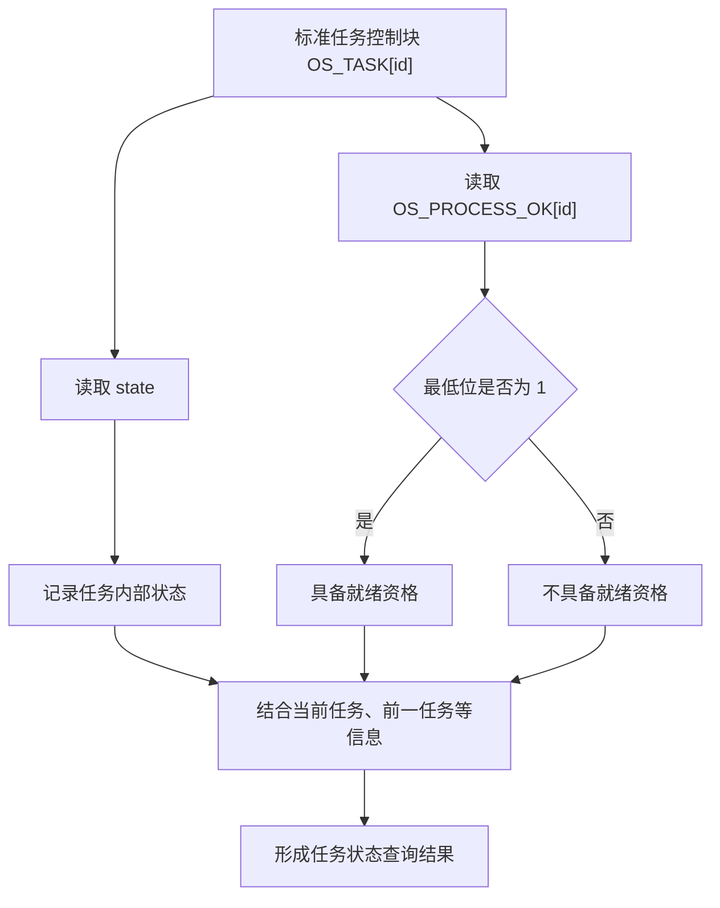
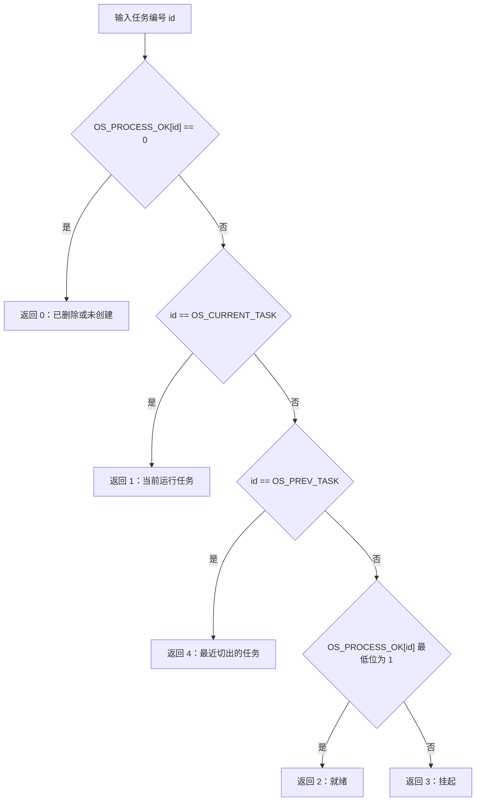
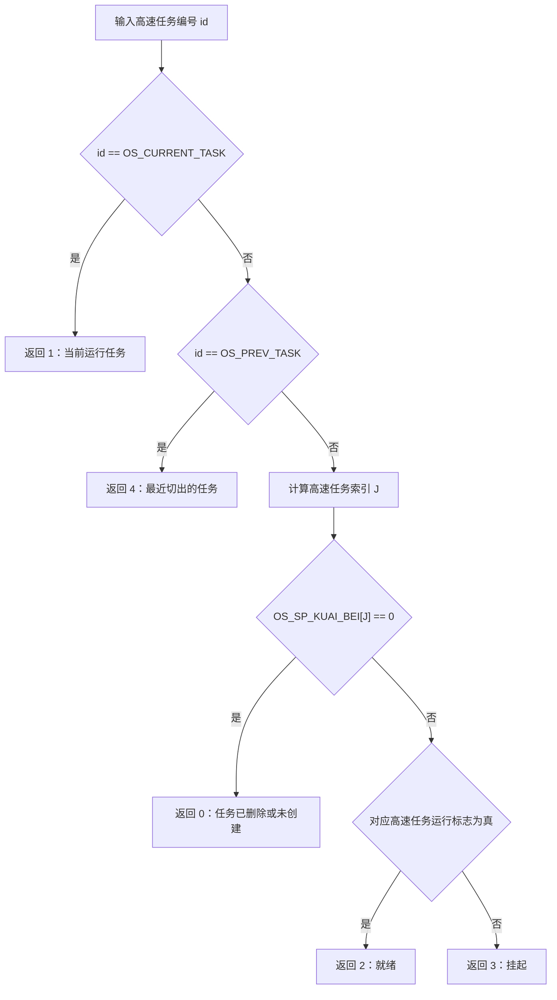
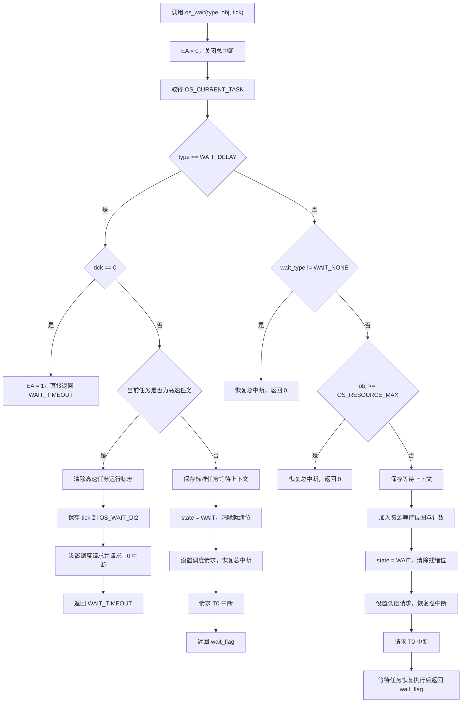
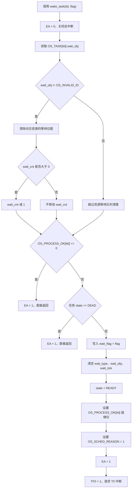
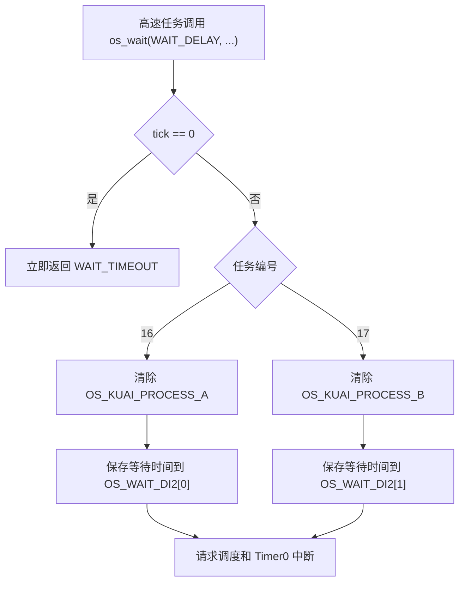

# HRTOS 状态机

## 概述

HRTOS 的任务状态管理由任务控制块、任务就绪标志、当前任务与前一任务信息，以及等待上下文共同构成。

系统通过任务状态记录任务所处的生命周期阶段，通过就绪标志控制标准任务是否参与调度，通过等待上下文记录任务正在等待的条件及唤醒结果。高速任务采用独立的运行标志和延时计数，不完全遵循标准任务的等待处理路径。

理解 HRTOS 状态机时，需要区分以下几个概念：

- **任务内部状态**：由 `READY`、`WAIT`、`RUNNING`、`SUSPEND` 和 `DEAD` 等宏定义表示。
- **任务调度资格**：标准任务通过 `OS_PROCESS_OK[id]` 的最低位判断是否就绪。
- **任务状态查询结果**：由 `os_task_get_state()` 返回，采用独立于内部状态宏的编码。
- **等待上下文**：记录等待类型、等待对象、剩余等待时间和唤醒结果。
- **高速任务运行状态**：通过高速任务运行标志及对应的栈状态信息进行判断。

这些信息相互关联，但并不是同一个变量，也不能相互替代。

## 任务状态定义

HRTOS 配置文件中定义了以下任务状态：

```c
#define READY         0   /* 就绪态 */
#define WAIT          1   /* 等待态 */
#define RUNNING       2   /* 运行态 */
#define SUSPEND       3   /* 挂起态 */
#define DEAD          4   /* 删除态 */
```

### READY：就绪态

任务具备继续执行的条件，可以参与正常调度。

对于标准任务，系统使用 `OS_PROCESS_OK[id]` 的最低位表示其调度资格。最低位为 `1` 时，表示任务具有就绪资格；最低位为 `0` 时，任务不具备这一资格。

```c
OS_PROCESS_OK[id] |= 1;   /* 设置就绪位 */
OS_PROCESS_OK[id] &= 0xFE; /* 清除就绪位 */
```

这两个操作只修改最低位，不应将 `OS_PROCESS_OK[id]` 的整个字节简单理解为任务状态值。

### WAIT：等待态

任务因延时或等待某种资源、消息、事件等条件而暂时不能继续执行。

标准任务进入等待时，`os_wait()` 会记录等待上下文，并执行：

```c
OS_TASK[tid].state = WAIT;
OS_PROCESS_OK[tid] &= 0xFE;
```

任务被唤醒后，`wake_task()` 会设置唤醒结果、清理等待上下文、将任务状态设为 `READY`，并恢复其就绪资格。

高速任务的延时等待有所不同：它不通过上述标准任务等待上下文建立延时，而是清除对应的高速任务运行标志，并将等待时间写入 `OS_WAIT_DI2[]`。

### RUNNING：运行态

`RUNNING` 表示任务正在运行。不过，当前提供的 `os_task_get_state()` 并不是直接检查 `OS_TASK[id].state == RUNNING`，而是根据任务编号、当前任务编号、前一任务编号，以及相应的任务运行信息判断查询结果。

因此，不能仅通过检查 TCB 中的 `state` 字段，就认定能够完整还原 `os_task_get_state()` 的查询结果。

### SUSPEND：挂起态

`SUSPEND` 是配置文件中定义的任务状态。状态查询函数在标准任务不满足运行、前一任务和就绪条件时，会返回表示挂起的查询结果。

但目前提供的源码没有包含专门的挂起与恢复函数，因此不能仅凭这些文件确定挂起状态的全部进入条件、恢复条件，以及挂起与等待状态之间的交互规则。

### DEAD：删除态

`DEAD` 表示任务处于删除状态。

`wake_task()` 在清理等待对象信息后，会检查任务的就绪标志和内部状态。如果 `OS_PROCESS_OK[tid] == 0` 或任务状态为 `DEAD`，函数便提前返回，不再执行后续的唤醒操作。

需要注意，`wake_task()` 并不负责完整的任务删除流程。任务删除、栈回收以及任务槽位重新利用的完整机制，还需要结合任务创建、删除和清理相关源码进行分析。

## 任务状态与调度资格

标准任务的内部状态和就绪标志需要结合起来理解。



这张图表示的是状态信息的判读关系，并不代表所有状态转换都由一个统一函数完成。

在当前实现中：

- `os_wait()` 负责设置标准任务的等待上下文、将其状态设为 `WAIT`，并清除就绪位。
- `wake_task()` 负责清理等待上下文，将符合唤醒条件的任务恢复为 `READY`，并设置就绪位。
- `os_task_get_state()` 根据不同任务类型和运行信息返回状态查询结果。

因此，任务状态、调度资格和查询结果应当分别记录、分别理解。

## 任务状态查询接口

### 函数原型

```c
char os_task_get_state(unsigned char id);
```

该接口根据任务编号查询任务状态。

### 参数说明

| 参数 | 说明 |
|---|---|
| `id` | 任务编号。标准任务编号为 `0` 至 `15`，高速任务编号为 `16` 和 `17`。 |

当任务编号大于 `OS_PROCESS_MAX + 1` 时，函数返回 `-1`。

### 返回值

| 返回值 | 含义 |
|---|---|
| `0` | 任务已删除或尚未创建 |
| `1` | 当前正在运行的任务 |
| `2` | 就绪状态 |
| `3` | 挂起状态 |
| `4` | 最近一次被切出的任务 |
| `-1` | 任务编号超出允许范围 |

这里的返回值是查询接口的专用编码，不能直接与 `READY`、`WAIT`、`RUNNING`、`SUSPEND`、`DEAD` 的宏定义进行数值比较。

例如：

```c
#define READY 0
#define RUNNING 2
```

虽然 `READY` 的内部编码为 `0`，但 `os_task_get_state()` 返回 `2` 表示就绪，而不是运行。这是两套不同的编码体系。

### 标准任务的查询流程

对于编号小于 `OS_PROCESS_MAX` 的标准任务，函数按照以下顺序判断：



该判断顺序具有实际意义。

当多个条件同时成立时，函数优先返回代码中先检查的条件。例如，标准任务的就绪标志为零时，即使其编号与当前任务编号相同，函数也会优先返回 `0`。

### 高速任务的查询流程

高速任务的编号范围为 `OS_PROCESS_MAX` 至 `OS_PROCESS_MAX + 1`，即当前配置下的 `16` 和 `17`。

函数先检查该任务是否为当前任务或前一任务，然后根据高速任务的栈状态及运行标志判断其余状态。



高速任务 A 使用 `OS_KUAI_PROCESS_A`，高速任务 B 使用 `OS_KUAI_PROCESS_B`。

需要注意，当前函数把高速任务的非运行状态归类为就绪或挂起结果，但这不意味着高速任务与标准任务具有完全相同的 TCB 状态管理机制。

### 使用注意事项

`os_task_get_state()` 的返回类型为 `char`，而无效编号使用 `-1` 表示。若要将其作为跨编译器、跨编译选项的稳定 API，应确认目标编译器中 `char` 的有符号性，必要时改用明确的有符号返回类型。

此外，该函数没有对每个合法编号对应的底层状态进行完整性校验。调用方应传入有效任务编号，并将返回结果视为查询时的状态快照。

## 等待类型

HRTOS 使用 `wait_type` 区分任务正在等待的条件。

```c
#define WAIT_NONE      0
#define WAIT_DELAY     1
#define WAIT_SEM       2
#define WAIT_MUTEX     3
#define WAIT_MSG_SEND  4
#define WAIT_MSG_RECV  5
#define WAIT_EVENT     6
#define WAIT_MAILBOX   7
```

各类型的含义如下：

| 等待类型 | 含义 |
|---|---|
| `WAIT_NONE` | 当前没有等待 |
| `WAIT_DELAY` | 延时等待 |
| `WAIT_SEM` | 等待信号量 |
| `WAIT_MUTEX` | 等待互斥锁 |
| `WAIT_MSG_SEND` | 消息队列发送等待，通常与队列满有关 |
| `WAIT_MSG_RECV` | 消息队列接收等待，通常与队列空有关 |
| `WAIT_EVENT` | 等待事件 |
| `WAIT_MAILBOX` | 等待邮箱 |

这些宏定义表明系统为上述等待场景预留了类型标识，但具体类型是否被每个对应模块正确使用，仍应结合信号量、互斥锁、消息队列、事件和邮箱等实现进行确认。

## 等待上下文

配置文件中的 `OS_TCB` 包含以下等待相关字段：

```c
u8  wait_type;
u8  wait_flag;
u8  wait_obj;
u16 wait_tick;
```

这些字段共同记录任务的等待信息。

| 字段 | 作用 |
|---|---|
| `wait_type` | 等待类型 |
| `wait_flag` | 等待结果或唤醒原因 |
| `wait_obj` | 等待对象编号 |
| `wait_tick` | 等待超时计数 |

其中，`wait_tick` 的实际含义需要结合系统 Tick 更新代码确认。`os_wait()` 将调用方传入的 `tick` 写入该字段，但仅凭当前文件不能确认每次 Tick 如何递减该字段、如何处理计数到期，以及是否存在特殊的零值或边界约定。

### 等待结果

```c
#define WAIT_TIMEOUT  1
#define WAIT_SIGNAL   2
```

| 返回值 | 含义 |
|---|---|
| `WAIT_TIMEOUT` | 因超时而结束等待 |
| `WAIT_SIGNAL` | 因信号或相应等待条件满足而结束等待 |
| `0` | 等待参数无效，或当前任务已经存在等待状态 |

`WAIT_TIMEOUT` 和 `WAIT_SIGNAL` 是等待结果标志，不是任务状态。

例如，一个任务可以先处于 `WAIT`，在超时后由唤醒路径设置 `wait_flag = WAIT_TIMEOUT`，再恢复为 `READY`。任务重新获得执行机会后，`os_wait()` 返回等待结果。

## 标准任务的等待流程

标准任务调用 `os_wait()` 后，系统首先关闭总中断，取得当前任务编号，并根据等待类型进入相应处理路径。

对于非延时等待，函数还会检查当前任务是否已经存在等待类型，并验证等待对象编号是否超出资源槽位范围。



该流程图依据当前提供的 `wait.c` 整理。需要特别注意，函数中对延时等待和非延时等待的处理并不完全相同。

### 延时等待的处理

当 `type == WAIT_DELAY` 时，函数首先判断 `tick` 是否为零。

如果 `tick == 0`，函数恢复总中断并立即返回 `WAIT_TIMEOUT`，不会真正建立等待状态。

如果当前任务是标准任务，函数会写入等待上下文，将状态设为 `WAIT`，清除就绪位，设置调度请求并请求 Timer0 中断。函数随后返回 `OS_TASK[tid].wait_flag`。

如果当前任务是高速任务，则进入独立处理路径：

- 高速任务 A 清除 `OS_KUAI_PROCESS_A`，并将等待时间写入 `OS_WAIT_DI2[0]`。
- 高速任务 B 清除 `OS_KUAI_PROCESS_B`，并将等待时间写入 `OS_WAIT_DI2[1]`。
- 设置调度请求，并请求 Timer0 中断。

这一分支没有通过标准任务的 `OS_TASK[tid].state = WAIT`、等待位图及等待计数来建立延时等待。

### 资源等待的处理

对于非 `WAIT_DELAY` 类型，函数首先判断当前任务的 `wait_type` 是否为 `WAIT_NONE`。若不是，说明任务已经记录了等待类型，函数会返回 `0`。

随后检查：

```c
if(obj >= OS_RESOURCE_MAX)
{
    EA = 1;
    return 0;
}
```

在当前配置下，`OS_RESOURCE_MAX` 为 `6`，因此资源对象编号必须小于 `6`。

通过检查后，函数保存等待上下文。如果类型不是 `WAIT_DELAY`，且对象编号不等于 `OS_INVALID_ID`，则执行：

```c
OS_RES[obj].wait_mask |= ((u16)1 << tid);
OS_RES[obj].wait_cnt++;
```

其中：

- `wait_mask` 以位图形式记录等待任务。
- `wait_cnt` 记录等待计数。

接着将任务状态设为 `WAIT`，清除其就绪位，并请求调度。

**实现边界：** 当前代码没有显式验证 `type` 是否属于 `WAIT_SEM` 至 `WAIT_MAILBOX` 等已定义类型。它主要根据 `WAIT_DELAY` 分支、当前等待状态及对象编号进行处理。因此，调用方应传入模块约定的合法等待类型，不应将此函数视为具有完整参数校验的通用接口。

## 任务唤醒流程

`wake_task()` 负责处理指定任务的等待清理、唤醒结果记录和就绪恢复。

函数的实际执行顺序如下：



### 等待队列清理

函数先读取 `OS_TASK[tid].wait_obj`。如果该值不等于 `OS_INVALID_ID`，便清除对应资源的等待位图，并在 `wait_cnt` 大于零时将其减一。

这里的清理操作发生在删除状态检查之前。因此，即使后续判断发现任务已删除或状态为 `DEAD`，前面的等待队列清理也已经执行。

当前实现没有在访问 `OS_RES[obj]` 之前显式检查 `obj < OS_RESOURCE_MAX`，也没有在函数入口检查 `tid` 是否有效。因此，该函数依赖调用方传入有效任务编号，并保证等待对象信息合法。

### 删除状态检查

等待队列清理后，函数依次检查：

```c
if(OS_PROCESS_OK[tid] == 0)
{
    EA = 1;
    return;
}

if(OS_TASK[tid].state == DEAD)
{
    EA = 1;
    return;
}
```

如果任一条件成立，函数就恢复总中断并返回，不再恢复任务就绪资格。

这意味着唤醒操作并不保证任何传入任务都会被恢复为就绪态。

### 恢复任务就绪资格

通过删除状态检查后，函数依次执行：

```c
OS_TASK[tid].wait_flag = flag;

OS_TASK[tid].wait_type = WAIT_NONE;
OS_TASK[tid].wait_obj  = OS_INVALID_ID;
OS_TASK[tid].wait_tick = 0;

OS_TASK[tid].state = READY;
OS_PROCESS_OK[tid] |= 1;

OS_SCHED_REASON = 1;
```

这一过程将等待结果写入任务控制块，清除等待上下文，将任务状态恢复为 `READY`，并重新设置就绪位。

最后，函数恢复总中断并设置 `TF0 = 1`，请求 Timer0 中断，以触发后续的系统处理。

需要注意，`wake_task()` 本身不检查任务是否确实处于 `WAIT` 状态，也没有检查该任务是否已经被唤醒。因此，调用方应当确保调用时机和任务编号符合相应模块的约定。

## 延时等待中的对象编号注意事项

`os_wait()` 的注释说明，延时等待不关联具体资源对象。但当前实现中，标准任务的延时分支仍然执行：

```c
OS_TASK[tid].wait_obj = obj;
```

另一方面，`wake_task()` 只检查：

```c
if(obj != OS_INVALID_ID)
```

便可能访问 `OS_RES[obj]`，而没有进一步验证对象编号是否属于有效资源范围。

因此，按照当前实现，如果标准任务延时等待时传入了非 `OS_INVALID_ID` 的对象编号，后续唤醒路径可能把这个编号当作资源对象访问。

**调用约定建议：** 在当前代码不变的情况下，纯延时等待应传入 `OS_INVALID_ID` 作为对象编号，并确认所有调用点遵守这一约定。更稳妥的实现方式是在延时分支中明确将 `wait_obj` 设置为 `OS_INVALID_ID`，并在 `wake_task()` 中增加任务编号和资源对象编号的边界检查。

以上是根据现有代码发现的实现边界，不代表所有现有调用点都已经触发该问题。

## 高速任务的延时状态管理

HRTOS 配置了两个高速任务：

```c
#define OS_PROCESS_MAX    16
#define OS_FAST_TASK_MAX  2
```

标准任务编号为 `0` 至 `15`，高速任务编号为 `16` 和 `17`。

在 `os_wait()` 的延时分支中，高速任务不使用标准任务的等待位图和等待计数，而是使用独立的变量：

| 高速任务 | 运行标志 | 延时计数 |
|---|---|---|
| 高速任务 A | `OS_KUAI_PROCESS_A` | `OS_WAIT_DI2[0]` |
| 高速任务 B | `OS_KUAI_PROCESS_B` | `OS_WAIT_DI2[1]` |

高速任务延时处理的核心流程是：



高速任务延时到期后如何恢复运行，需要结合 Timer0 中断处理及高速任务调度代码进一步确认。不能仅凭 `os_wait()` 推断其完整的计时与恢复过程。

## 状态一致性与调试

排查任务状态问题时，应同时检查任务控制块、调度资格和等待上下文，而不是只看单一字段。

### 标准任务

建议关注以下变量：

- `OS_TASK[id].state`：任务内部状态。
- `OS_PROCESS_OK[id]` 的最低位：任务是否具有就绪资格。
- `OS_TASK[id].wait_type`：是否记录了等待类型。
- `OS_TASK[id].wait_obj`：等待对象编号。
- `OS_TASK[id].wait_tick`：等待计数。
- `OS_TASK[id].wait_flag`：等待结果。
- `OS_CURRENT_TASK`：当前任务编号。
- `OS_PREV_TASK`：前一任务编号。

### 资源等待

建议同时检查：

- `OS_RES[obj].wait_mask`：资源等待位图。
- `OS_RES[obj].wait_cnt`：资源等待计数。
- 任务控制块中对应的 `wait_type` 和 `wait_obj`。
- 唤醒路径是否对同一个等待记录进行了重复清理。

`wait_mask` 与 `wait_cnt` 应当保持逻辑一致，但当前 `wake_task()` 会在 `wait_cnt` 大于零时直接递减计数，并未确认被清除的任务位原先是否确实存在。因此，如果唤醒路径被重复调用，计数和位图可能出现不一致，需要结合调用方排查。

### 状态查询

调试日志应区分内部状态宏与 `os_task_get_state()` 的返回值。例如：

```c
/* 内部状态 */
OS_TASK[id].state

/* 对外查询结果 */
os_task_get_state(id)
```

两者采用不同的编码和判断逻辑，不能用同一套数字标签解释。

## 实现边界

根据当前提供的 `task_get_state.c`、`wait.c`、`wake_task.c` 和配置文件，可以确认：

- 任务状态宏、等待类型和等待结果标志的具体定义。
- 标准任务的等待上下文设置及唤醒清理流程。
- 标准任务就绪位的设置和清除方式。
- 高速任务延时使用独立运行标志和延时计数。
- 状态查询接口对标准任务与高速任务采用不同的判断路径。
- `wake_task()` 会在删除状态检查前清理可能关联的资源等待记录。

目前尚不能仅凭这些文件完整确认：

- 所有任务状态转换的完整集合。
- 任务挂起、恢复、删除及重新创建的完整流程。
- 每种 IPC 对象的等待和唤醒策略。
- Tick 中断如何递减等待时间及处理超时。
- 高速任务延时到期后的具体恢复流程。
- 调度器如何使用 `OS_SCHED_REASON`、`OS_CURRENT_TASK` 和 `OS_PREV_TASK` 完成实际切换。
- 所有状态变更是否都由临界区保护。

这些内容应当以相应的任务管理、调度器、Timer0 中断及 IPC 模块源码为依据补充，而不应仅凭状态宏或接口注释推断。

## 总结

HRTOS 的任务状态管理不是简单地依赖一个状态字段，而是结合任务内部状态、调度资格、当前任务信息和等待上下文共同完成。

标准任务通过统一等待上下文管理延时和资源等待，并在唤醒后恢复就绪资格；高速任务则对延时采用独立的处理路径。`os_task_get_state()` 为调用方提供统一的查询入口，但其返回编码与内部状态宏不同。

在系统手册中，应始终区分**内部状态、调度资格、查询结果和等待结果**。这既有助于准确理解内核行为，也能避免调试时因不同编码体系混淆而得出错误结论。