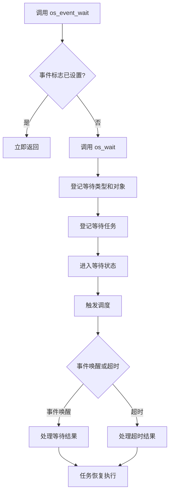
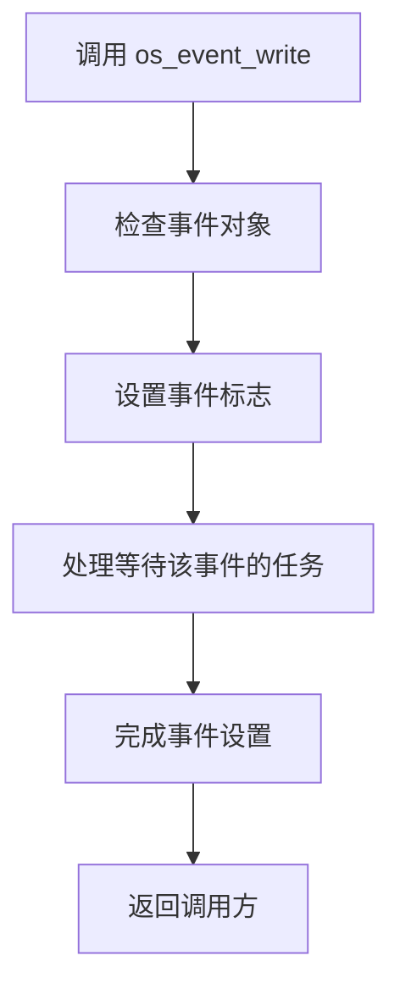
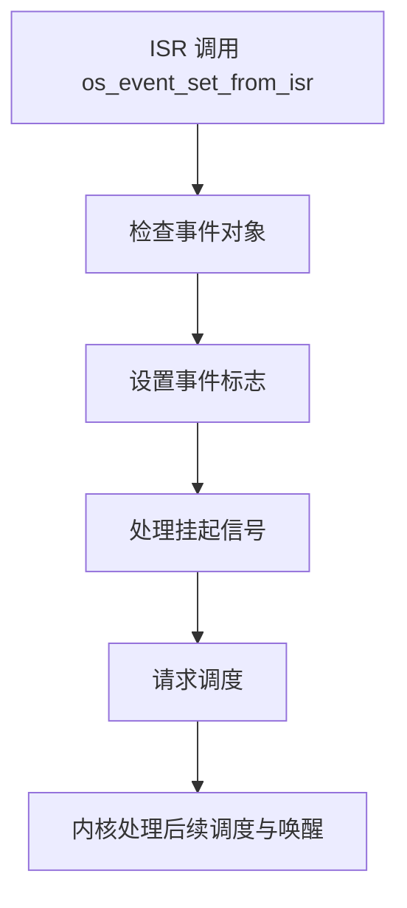

# HRTOS 事件模块

## 模块介绍

事件模块提供基于事件标志的任务同步机制，用于通知任务某个条件已经发生。

事件不承担数据传输功能。任务可以通过事件等待接口等待指定事件，也可以通过事件设置接口通知等待任务。事件对象使用 HRTOS 统一资源结构，并接入统一等待与唤醒机制。

事件模块支持任务上下文和中断上下文中的事件设置。

## 主要职责

- 事件对象初始化与删除
- 事件标志设置
- 事件状态查询
- 带超时的事件等待
- 等待任务管理与唤醒
- 中断上下文中的事件设置
- 与内核统一等待机制协同工作

## 主要文件

### 源文件

| 文件 | 主要职责 |
|---|---|
| `Src/event/event_init.c` | 初始化事件对象 |
| `Src/event/event_write.c` | 设置事件标志 |
| `Src/event/event_wait.c` | 等待事件发生 |
| `Src/event/event_query.c` | 查询事件状态 |
| `Src/event/event_delete.c` | 删除事件对象 |
| `Src/interrupt/event_set_from_isr.c` | 在中断上下文中设置事件 |

### 头文件

| 文件 | 主要职责 |
|---|---|
| `Inc/event.h` | 事件 API 声明 |
| `Inc/config.h` | 内核配置与相关类型定义 |
| `Inc/hrtos_internal.h` | 内核内部事件变量及接口声明 |

## 数据结构

### OS_RESOURCE

事件对象使用统一资源结构 `OS_RESOURCE`：

```c
typedef struct {
    u8 value;
    u8 owner;
    u8 wait_cnt;
    u16 wait_mask;
    u8 pending_signal;
} OS_RESOURCE;
```

各字段在事件场景中的用途如下：

| 字段 | 作用 |
|---|---|
| `value` | 事件标志值，0 表示未设置，非零表示已设置 |
| `owner` | 统一资源结构中的所有者字段，事件不使用资源所有权机制 |
| `wait_cnt` | 等待任务计数 |
| `wait_mask` | 等待任务位图 |
| `pending_signal` | 中断上下文使用的挂起信号计数 |

`wait_mask` 使用 16 位位图表示标准任务的等待状态，位 0 对应任务 0，位 15 对应任务 15。

### 事件相关变量

事件模块涉及以下内部变量：

```c
extern unsigned int xdata OS_EVENT_BIT;
extern unsigned char xdata OS_TASK_EVENT[OS_PROCESS_MAX + OS_FAST_TASK_MAX];
```

- `OS_EVENT_BIT`：事件相关的位操作变量。
- `OS_TASK_EVENT`：按标准任务和快速任务数量配置的事件相关任务数据。

这些变量属于内核内部数据，不应与 `OS_RESOURCE.value` 表示的单个事件对象标志混为一谈。

## 核心函数

### os_event_init()

**位置：** `Src/event/event_init.c`

**功能：** 初始化事件对象。

**参数：**

- `obj`：事件对象对应的资源 ID。

**返回值：**

- `1`：成功。
- `-1`：失败。

初始化过程包括检查资源 ID、初始化统一资源结构、清零事件标志，以及初始化相关等待信息。

事件对象使用统一资源池。当前 `OS_RESOURCE_MAX` 配置为 6，事件对象与其他使用 `OS_RESOURCE` 的 IPC 对象共享该资源池，因此事件可用数量取决于资源池配置和对象分配情况。

### os_event_write()

**位置：** `Src/event/event_write.c`

**功能：** 在任务上下文中设置事件标志。

**参数：**

- `id`：事件对象对应的资源 ID。

**返回值：**

- `1`：成功。
- `-1`：失败。

事件设置操作将事件对象的 `value` 设为非零状态，并处理等待该事件的任务。事件设置采用持续有效的标志语义，事件被设置后不会因任务读取或等待返回而自动清除。

### os_event_wait()

**功能：** 等待指定事件触发。

**函数原型：**
```c
char os_event_wait(u8 obj, u16 tick);
```

**参数说明：**
- `obj`：事件资源槽位编号，范围为 `0` 至 `OS_RESOURCE_MAX - 1`。
- `tick`：最大等待时间，以系统节拍数为单位，具体超时行为遵循内核等待机制。

**返回值：**
- `1`：事件已经触发，直接返回。
- `-1`：事件资源槽位编号无效。
- 其他结果：由 `os_wait()` 返回，具体含义遵循内核等待机制。

**执行逻辑：**

- 参数检查通过后，关闭总中断，检查事件状态。
- 如果事件已触发，恢复总中断并立即返回 `1`。
- 如果事件未触发，恢复总中断，调用 `os_wait(WAIT_EVENT, obj, tick)` 进入事件等待流程。

**注意事项：**

事件已触发时，函数不会进入等待流程；事件未触发时，任务的等待及超时处理由内核等待机制负责。


### os_event_query()

**位置：** `Src/event/event_query.c`

**功能：** 查询事件状态，不主动阻塞当前任务。

**参数：**

- `id`：事件对象对应的资源 ID。

**返回值：**

- `0`：事件未设置。
- 非零：事件已设置。

该接口用于检查事件标志当前的状态。

### os_event_delete()

**位置：** `Src/event/event_delete.c`

**功能：** 删除事件对象。

**参数：**

- `id`：事件对象对应的资源 ID。

**返回值：**

- `1`：成功。
- `-1`：失败。

删除操作负责清理事件对象及其相关等待信息。对于正在等待该事件的任务，内核需要按照事件删除机制处理其等待状态。

### os_event_set_from_isr()

**位置：** `Src/interrupt/event_set_from_isr.c`

**功能：** 在中断上下文中设置事件。

**参数：**

- `id`：事件对象对应的资源 ID。

**返回值：**

- `1`：成功。
- `-1`：失败。

该接口用于中断服务程序通知事件发生。其处理路径与普通任务上下文中的事件设置不同，涉及事件标志、挂起信号计数及调度请求等内核机制。

中断服务程序应使用专门的 ISR 接口执行相应操作，避免将普通任务上下文中的处理流程直接套用到中断上下文。

## 调用关系

### 事件等待流程



事件已经设置时，任务可通过快速路径直接返回；事件尚未设置时，任务进入统一等待机制，由内核负责等待状态管理、唤醒和超时处理。

### 任务上下文中的事件设置



事件设置后，等待该事件的任务按照事件唤醒机制进行处理。事件标志保持设置状态，不因唤醒任务而自动清除。

### 中断上下文中的事件设置



ISR 事件设置通过专用接口完成，并与内核调度机制协同工作。

## 事件生命周期

### 初始化

调用 `os_event_init()` 初始化事件对象，建立事件标志及相关资源状态。

### 等待

任务调用 `os_event_wait()` 检查事件状态。事件已设置时可立即返回；事件未设置时进入统一等待机制。

### 设置

任务调用 `os_event_write()`，或中断服务程序调用 `os_event_set_from_isr()`，将事件标志设置为有效状态。

### 唤醒

事件设置后，内核根据事件等待机制处理相关等待任务，使符合唤醒条件的任务重新参与调度。

### 保持

事件标志采用持续有效的状态语义。事件被设置后，标志保持有效，直到通过明确的事件管理操作改变其状态。

### 删除

调用 `os_event_delete()` 删除事件对象，并处理相应的资源和等待状态。

## 设计特点

### 轻量级同步

事件以标志状态表达事件是否发生，不携带数据负载，适合任务间的状态通知与条件同步。

### 统一等待机制

事件等待通过 `os_wait()` 接入内核统一等待体系，使用等待类型、等待对象和等待计时信息管理阻塞与恢复。

### 位图等待管理

统一资源结构通过 `wait_mask` 记录标准任务的等待状态，避免为每个事件对象单独建立复杂的等待队列结构。

### 广播式事件语义

事件用于通知某个条件已经发生，不承担信号量计数或消息队列数据传递功能。具体等待任务的唤醒范围由事件设置接口的实现决定。

### 中断上下文支持

事件模块提供独立的 ISR 设置接口，用于将中断中发生的事件通知给内核，并配合调度请求完成后续处理。

## 系统约束

- 事件对象使用统一资源池，当前资源池容量由 `OS_RESOURCE_MAX` 决定。
- 当前 `OS_RESOURCE_MAX` 配置为 6，事件与其他统一资源对象共享该容量。
- 事件不携带数据负载。
- 事件标志采用持续有效语义，不因等待返回而自动清除。
- 事件等待通过统一等待机制处理阻塞和超时。
- 中断上下文中的事件设置应使用 `os_event_set_from_isr()`。
- 事件等待、唤醒和删除操作应遵循统一资源管理规则。

## 使用示例

### 事件通知

```c
/* 任务 A：等待事件 */
result = os_event_wait(EVENT_ID, OS_WAIT_FOREVER);

/* 任务 B：设置事件 */
os_event_write(EVENT_ID);
```

任务 A 等待指定事件；任务 B 设置事件标志后，内核按照事件等待机制处理相关任务。

### 带超时的事件等待

```c
result = os_event_wait(EVENT_ID, 100);

if (result == WAIT_TIMEOUT)
{
    /* 处理超时 */
}
```

该示例展示带超时等待的使用形式。等待结果常量及其与 API 返回值的对应关系，应与 HRTOS 的等待接口定义一致。

### 中断事件通知

```c
void external_interrupt_handler(void)
{
    os_event_set_from_isr(EVENT_ID);
}
```

中断服务程序通过专用接口设置事件，使中断中发生的事件能够进入内核的通知与调度处理流程。

## 性能特点

### 事件已设置时的快速路径

当事件标志已经有效时，等待接口可以直接返回，不必进入任务阻塞与恢复流程。

### 等待与唤醒开销

事件未设置时，任务需要经过统一等待机制。事件设置时，内核还需要处理相关等待任务，因此唤醒开销会随等待任务数量及实际处理路径变化。

### 内存开销

事件使用统一 `OS_RESOURCE` 对象和现有等待位图，不需要为每个事件单独维护独立的任务链表。

## 与其他 IPC 的区别

| IPC 类型 | 主要用途 | 核心语义 |
|---|---|---|
| 事件 | 状态通知与条件同步 | 事件标志 |
| 信号量 | 资源计数与任务同步 | 计数及等待处理 |
| 消息队列 | 任务间数据传递 | 消息缓存与队列 |
| 互斥锁 | 共享资源互斥访问 | 所有权与互斥控制 |

事件适合表达“某件事已经发生”，不适合承载数据，也不能替代互斥锁的资源所有权管理。