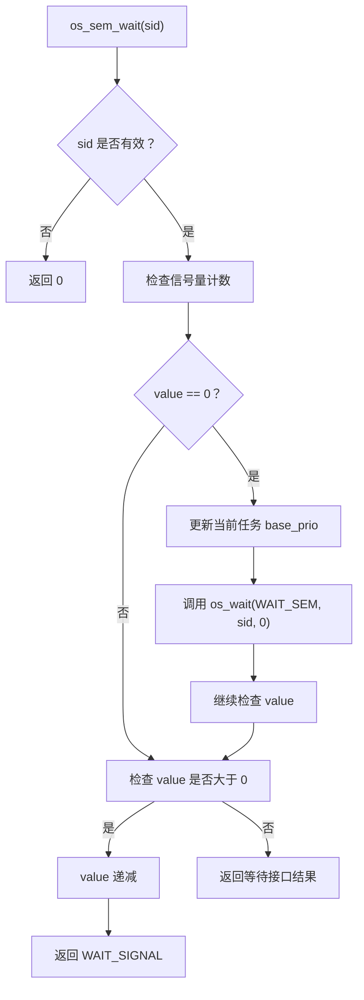
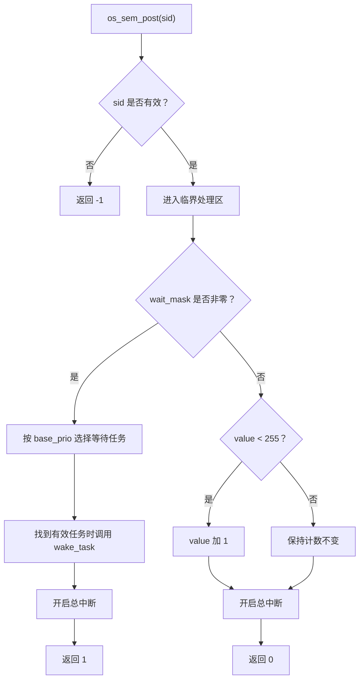

# HRTOS 信号量设计

## 模块介绍

HRTOS 信号量模块提供基于计数的任务同步机制，用于协调多个任务之间的执行关系，以及管理具有多个可用实例的共享资源。

信号量采用经典的 P/V 操作模型：

- **P 操作：** 通过 `os_sem_wait()` 获取信号量。计数大于 0 时，消耗一个计数；计数为 0 时，进入等待流程。
- **V 操作：** 通过 `os_sem_post()` 释放信号量。有任务等待时，优先唤醒一个等待任务；没有等待任务时，增加信号量计数。

信号量不记录资源所有者，也不提供互斥锁的所有权检查和优先级继承机制。

## 主要职责

信号量模块主要负责：

- 初始化信号量及其初始计数。
- 提供信号量获取与释放操作。
- 管理可用资源计数。
- 维护等待任务位图。
- 在释放信号量时，根据等待任务的基础优先级选择唤醒对象。

## 主要文件

### 源文件

- `Src/semaphore/semaphore_init.c`：信号量初始化。
- `Src/semaphore/semaphore_wait.c`：信号量等待与获取。
- `Src/semaphore/semaphore_post.c`：信号量释放与等待任务唤醒。

### 头文件

- `hrtos_internal.h`：内部类型、资源结构及相关内核接口声明。

## 数据结构

### OS_RESOURCE 统一资源结构

信号量复用 HRTOS 的统一资源结构：

```c
typedef struct {
    u8  value;
    u8  owner;
    u8  wait_cnt;
    u16 wait_mask;
    u8  pending_signal;
} OS_RESOURCE;
```

各字段在信号量模块中的用途如下：

| 字段 | 用途 |
|---|---|
| `value` | 信号量计数，表示当前可直接获取的计数值。 |
| `owner` | 信号量不使用所有权机制，初始化时设置为 `OS_INVALID_ID`。 |
| `wait_cnt` | 初始化时清零，当前提供的信号量实现未使用该字段维护等待数量。 |
| `wait_mask` | 等待任务位图，用于记录等待该信号量的标准任务。 |
| `pending_signal` | 属于统一资源结构；当前提供的三个信号量函数没有直接使用该字段。 |

`wait_mask` 为 16 位位图，标准任务 ID 0–15 对应 bit 0–15。

当前 `OS_RESOURCE_MAX` 为 6。信号量与其他使用 `OS_RESOURCE` 的 IPC 对象共享资源池，因此可创建的信号量数量取决于资源槽位的整体分配情况，并非独立拥有 6 个专用槽位。

## 核心函数

### os_sem_init()

**函数原型**

```c
char os_sem_init(u8 sid, u8 init_val);
```

**功能**

初始化指定资源槽位中的信号量，设置初始计数并清空相关等待状态。

**参数**

- `sid`：信号量使用的资源槽位编号，有效范围为 `0` 至 `OS_RESOURCE_MAX - 1`。
- `init_val`：信号量初始计数，类型为 `u8`，范围为 0–255。

**返回值**

- `1`：初始化成功。
- `-1`：资源槽位编号无效。

**实现过程**

1. 检查 `sid` 是否超出资源池范围。
2. 获取对应的 `OS_RESOURCE` 结构。
3. 将 `value` 设置为 `init_val`。
4. 将 `owner` 设置为 `OS_INVALID_ID`。
5. 清零 `wait_mask` 和 `wait_cnt`。

该函数直接初始化结构字段，不调用 `os_res_init()`。调用方应在系统初始化阶段，或能够确保没有相关任务正在使用该信号量时，执行初始化操作。

### os_sem_wait()

**函数原型**

```c
u8 os_sem_wait(u8 sid);
```

**功能**

执行 P 操作，获取一个信号量计数。当计数为 0 时，调用统一等待接口进入等待流程。

**参数**

- `sid`：信号量资源槽位编号。

**返回值**

- `WAIT_SIGNAL`：计数大于 0 时，函数递减计数并返回该值。
- `0`：资源槽位编号无效。
- 其他返回值：取决于实际等待路径及 `os_wait()` 的返回结果。

**实现过程**

1. 检查资源槽位编号是否合法。
2. 关闭总中断，获取对应的资源结构。
3. 如果 `value == 0`，先更新当前任务的 `base_prio`，随后重新开启总中断并调用 `os_wait(WAIT_SEM, sid, 0)`。
4. 检查 `value` 是否大于 0；若大于 0，则递减计数、开启总中断并返回 `WAIT_SIGNAL`。
5. 如果未进入上述快速返回路径，则开启总中断并返回等待接口保存的结果。

**设计特点**

- 计数可用时，直接递减并返回，无须调用 `os_wait()`。
- 计数为 0 时，进入统一任务等待流程。
- 等待调用的超时参数为 `0`，具体等待与唤醒语义还取决于内核等待机制的实现。
- 本函数的返回值应结合实际执行路径判断，不宜仅凭“函数已经返回”就认定获取成功。

**使用注意**

由于该函数在 `value == 0` 的分支中调用 `os_wait()` 后仍会继续检查 `value`，其具体返回行为与内核等待机制存在关联。调用方应依据实际的返回值约定处理结果，不应将所有非零返回值一概视为获取成功。

### os_sem_post()

**函数原型**

```c
char os_sem_post(u8 sid);
```

**功能**

执行 V 操作，释放一个信号量。若有等待任务，则选择一个任务唤醒；否则增加信号量计数。

**参数**

- `sid`：信号量资源槽位编号。

**返回值**

- `1`：检测到等待任务并执行唤醒处理路径。
- `0`：没有等待任务，释放操作正常结束。
- `-1`：资源槽位编号无效。

**实现过程**

1. 检查资源槽位编号。
2. 关闭总中断，进入临界处理区。
3. 检查 `wait_mask`。
4. 如果存在等待任务，遍历标准任务位图，比较等待任务的 `base_prio`，选择基础优先级最高的任务。
5. 如果找到有效任务，调用 `wake_task(next, WAIT_SIGNAL)`。
6. 有等待任务时，不增加 `value`，随后开启总中断并返回 `1`。
7. 没有等待任务时，若 `value < 255`，则将计数加 1；达到 255 时保持不变。随后开启总中断并返回 `0`。

**设计特点**

- 采用先处理等待任务、再累加计数的释放策略。
- 多个任务等待时，按 `base_prio` 选择优先级最高的任务。
- 当没有等待任务时，计数最大为 255，不会发生 8 位计数器溢出。
- 当 `wait_mask` 非零但遍历后没有找到有效任务时，当前实现仍走返回 `1` 的路径；该返回值表示执行了等待任务处理分支，并不保证一定有有效任务被唤醒。

## 调用流程

### 信号量获取流程



### 信号量释放流程



## 生命周期

一个典型的信号量使用过程如下：

1. **初始化：** 使用 `os_sem_init()` 设置初始计数。
2. **获取：** 任务调用 `os_sem_wait()` 尝试获取计数。
3. **等待：** 当计数为 0 时，进入内核等待流程。
4. **释放：** 任务调用 `os_sem_post()` 释放信号量。
5. **唤醒或累加：** 存在等待任务时执行唤醒处理；没有等待任务时增加计数。
6. **持续使用：** 在资源池和任务生命周期允许的范围内重复使用。

## 设计原则

### 计数语义

- `value` 表示当前信号量计数。
- 获取操作在可用路径中递减计数。
- 释放操作在没有等待任务时递增计数。
- 计数范围为 0–255。

### 等待任务选择

释放信号量时，当前实现遍历 `wait_mask`，以等待任务的 `base_prio` 作为比较依据，选择基础优先级最高的任务。

这与互斥锁的优先级继承逻辑不同：信号量不会因为某个任务等待而修改持有者优先级，也不记录资源所有权。

### 统一资源模型

- 信号量使用统一 `OS_RESOURCE` 资源结构。
- 通过 `os_wait()` 接入内核统一等待机制。
- 等待任务通过 `wait_mask` 进行标记。
- 信号量与其他 IPC 对象共享资源槽位。

## 使用约束

- 信号量资源槽位数量由 `OS_RESOURCE_MAX` 和其他 IPC 对象的使用情况共同决定。
- 初始计数和运行计数均使用 `u8`，范围为 0–255。
- `os_sem_wait()` 的等待参数为 `0`，不提供独立的有限等待时间参数。
- 信号量不记录所有者，不支持互斥锁式的所有权检查。
- 信号量没有优先级继承机制。
- 不应将信号量直接等同于互斥锁；需要独占访问和所有权管理时，应使用互斥锁。

## 使用模式

### 资源计数

当系统存在多个可用资源实例时，可以使用计数信号量协调访问。

```c
#define SEM_RESOURCE_ID  0

void semaphore_init(void)
{
    os_sem_init(SEM_RESOURCE_ID, 3);
}

void task_a(void)
{
    while (1)
    {
        if (os_sem_wait(SEM_RESOURCE_ID) == WAIT_SIGNAL)
        {
            use_resource();
            os_sem_post(SEM_RESOURCE_ID);
        }

        os_delay(10);
    }
}
```

示例中的成功判断仅适用于 `WAIT_SIGNAL` 确实表示获取成功的路径。对于阻塞路径，应结合实际 `os_wait()` 返回约定确认任务是否成功取得信号量，再执行资源操作。

### 二进制信号量

将初始计数设置为 0，可用于表达“当前没有可获取信号”的初始状态。

```c
#define SEM_EVENT_ID  1

void semaphore_init(void)
{
    os_sem_init(SEM_EVENT_ID, 0);
}

void producer_task(void)
{
    while (1)
    {
        produce_data();
        os_sem_post(SEM_EVENT_ID);
        os_delay(10);
    }
}

void consumer_task(void)
{
    while (1)
    {
        if (os_sem_wait(SEM_EVENT_ID) == WAIT_SIGNAL)
        {
            consume_data();
        }
    }
}
```

这里展示的是基本使用模式。实际应用应确认阻塞路径的返回值语义，并根据生产者与消费者之间的同步需求设计错误处理。

## 性能考虑

### 可用计数路径

当 `value > 0` 时，获取操作直接递减计数并返回 `WAIT_SIGNAL`，不需要调用 `os_wait()`。这是信号量的直接获取路径。

### 等待与唤醒路径

当 `value == 0` 时，获取操作进入统一等待流程；释放操作在检测到等待任务后，会进行优先级比较并执行唤醒处理。该路径涉及任务等待和唤醒机制，开销高于直接获取路径。

### 内存占用

信号量复用 `OS_RESOURCE`，不额外定义独立的信号量控制块。

在当前 Keil C51 配置下，`OS_RESOURCE` 结构由三个 8 位字段、一个 16 位字段和另一个 8 位字段组成，合计 6 字节。实际结构大小以当前编译器布局和工程配置为准。

## 与其他 IPC 的比较

### 信号量与互斥锁

- **信号量：** 计数同步，不记录所有者。
- **互斥锁：** 用于独占访问，记录所有者，并具有相应的优先级继承处理。

### 信号量与事件

- **信号量：** 通过计数表示可获取的信号或资源数量。
- **事件：** 通常通过事件状态或标志表达某个条件是否发生。

### 信号量与消息队列

- **信号量：** 主要用于计数和任务同步。
- **消息队列：** 用于在任务之间传递带有内容的数据。

## 常见注意事项

### 正确处理获取结果

调用 `os_sem_wait()` 后，应根据实际返回值约定判断是否成功获取信号量，不能将任意非零值直接当作成功。

### 配对使用获取与释放

对计数信号量而言，获取与释放次数应符合应用的资源管理逻辑。多释放可能使计数提前达到上限，多获取则可能导致任务等待。

### 区分同步与互斥

信号量适合资源计数和任务间同步，但不具备互斥锁的所有权检查与优先级继承机制。需要保护独占共享资源时，应根据实际场景选择合适的同步原语。