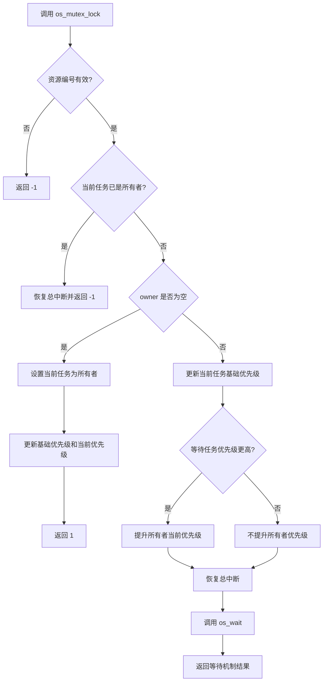
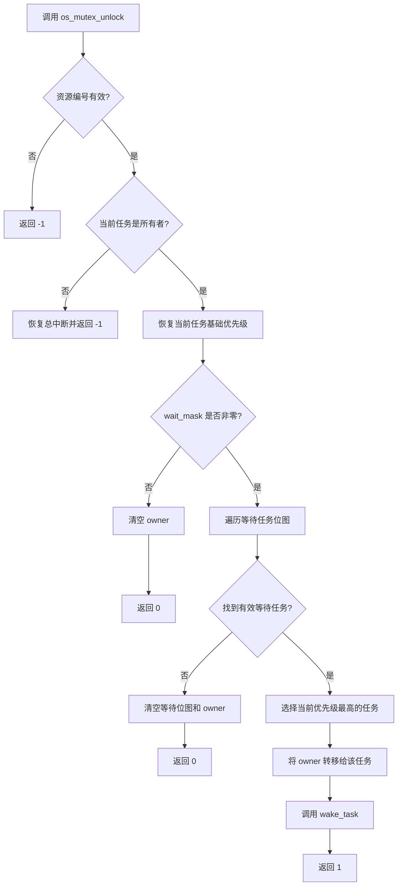
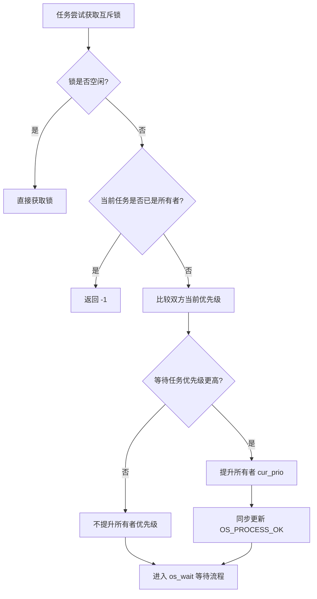

# HRTOS 互斥锁设计

## 模块介绍

互斥锁模块用于保护任务之间共享的资源，确保同一时刻只有一个任务持有指定互斥锁。

HRTOS 互斥锁使用统一 IPC 资源结构管理锁的所有者和等待任务，并支持优先级继承：当较高优先级任务等待较低优先级任务持有的锁时，内核可以提升锁所有者的当前优先级，降低优先级反转的影响。

互斥锁不支持递归获取，获取操作不提供超时参数。

## 主要职责

互斥锁模块负责：

- 初始化互斥锁资源
- 获取和释放互斥锁
- 记录当前锁所有者
- 管理互斥锁等待任务
- 根据等待任务的优先级执行优先级继承
- 解锁时恢复当前所有者的基础优先级
- 在解锁时选择等待队列中当前优先级最高的任务，并转移锁所有权

## 主要文件

### 源文件

- `Src/mutex/mutex_init.c`：互斥锁初始化
- `Src/mutex/mutex_lock.c`：互斥锁获取及优先级继承
- `Src/mutex/mutex_unlock.c`：互斥锁释放、所有权转移及优先级恢复

### 头文件

- `Inc/mutex.h`：互斥锁 API 声明
- `Inc/config.h`：统一 IPC 资源结构及相关配置
- `Inc/hrtos_internal.h`：内核内部变量和接口声明

## 数据结构

### OS_RESOURCE

互斥锁使用统一 IPC 资源结构 `OS_RESOURCE`，而不是独立的互斥锁结构。

```c
typedef struct {
    u8 value;
    u8 owner;
    u8 wait_cnt;
    u16 wait_mask;
    u8 pending_signal;
} OS_RESOURCE;
```

互斥锁相关字段说明：

- `owner`：当前持有互斥锁的任务 ID；`OS_INVALID_ID` 表示当前没有所有者。
- `wait_mask`：等待该互斥锁的标准任务位图，bit0–bit15 对应标准任务 0–15。
- `wait_cnt`：统一资源结构中的等待计数。
- `value`：互斥锁初始化时设置为 `1`；当前加锁和解锁实现主要通过 `owner` 判断锁的所有权。
- `pending_signal`：统一资源结构中的通用字段，当前所示互斥锁加锁和解锁代码不直接使用该字段。

### 资源配置

当前配置：

- `OS_RESOURCE_MAX = 6`：统一 IPC 资源槽位数量上限。
- 互斥锁与其他 IPC 对象共享统一资源池。

因此，互斥锁可使用的资源槽位受统一资源池限制，不能将其单独描述为最多支持 8 个互斥锁。实际可用数量还取决于其他 IPC 对象占用的资源槽位。

## 核心函数

### os_mutex_init()

**位置：** `Src/mutex/mutex_init.c`

**功能：** 初始化指定互斥锁资源。

**函数原型：**

```c
char os_mutex_init(u8 mid);
```

**参数：**

- `mid`：互斥锁资源槽位编号，范围为 `0` 至 `OS_RESOURCE_MAX - 1`。

**返回值：**

- `1`：初始化成功。
- `-1`：资源槽位编号无效。

**处理过程：**

- 检查资源槽位编号。
- 获取对应的 `OS_RES[mid]`。
- 将 `value` 设置为 `1`。
- 将 `owner` 设置为 `OS_INVALID_ID`。
- 将 `wait_mask` 和 `wait_cnt` 清零。

该函数直接初始化统一资源结构的相关字段，不调用 `os_res_init()`。

### os_mutex_lock()

**位置：** `Src/mutex/mutex_lock.c`

**功能：** 获取指定互斥锁；如果锁已被其他任务持有，则根据优先级继承逻辑处理，并进入内核等待流程。

**函数原型：**

```c
char os_mutex_lock(u8 mid);
```

**参数：**

- `mid`：互斥锁资源槽位编号。

**返回值：**

- `1`：直接获取互斥锁成功。
- `-1`：资源槽位编号无效，或当前任务已是该锁的所有者。
- 其他结果：锁被占用时，直接返回 `os_wait(WAIT_MUTEX, mid, 0)` 的结果。

**处理过程：**

- 检查资源槽位编号。
- 获取当前任务 ID，并定位对应的资源结构。
- 关闭总中断，进入临界处理流程。
- 如果当前任务已经是锁的所有者，则恢复总中断并返回 `-1`，不支持递归获取。
- 如果 `owner == OS_INVALID_ID`，将当前任务设为所有者，并根据 `OS_PROCESS_OK` 恢复其基础优先级，随后返回 `1`。
- 如果锁已被其他任务持有，则根据 `OS_PROCESS_OK` 更新当前任务的基础优先级和当前优先级。
- 比较等待任务与锁所有者的当前优先级；当等待任务优先级更高时，提升所有者的当前优先级，并同步更新 `OS_PROCESS_OK` 中的优先级位。
- 恢复总中断后，调用 `os_wait(WAIT_MUTEX, mid, 0)` 进入等待流程，并返回该调用的结果。

**注意事项：**

锁被占用时，`os_mutex_lock()` 的返回值由 `os_wait()` 决定，不能统一描述为固定返回 `0` 或 `1`。调用者应结合实际内核等待机制理解返回结果。

### os_mutex_unlock()

**位置：** `Src/mutex/mutex_unlock.c`

**功能：** 释放指定互斥锁，恢复当前所有者的基础优先级；如果存在有效等待任务，则将锁的所有权转移给其中当前优先级最高的任务，并唤醒该任务。

**函数原型：**

```c
char os_mutex_unlock(u8 mid);
```

**参数：**

- `mid`：互斥锁资源槽位编号。

**返回值：**

- `1`：锁的所有权已转移给选定的等待任务。
- `0`：没有有效等待任务，或等待位图中没有找到有效任务。
- `-1`：资源槽位编号无效，或当前任务不是锁的所有者。

**处理过程：**

- 检查资源槽位编号。
- 获取当前任务 ID 和对应的资源结构。
- 关闭总中断，进入临界处理流程。
- 如果当前任务不是锁的所有者，恢复总中断并返回 `-1`。
- 将当前所有者的 `cur_prio` 恢复为 `base_prio`，并同步更新 `OS_PROCESS_OK` 中的优先级位。
- 检查 `wait_mask`。
- 如果存在等待位，则遍历标准任务 0–15，选择位图中 `cur_prio` 最高的任务。
- 如果未找到有效任务，则清空等待位图、将所有者设为 `OS_INVALID_ID`，恢复总中断并返回 `0`。
- 如果找到有效任务，先将 `owner` 设置为该任务 ID，再调用 `wake_task(next, WAIT_SIGNAL)` 唤醒该任务，最后恢复总中断并返回 `1`。
- 如果没有等待任务，则将 `owner` 设置为 `OS_INVALID_ID`，恢复总中断并返回 `0`。

**重要说明：**

所有权转移发生在唤醒调用之前。因此，解锁路径并不是简单地清空所有者字段，再让等待任务竞争锁；它会先将锁指定给选中的任务。

## 调用关系

### 互斥锁获取流程



### 互斥锁释放流程



### 优先级继承流程



以上流程描述当前实现中的主要处理路径。实际任务切换时机仍由内核调度机制决定。

## 生命周期

### 互斥锁生命周期

- **初始化：** 调用 `os_mutex_init()`，清空所有者和等待状态。
- **获取：** 任务调用 `os_mutex_lock()`。
- **直接获取：** 锁空闲时，当前任务成为所有者。
- **竞争等待：** 锁被其他任务持有时，当前任务根据优先级继承逻辑处理后进入等待流程。
- **释放：** 所有者调用 `os_mutex_unlock()`。
- **优先级恢复：** 当前所有者的当前优先级恢复到基础优先级。
- **所有权转移：** 如果存在有效等待任务，选择其中当前优先级最高的任务并转移锁所有权。
- **恢复空闲：** 没有有效等待任务时，将所有者设置为 `OS_INVALID_ID`。

## 设计原则

### 互斥与所有权

- 使用 `owner` 记录当前锁所有者。
- 当前所有者才能成功释放互斥锁。
- 不允许同一任务递归获取同一把锁。
- 所有权转移与等待任务唤醒由解锁流程完成。

### 优先级继承

- 当锁被其他任务持有时，比较等待任务与锁所有者的当前优先级。
- 当等待任务优先级更高时，提升所有者的当前优先级。
- 将优先级更新同步到 `OS_PROCESS_OK` 对应的优先级位。
- 解锁时，将当前所有者的当前优先级恢复到基础优先级。

当前实现不应被描述为完整的多锁优先级继承链或优先级天花板协议。

### 统一资源模型

- 互斥锁使用 `OS_RESOURCE` 统一资源结构。
- 通过 `OS_RES[mid]` 访问对应资源。
- 通过 `os_wait()` 进入互斥锁等待流程。
- 通过 `wake_task()` 唤醒选定的等待任务。

## 约束

- 互斥锁共享统一 IPC 资源池，当前资源槽位上限为 6。
- 不支持递归获取。
- 只有当前所有者可以释放互斥锁。
- 获取接口不提供超时参数。
- 不应在 ISR 上下文中使用互斥锁 API。
- 当前实现包含优先级继承和解锁时的基础优先级恢复。
- 不应据此宣称支持完整的优先级继承链或优先级天花板协议。

## 优先级继承算法

### 优先级提升条件

在锁已被其他任务持有时：

- 当前任务不是锁的所有者。
- 当前任务的优先级高于锁所有者的当前优先级。

满足条件时，执行优先级提升。

### 优先级提升实现

```c
if (OS_TASK[tid].cur_prio > OS_TASK[m->owner].cur_prio)
{
    OS_TASK[m->owner].cur_prio = OS_TASK[tid].cur_prio;

    OS_PROCESS_OK[m->owner] &= 0xF1;
    OS_PROCESS_OK[m->owner] |=
        ((OS_TASK[tid].cur_prio & 0x07) << 1);
}
```

该代码将锁所有者的当前优先级提升到等待任务的当前优先级，并更新 `OS_PROCESS_OK` 中对应的优先级位。

### 优先级恢复

解锁时：

- 将当前所有者的 `cur_prio` 恢复为 `base_prio`。
- 清除 `OS_PROCESS_OK` 中原有的优先级位。
- 将基础优先级写回对应的优先级位。

该恢复操作按照当前实现直接执行，不会在此处重新遍历当前任务持有的其他互斥锁来计算应保留的继承优先级。

## 使用模式

### 基本互斥锁保护

```c
#define MUTEX_ID  0

u8 shared_counter = 0;

void task_a(void)
{
    while (1)
    {
        if (os_mutex_lock(MUTEX_ID) >= 0)
        {
            shared_counter++;
            os_mutex_unlock(MUTEX_ID);
        }

        os_delay(10);
    }
}

void task_b(void)
{
    while (1)
    {
        if (os_mutex_lock(MUTEX_ID) >= 0)
        {
            shared_counter--;
            os_mutex_unlock(MUTEX_ID);
        }

        os_delay(10);
    }
}
```

示例假定互斥锁已经初始化，且两个任务均为合法的标准任务。调用者应根据实际等待机制确认加锁返回值，并确保只在成功持有锁时执行解锁。

### 优先级继承场景

假设存在三个任务：

- 低优先级任务：优先级 2，持有互斥锁。
- 中优先级任务：优先级 4，执行普通工作。
- 高优先级任务：优先级 6，尝试获取同一把互斥锁。

当高优先级任务等待低优先级任务持有的锁时，若满足优先级继承条件，低优先级任务的当前优先级将提升至 6。这样可以降低中优先级任务持续抢占锁所有者、延长高优先级任务等待时间的风险。

低优先级任务释放锁时，其当前优先级会按照当前实现恢复到基础优先级；随后，解锁流程将锁所有权转移给选中的等待任务。

## 性能考虑

### 锁获取路径

- **空闲路径：** 检查所有者状态，设置所有者并更新优先级。
- **竞争路径：** 执行所有者检查、优先级比较及必要的优先级更新，然后进入内核等待流程。

竞争路径的额外开销取决于等待状态、优先级更新和调度过程。

### 解锁路径

- 检查调用者是否为所有者。
- 恢复当前所有者的基础优先级。
- 根据等待位图选择任务。
- 有有效等待任务时，执行所有权转移并调用 `wake_task()`。

等待任务较多时，需要遍历标准任务位图以选择当前优先级最高的等待任务。

### 内存效率

- 互斥锁不使用独立的控制结构。
- 每个互斥锁使用一个统一 `OS_RESOURCE` 槽位。
- `OS_RESOURCE` 的结构大小为 7 字节，其中部分字段供其他 IPC 机制使用。
- 互斥锁使用的资源槽位与其他 IPC 对象共享，实际资源占用取决于整个系统的 IPC 配置。

## 与其他 IPC 机制的比较

### 互斥锁与信号量

- **互斥锁：** 具有所有权，只有所有者才能释放，并包含优先级继承处理。
- **信号量：** 主要用于同步或资源计数，是否具有所有权取决于具体实现。

### 互斥锁与二进制信号量

- **互斥锁：** 通过 `owner` 管理持有者，并限制释放者身份。
- **二进制信号量：** 通常用于事件同步，不必采用所有者机制。

### 互斥锁与自旋锁

- **互斥锁：** 通过等待机制处理锁竞争。
- **自旋锁：** 通过持续检查锁状态等待资源释放；HRTOS 当前互斥锁模块不采用这种方式。

## 常见注意事项

### 死锁风险

- 多把锁应尽可能按照统一顺序获取。
- 持锁期间应尽量缩短共享资源的访问时间。
- 避免持锁调用可能导致任务长期阻塞的 API。
- 不应在 ISR 上下文中使用互斥锁。

### 优先级继承边界

- 优先级继承用于缓解优先级反转，不等同于消除所有阻塞。
- 优先级继承不能防止死锁。
- 当前实现的解锁恢复逻辑直接将当前所有者恢复到基础优先级。
- 不应假定当前实现能够完整处理多把锁之间的优先级继承链。
- 实际最坏阻塞时间仍取决于临界区长度、任务行为、调度机制及其他系统约束。