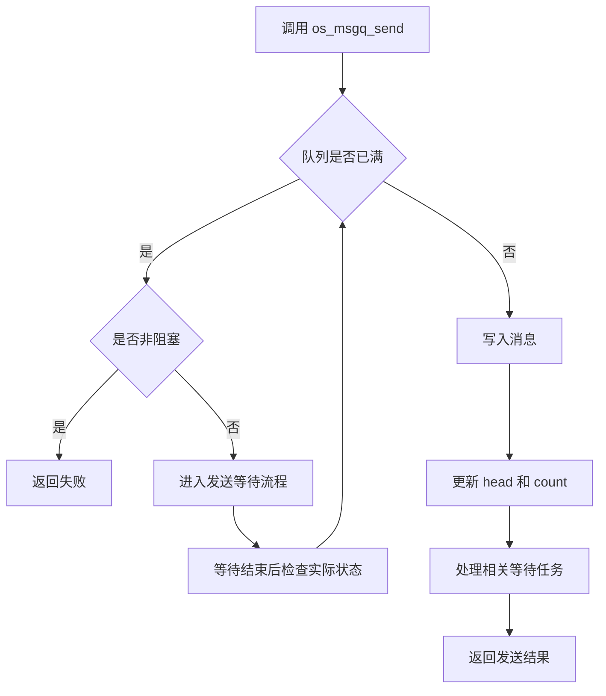
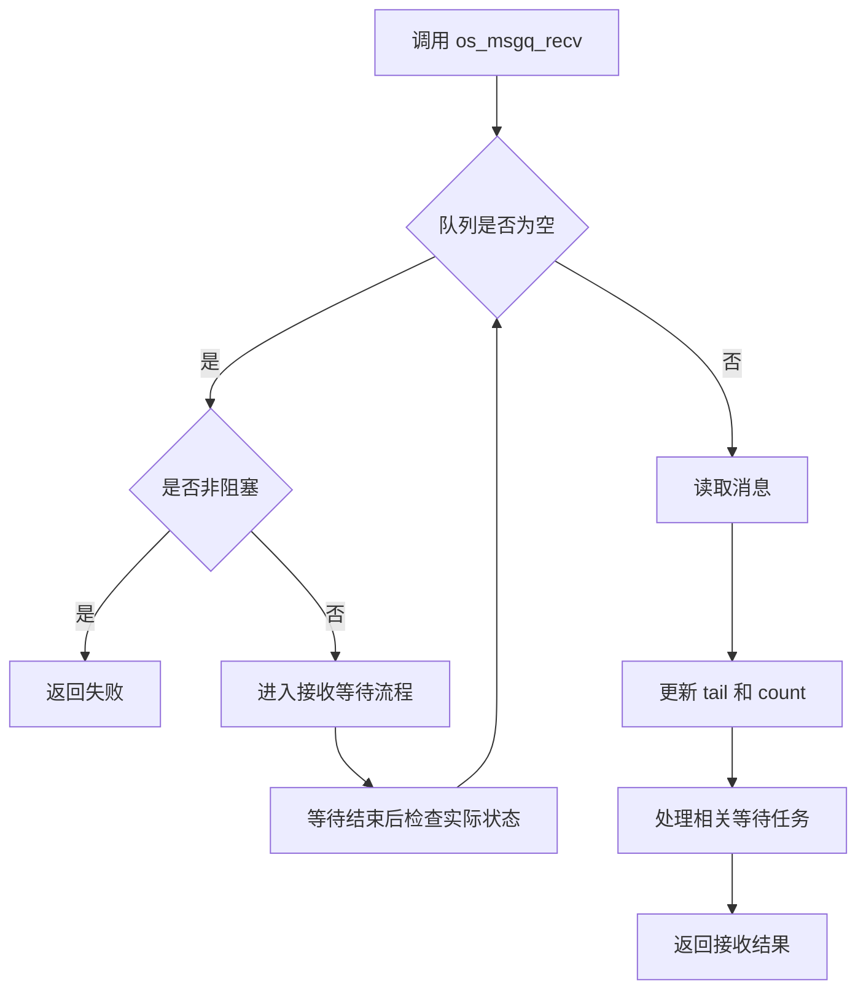
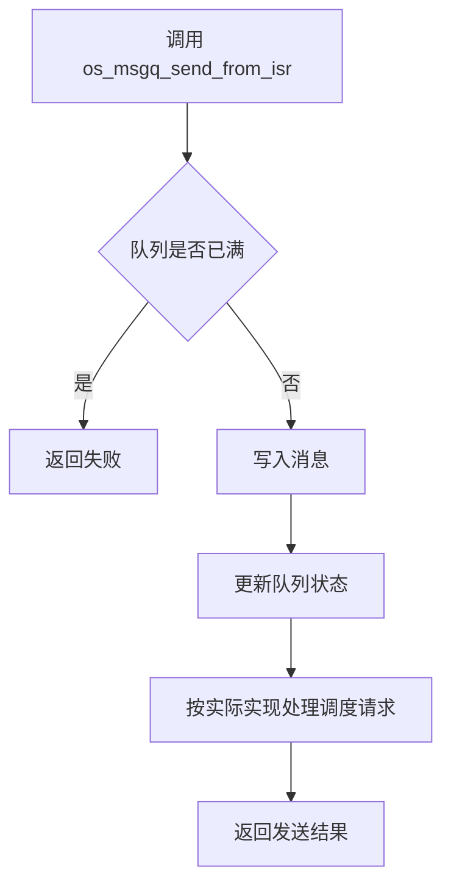

# HRTOS 消息队列设计

## 模块介绍

消息队列模块提供带缓冲区的任务间通信机制，用于在任务之间传递 1 字节消息。模块采用循环缓冲区管理消息，支持阻塞和非阻塞收发，并提供中断上下文使用的消息队列接口。

## 主要职责

消息队列模块负责：

- 使用用户提供的缓冲区初始化队列
- 消息发送与接收
- 队列清除
- 阻塞与非阻塞收发
- 中断上下文中的消息发送与接收

## 主要文件

### 源文件

- `Src/msgq/msgq_init.c`：消息队列初始化
- `Src/msgq/msgq_send.c`：消息发送
- `Src/msgq/msgq_recv.c`：消息接收
- `Src/msgq/msgq_clear.c`：消息队列清除
- `Src/interrupt/msgq_send_from_isr.c`：中断上下文消息发送
- `Src/interrupt/msgq_recv_from_isr.c`：中断上下文消息接收

### 头文件

- `Inc/msgq.h`：消息队列 API 声明
- `Inc/config.h`：消息队列结构定义及相关配置
- `Inc/hrtos_internal.h`：内核内部变量及接口声明

## 数据结构

### os_msgq_t

消息队列控制结构定义于 `Inc/config.h`。

```c
typedef struct {
    u8 *buf;       /* 用户缓冲区指针 */
    u8 _size;      /* 缓冲区大小 */
    u8 head;       /* 写入位置 */
    u8 tail;       /* 读取位置 */
    u8 count;      /* 当前消息数量 */
} os_msgq_t;
```

成员说明：

- `buf`：指向用户提供的消息缓冲区。
- `_size`：缓冲区容量。
- `head`：下一条消息的写入位置。
- `tail`：下一条消息的读取位置。
- `count`：当前队列中的消息数量。

### 队列数组

消息队列控制块数组：

```c
volatile os_msgq_t xdata OS_MSGQ[OS_MSGQ_MAX];
```

相关配置：

- `OS_MSGQ_MAX`：最大消息队列数量，当前配置为 3。
- `OS_RESOURCE_MAX`：统一 IPC 资源数量上限，当前配置为 6。

消息队列数量与统一 IPC 资源数量是不同的配置，不能混为一谈。

### 内存占用

在当前 Keil C51 配置下，`u8 *buf` 占用 3 字节，其余 4 个成员各占 1 字节。

| 成员 | 大小 |
|---|---:|
| `buf` | 3 字节 |
| `_size` | 1 字节 |
| `head` | 1 字节 |
| `tail` | 1 字节 |
| `count` | 1 字节 |
| **单个控制块** | **7 字节** |

当前配置下，3 个消息队列控制块共占用 21 字节，不包含用户提供的消息缓冲区。

## 核心函数

### os_msgq_init()

**位置：** `Src/msgq/msgq_init.c`

**功能：** 将消息队列控制结构与用户缓冲区关联，并初始化队列状态。

**参数：**

- `q`：消息队列控制结构指针。
- `buf`：用户提供的消息缓冲区指针。
- `_size`：缓冲区容量。

**处理过程：**

- 保存缓冲区指针。
- 保存缓冲区容量。
- 将 `head` 和 `tail` 初始化为 0。
- 将 `count` 初始化为 0。

调用者应确保控制结构、缓冲区指针和缓冲区容量有效，并为队列提供足够的存储空间。

### os_msgq_send()

**位置：** `Src/msgq/msgq_send.c`

**功能：** 向指定消息队列发送一条消息。

**参数：**

- `q`：消息队列控制结构指针。
- `obj`：关联的 IPC 资源编号，用于等待与唤醒。
- `_data`：待发送的 1 字节消息。
- `nonblock`：收发模式，`0` 表示阻塞，`1` 表示非阻塞。

**返回值：**

- `1`：发送成功。
- `0`：发送失败。

**处理过程：**

- 检查队列是否有可用空间。
- 队列已满时，根据 `nonblock` 决定立即返回失败或进入等待流程。
- 空间可用时，将消息写入 `head` 指向的位置。
- 更新 `head` 和 `count`。
- 按内核实现处理相关等待任务的唤醒。

阻塞模式下，调用者应结合等待机制的返回结果判断后续操作，不应假定等待结束就必然意味着发送成功。

### os_msgq_recv()

**位置：** `Src/msgq/msgq_recv.c`

**功能：** 从指定消息队列接收一条消息。

**参数：**

- `q`：消息队列控制结构指针。
- `obj`：关联的 IPC 资源编号，用于等待与唤醒。
- `_data`：接收消息的存储地址。
- `nonblock`：收发模式，`0` 表示阻塞，`1` 表示非阻塞。

**返回值：**

- `1`：接收成功。
- `0`：接收失败。

**处理过程：**

- 检查队列中是否存在消息。
- 队列为空时，根据 `nonblock` 决定立即返回失败或进入等待流程。
- 有消息可读取时，从 `tail` 指向的位置读取数据。
- 更新 `tail` 和 `count`。
- 按内核实现处理相关等待任务的唤醒。

### os_msgq_clear()

**位置：** `Src/msgq/msgq_clear.c`

**功能：** 清除队列当前保存的消息。

**参数：**

- `q`：消息队列控制结构指针。

**处理过程：**

- 将 `head` 重置为 0。
- 将 `tail` 重置为 0。
- 将 `count` 重置为 0。

清除操作用于丢弃队列中已有的消息。不要将其视为自动解除所有等待任务阻塞状态的操作；等待任务的处理应以实际内核实现为准。

### os_msgq_send_from_isr()

**位置：** `Src/interrupt/msgq_send_from_isr.c`

**功能：** 在中断服务程序中发送消息。

**参数：**

- `q`：消息队列控制结构指针。
- `obj`：关联的 IPC 资源编号。
- `_data`：待发送的 1 字节消息。

**返回值：**

- `1`：发送成功。
- `0`：发送失败。

**处理原则：**

- 中断上下文中不应因队列已满而阻塞等待。
- 队列有空间时，写入消息并更新队列状态。
- 队列已满时，按接口约定返回失败。
- 与任务唤醒和调度相关的行为以实际 ISR 实现为准。

### os_msgq_recv_from_isr()

**位置：** `Src/interrupt/msgq_recv_from_isr.c`

该接口用于中断上下文中的消息接收。其具体参数、返回值、队列状态处理和中断安全约束，应以该接口的实际实现及头文件声明为准。

## 调用关系

### 消息发送流程



### 消息接收流程



### 中断发送流程



以上流程图用于说明主要处理路径。具体等待、唤醒及调度行为以对应源文件为准。

## 生命周期

### 队列生命周期

- **初始化：** 调用 `os_msgq_init()`，关联控制结构与用户缓冲区。
- **发送：** 调用发送接口，将消息写入循环缓冲区。
- **接收：** 调用接收接口，从循环缓冲区读取消息。
- **队列已满：** 发送操作根据阻塞模式处理。
- **队列为空：** 接收操作根据阻塞模式处理。
- **清除：** 调用 `os_msgq_clear()`，清空队列当前保存的消息。

## 设计原则

### 循环缓冲区

- `head` 指向下一条消息的写入位置。
- `tail` 指向下一条消息的读取位置。
- 指针在缓冲区末尾处循环回绕。
- `count` 记录当前消息数量。

### 用户提供缓冲区

- 消息存储空间由用户提供。
- 队列模块不依赖动态内存分配。
- 控制结构负责管理缓冲区指针、容量和读写状态。
- 缓冲区的有效性与生命周期由调用者负责。

### 阻塞与非阻塞

- **阻塞模式：** 当队列条件不满足时，可通过内核等待机制等待。
- **非阻塞模式：** 当队列条件不满足时，立即返回失败。
- 具体等待结果及唤醒行为遵循内核实现。

### 中断安全

- 提供独立的中断上下文消息队列接口。
- 中断上下文中不能因队列条件不满足而执行阻塞等待。
- 消息入队、出队及调度请求必须符合对应接口的实现约束。
- 不应仅凭接口名称推断所有中断上下文操作均安全。

### 统一等待机制

消息队列通过内核等待机制处理需要阻塞的收发操作。相关等待类型包括：

- `WAIT_MSG_SEND`：消息发送等待。
- `WAIT_MSG_RECV`：消息接收等待。

具体等待条件、唤醒时机及等待结果以实际内核代码为准。

## 约束

- 当前最多配置 3 个消息队列控制块。
- 每条消息为 1 字节。
- 消息缓冲区由用户提供。
- 消息按照 FIFO 顺序处理。
- 不提供基于消息优先级的排序。
- 中断上下文不能在队列已满或为空时阻塞等待。
- 不提供内置消息过滤或按条件选择消息的功能。

## 使用模式

以下示例用于说明典型调用方式。`g_queue`、`QUEUE_RES_ID`、`produce_data()` 和 `process_data()` 需要由应用程序自行定义；缓冲区应在队列初始化前准备好。

### 基本生产者—消费者

```c
/* 用户提供的缓冲区 */
u8 g_queue_buf[16];

/* 消息队列控制结构 */
os_msgq_t g_queue;

/* 生产者任务 */
void producer_task(void)
{
    while (1)
    {
        u8 data = produce_data();

        if (os_msgq_send(&g_queue, QUEUE_RES_ID, data, 0) == 0)
        {
            /* 根据应用需求处理发送失败 */
        }

        os_delay(10);
    }
}

/* 消费者任务 */
void consumer_task(void)
{
    u8 data;

    while (1)
    {
        if (os_msgq_recv(&g_queue, QUEUE_RES_ID, &data, 0) == 1)
        {
            process_data(data);
        }
    }
}
```

### 非阻塞模式

```c
/* 非阻塞发送 */
if (os_msgq_send(&g_queue, QUEUE_RES_ID, data, 1) == 0)
{
    /* 队列已满或发送失败 */
}

/* 非阻塞接收 */
if (os_msgq_recv(&g_queue, QUEUE_RES_ID, &data, 1) == 0)
{
    /* 队列为空或接收失败 */
}
```

### 中断到任务

```c
/* 中断服务程序 */
void uart_rx_isr(void)
{
    u8 data = SBUF;

    if (os_msgq_send_from_isr(&g_queue, QUEUE_RES_ID, data) == 0)
    {
        /* 队列满时按应用需求处理 */
    }
}

/* 接收任务 */
void uart_task(void)
{
    u8 data;

    while (1)
    {
        if (os_msgq_recv(&g_queue, QUEUE_RES_ID, &data, 0) == 1)
        {
            process_uart_data(data);
        }
    }
}
```

应用程序应根据实际 API 声明确认返回值含义，并确保中断服务程序调用的接口满足当前内核的中断安全约束。

## 性能考虑

### 缓冲区容量

- 容量较大时，可以容纳更多暂存消息，但会占用更多 RAM。
- 容量较小时，内存占用较少，但更容易出现队列已满的情况。
- 容量应结合消息产生速率、消费速率及允许的最大积压量确定。

### 上下文切换

- 阻塞操作可能导致任务进入等待状态并触发调度。
- 非阻塞操作不因队列条件不满足而等待，但应用程序需要自行处理失败结果。
- 中断上下文中的消息操作应遵循对应接口的调度与唤醒规则。

### 内存效率

- 单个 `os_msgq_t` 控制结构占用 7 字节。
- 当前 3 个控制结构共占用 21 字节。
- 用户消息缓冲区的内存占用由缓冲区容量决定。
- 上述控制结构占用不包含其他 IPC 资源、任务控制块及内核等待机制的开销。

## 与其他 IPC 机制的比较

### 消息队列与事件

- **消息队列：** 在缓冲区中保存并传递具体数据。
- **事件：** 用于表示事件状态及进行任务同步，不承担多条数据的缓存传输。

### 消息队列与邮箱

- **消息队列：** 支持多条消息按 FIFO 顺序排队。
- **邮箱：** 通常用于传递单条消息，具体覆盖规则取决于邮箱实现。

### 消息队列与信号量

- **消息队列：** 兼顾数据传输与任务同步。
- **信号量：** 主要用于同步或资源计数，不负责保存消息内容。