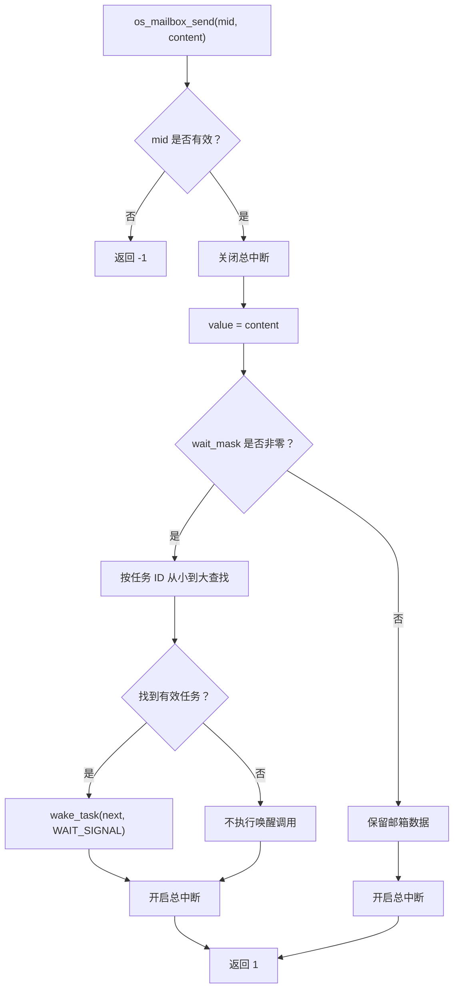
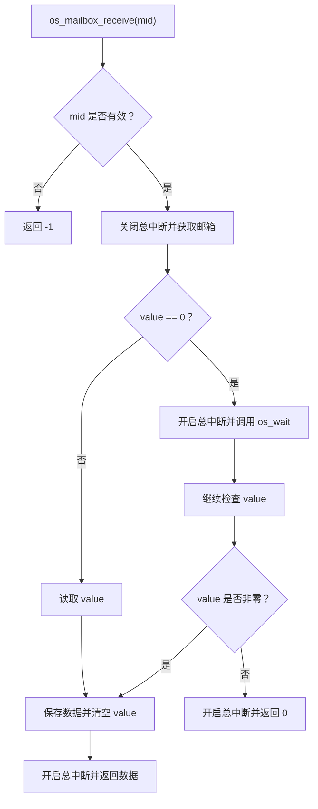
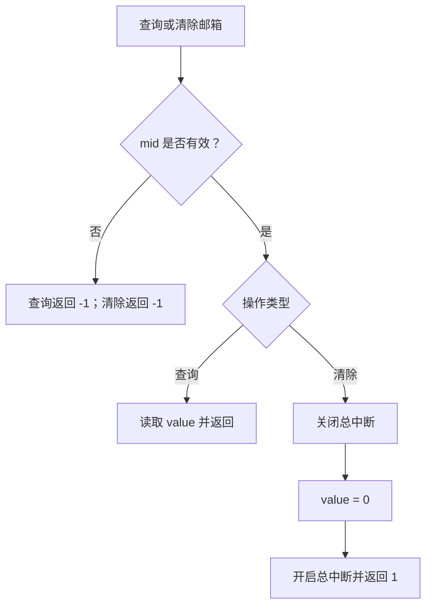

# HRTOS 邮箱设计

## 模块介绍

HRTOS 邮箱模块用于在任务之间传递单个数据，提供邮箱初始化、数据发送、数据接收、数据查询和邮箱清除等操作。

邮箱使用统一的 `OS_RESOURCE` 资源结构保存数据。其中，`value` 字段用于存储邮箱当前的数据，`wait_mask` 用于记录等待邮箱的任务。

邮箱采用单槽存储方式：发送操作将数据写入邮箱，接收操作读取数据并将邮箱清空。当邮箱为空时，接收任务可以通过统一等待机制进入等待流程。

## 主要职责

邮箱模块主要负责：

- 初始化邮箱资源。
- 向邮箱发送数据。
- 从邮箱接收数据。
- 查询邮箱当前保存的数据。
- 清除邮箱中的数据。
- 在发送数据时，检查等待队列并唤醒等待任务。

## 主要文件

### 源文件

- `Src/mailbox/mailbox_init.c`：邮箱初始化。
- `Src/mailbox/mailbox_send.c`：邮箱数据发送。
- `Src/mailbox/mailbox_receive.c`：邮箱数据接收。
- `Src/mailbox/mailbox_query.c`：查询邮箱当前数据。
- `Src/mailbox/mailbox_clear.c`：清除邮箱数据。

### 头文件

- `hrtos_internal.h`：内部资源结构、任务状态及相关内核接口声明。

## 数据结构

### OS_RESOURCE 统一资源结构

邮箱复用 HRTOS 的统一资源结构：

```c
typedef struct {
    u8  value;
    u8  owner;
    u8  wait_cnt;
    u16 wait_mask;
    u8  pending_signal;
} OS_RESOURCE;
```

各字段在邮箱模块中的用途如下：

| 字段 | 用途 |
|---|---|
| `value` | 保存邮箱当前的数据。值为 `0` 时，接收接口将邮箱视为空。 |
| `owner` | 邮箱不使用资源所有者机制，初始化时设置为 `OS_INVALID_ID`。 |
| `wait_cnt` | 初始化时清零，当前提供的邮箱代码没有使用该字段维护等待数量。 |
| `wait_mask` | 等待任务位图，用于查找等待接收邮箱数据的任务。 |
| `pending_signal` | 统一资源结构中的字段，当前提供的邮箱函数没有直接使用。 |

当前 `OS_RESOURCE_MAX` 为 6。邮箱与其他使用 `OS_RESOURCE` 的 IPC 对象共享资源池，可使用的邮箱数量取决于整体资源槽位的分配情况。

## 核心函数

### os_mailbox_init()

**函数原型**

```c
void os_mailbox_init(u8 mid);
```

**功能**

初始化指定邮箱，将邮箱设置为空状态，并清除相关等待状态。

**参数**

- `mid`：邮箱资源槽位编号，有效范围为 `0` 至 `OS_RESOURCE_MAX - 1`。

**返回值**

无。

**实现过程**

1. 检查邮箱资源槽位编号。
2. 如果编号无效，直接返回。
3. 获取对应的 `OS_RESOURCE` 结构。
4. 将 `value` 设置为 `0`，表示邮箱为空。
5. 将 `owner` 设置为 `OS_INVALID_ID`。
6. 清零 `wait_mask` 和 `wait_cnt`。

该函数直接设置资源结构的相关字段，不调用其他资源初始化接口。

初始化操作应安排在邮箱投入使用之前，避免清除正在使用的邮箱数据或等待状态。

### os_mailbox_send()

**函数原型**

```c
char os_mailbox_send(u8 mid, u8 content);
```

**功能**

向指定邮箱写入一个数据，并在检测到等待任务时尝试唤醒其中一个任务。

**参数**

- `mid`：邮箱资源槽位编号。
- `content`：待发送的数据，类型为 `u8`，取值范围为 0–255。

**返回值**

- `1`：邮箱发送处理完成。
- `-1`：邮箱资源槽位编号无效。

**实现过程**

1. 检查邮箱资源槽位编号。
2. 关闭总中断，进入临界处理区。
3. 将 `content` 写入邮箱的 `value` 字段。
4. 检查 `wait_mask` 是否非零。
5. 如果存在等待任务，从任务位图中按任务 ID 从小到大的顺序查找第一个置位的任务。
6. 找到任务后，调用 `wake_task(next, WAIT_SIGNAL)`。
7. 开启总中断并返回 `1`。

如果没有等待任务，数据会保留在 `value` 字段中，供后续接收或查询操作使用。

**设计特点**

- 每次发送都会直接覆盖 `value`，不检查邮箱原先是否已有未读取的数据。
- 存在等待任务时，按任务 ID 从小到大的顺序查找第一个置位任务，而不是按照任务优先级选择。
- 当 `wait_mask` 非零但未找到有效任务时，当前实现仍返回 `1`。
- 返回 `1` 代表发送处理路径完成，不代表数据一定已经被接收任务读取。

### os_mailbox_receive()

**函数原型**

```c
int os_mailbox_receive(u8 mid);
```

**功能**

从指定邮箱读取数据。邮箱当前有数据时，读取并清空邮箱；邮箱为空时，调用统一等待接口进入等待流程。

**参数**

- `mid`：邮箱资源槽位编号。

**返回值**

- `-1`：邮箱资源槽位编号无效。
- 其他值：当前实现读取或返回的邮箱数据。

**实现过程**

1. 检查邮箱资源槽位编号。
2. 关闭总中断，获取对应的邮箱资源结构。
3. 如果 `value == 0`，开启总中断并调用 `os_wait(WAIT_MAILBOX, mid, 0)`。
4. 随后检查 `value` 是否非零。
5. 如果有数据，将数据保存到局部变量 `_data`，清空 `value`，开启总中断并返回 `_data`。
6. 如果此时 `value` 仍为零，则开启总中断并返回当前 `value`。

**设计特点**

- 邮箱有数据时，直接读取并清空邮箱。
- 邮箱为空时，调用 `os_wait()` 进入等待流程。
- 等待调用的超时参数为 `0`。
- 当前实现没有检查 `os_wait()` 的返回值。
- 等待调用之后，函数继续检查 `value`，并不会无条件地将等待返回值转换为接收成功。

**使用注意**

当前实现中，`value == 0` 同时表示邮箱为空，也可能表示发送的数据本身为 `0`。因此，`content` 为 `0` 时，邮箱无法仅通过 `value` 区分“邮箱为空”和“邮箱保存了数据 0”。

此外，阻塞路径的最终返回行为取决于 `os_wait()` 的实际执行机制及邮箱数据在等待期间的变化。调用方不应仅凭任务从等待状态恢复，就认定已经成功接收到有效数据。

### os_mailbox_query()

**函数原型**

```c
int os_mailbox_query(u8 mid);
```

**功能**

查询指定邮箱当前保存的数据，不主动修改邮箱状态。

**参数**

- `mid`：邮箱资源槽位编号。

**返回值**

- `-1`：邮箱资源槽位编号无效。
- 其他值：当前 `OS_RESOURCE.value` 的值。

**实现过程**

1. 检查邮箱资源槽位编号。
2. 如果编号无效，返回 `-1`。
3. 否则直接返回 `OS_RES[mid].value`。

该接口只读取当前值，不清空邮箱，也不执行等待操作。

由于返回值 `0` 同时可能表示邮箱为空或邮箱中保存的数据为 `0`，因此不能单凭查询结果准确判断这两种状态。

### os_mailbox_clear()

**函数原型**

```c
char os_mailbox_clear(u8 mid);
```

**功能**

清除指定邮箱当前保存的数据，将 `value` 设置为 `0`。

**参数**

- `mid`：邮箱资源槽位编号。

**返回值**

- `1`：清除操作完成。
- `-1`：邮箱资源槽位编号无效。

**实现过程**

1. 检查邮箱资源槽位编号。
2. 获取对应的 `OS_RESOURCE` 结构。
3. 关闭总中断。
4. 将 `value` 设置为 `0`。
5. 开启总中断并返回 `1`。

该函数只清除邮箱数据，不修改 `wait_mask`、`wait_cnt` 或 `owner`，也不负责唤醒等待任务。

## 调用流程

### 邮箱发送流程



### 邮箱接收流程



### 邮箱查询与清除流程



## 生命周期

### 邮箱初始化

1. 系统初始化阶段调用 `os_mailbox_init()`。
2. 邮箱数据设置为 `0`。
3. 所有者字段设置为 `OS_INVALID_ID`。
4. 等待位图和等待计数清零。
5. 邮箱进入可供任务使用的初始状态。

### 邮箱发送与接收

1. 发送任务调用 `os_mailbox_send()`。
2. 发送函数将数据写入邮箱。
3. 如果检测到等待任务，按任务 ID 顺序选择一个任务并执行唤醒操作。
4. 接收任务调用 `os_mailbox_receive()`。
5. 邮箱数据非零时，接收函数读取数据并清空邮箱。
6. 邮箱数据为零时，接收函数进入统一等待流程。

### 邮箱查询与清除

- `os_mailbox_query()` 用于读取当前邮箱值，不改变邮箱内容。
- `os_mailbox_clear()` 用于清空当前邮箱值，不负责清除等待队列。

## 设计原则

### 单槽数据存储

邮箱通过单个 `u8 value` 字段保存数据，不包含独立的多条消息缓冲区。

因此，连续发送多个数据时，后一次发送会覆盖前一次保存的值。若应用需要缓存多条消息，应使用消息队列。

### 统一资源模型

邮箱复用 `OS_RESOURCE`，通过 `wait_mask` 关联等待任务，并使用 `os_wait()` 接入统一任务等待机制。

### 非优先级排序唤醒

邮箱发送函数按任务 ID 从小到大的顺序查找等待任务，不按照任务基础优先级或当前优先级排序。

### 查询与清除分离

- 查询操作仅读取当前值。
- 清除操作只将当前值设为 `0`。
- 接收操作在读取非零数据后清空邮箱。

三种接口的语义不同，使用时应根据实际目的进行选择。

## 使用约束

- 邮箱与其他 IPC 对象共享 `OS_RESOURCE` 资源池。
- 邮箱数据使用 `u8` 保存，范围为 0–255。
- 当前实现使用 `value == 0` 表示邮箱为空，因此数据 `0` 无法被可靠地区分为有效消息或空状态。
- 邮箱不具备消息队列的多条消息缓存能力。
- 发送操作会覆盖原有数据，不检查邮箱是否已有未读取内容。
- `os_mailbox_query()` 不修改邮箱状态，也不提供等待功能。
- `os_mailbox_clear()` 不清除等待位图，不负责唤醒等待任务。
- 邮箱不使用资源所有者机制。

## 使用模式

### 基本邮箱通信

以下示例展示邮箱的基本初始化、发送和接收方式。示例使用非零数据，以避免当前实现中 `0` 值与空状态无法区分的问题。

```c
#define MAILBOX_ID  0

void mailbox_setup(void)
{
    os_mailbox_init(MAILBOX_ID);
}

void producer_task(void)
{
    u8 data = 1;

    while (1)
    {
        os_mailbox_send(MAILBOX_ID, data);
        os_delay(10);
    }
}

void consumer_task(void)
{
    int data;

    while (1)
    {
        data = os_mailbox_receive(MAILBOX_ID);

        if (data > 0)
        {
            process_data((u8)data);
        }
    }
}
```

该示例用于说明 API 的基本调用方式。实际应用还需要结合当前阻塞接收实现，确认任务恢复后的数据有效性，并处理发送覆盖、接收时序等问题。

### 查询邮箱数据

```c
int data;

data = os_mailbox_query(MAILBOX_ID);

if (data > 0)
{
    /* 根据当前邮箱数据执行处理 */
}
```

查询操作不会消费数据，后续接收操作仍可能读取相同数据，除非其他操作修改了邮箱内容。

### 清空邮箱

```c
if (os_mailbox_clear(MAILBOX_ID) == 1)
{
    /* 清除操作完成 */
}
```

该操作仅清空当前数据，不会清除等待任务位图。

## 性能考虑

### 直接读写

邮箱数据存储在 `OS_RESOURCE.value` 中，不涉及独立的数据缓冲区管理。发送操作直接写入一个字节，查询操作直接读取当前值。

### 等待任务查找

发送函数在 `wait_mask` 非零时，按任务 ID 顺序遍历 `OS_MAX_TASK` 范围内的任务位图，找到第一个置位任务后执行唤醒操作。

### 内存占用

邮箱不单独分配消息缓冲区，而是复用统一资源结构。邮箱的资源开销主要来自共享的 `OS_RESOURCE` 结构，不应将整个结构的大小误认为邮箱独立新增的内存开销。

## 与其他 IPC 的比较

### 邮箱与消息队列

- **邮箱：** 通过一个 `value` 字段保存单个数据，后续发送可能覆盖先前数据。
- **消息队列：** 使用缓冲区管理多条消息，适合连续的数据传递。

### 邮箱与信号量

- **邮箱：** 主要用于传递一个数据值。
- **信号量：** 主要用于计数同步和协调任务执行。

### 邮箱与互斥锁

- **邮箱：** 不记录资源所有者，重点在于数据传递。
- **互斥锁：** 用于共享资源的独占访问，具有所有权管理。

## 常见注意事项

### 避免发送覆盖

邮箱只保存一个当前值。如果发送速度高于接收速度，后续数据可能覆盖尚未读取的数据。需要保留连续消息时，应使用消息队列。

### 避免使用零值作为有效数据

当前实现使用 `value == 0` 判断邮箱为空。因此，发送数据 `0` 时，接收接口可能将其视为空状态。应避免将 `0` 作为有效邮箱数据，或在后续版本中增加独立的有效状态标志。

### 正确理解接收返回值

当邮箱为空时，接收函数调用 `os_wait()`，随后继续检查邮箱值。其返回结果依赖等待机制及数据变化，调用方应确认返回值确实代表有效数据后再处理。

### 区分清除与重新初始化

`os_mailbox_clear()` 只将 `value` 清零，而 `os_mailbox_init()` 还会重置所有者字段和等待相关字段。两者不能视为完全相同的操作。