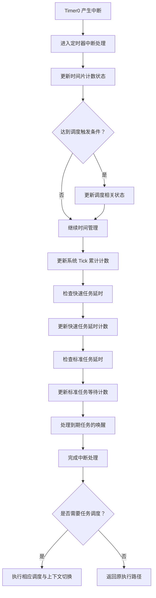
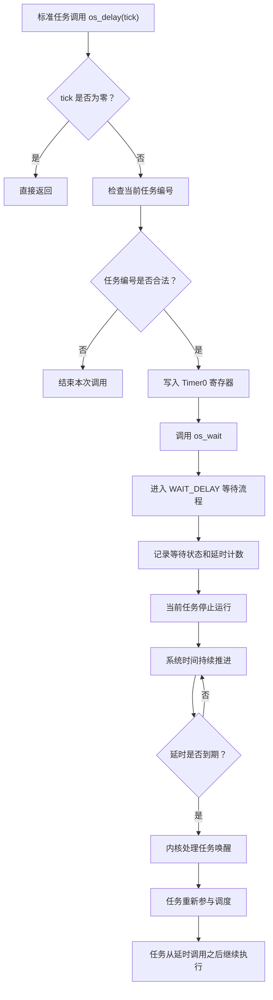
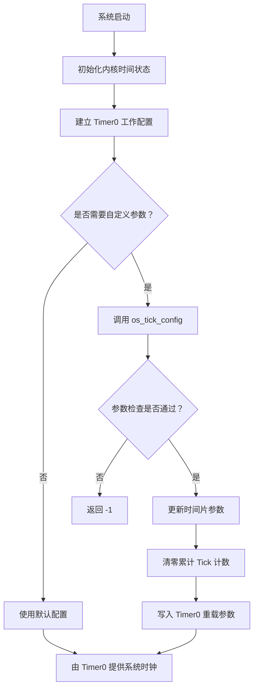

# HRTOS 定时器系统手册

## 模块概述

HRTOS 定时器系统为内核提供统一的时间基准，负责系统 Tick 计数、任务延时、时间单位转换以及系统运行时间统计。该模块以 8051 的 Timer0 为基础，将硬件定时中断与内核调度、任务等待和唤醒机制连接起来，是 HRTOS 时间管理功能的重要组成部分。

定时器系统不仅用于周期性触发任务调度，还承担标准任务的延时管理和快速任务的独立延时计数。通过统一的系统时间基准，应用程序可以实现周期性任务、延时执行、运行时间监测等功能，而不必在每个任务中单独维护软件计时逻辑。

HRTOS 同时提供两种不同的延时方式：

- **系统 Tick 延时**：通过 `os_delay()` 使当前任务进入等待状态，将 CPU 让给其他可运行任务，并在延时到期后重新参与调度。
- **忙等待延时**：通过 `os_delay_ms()` 在当前执行路径中循环等待，期间持续占用 CPU，不主动让出处理器。

两种方式分别适用于任务级时间管理和短时间硬件时序控制，使用时应根据实时性要求和 CPU 占用情况进行选择。

## 模块职责

定时器系统主要负责以下工作：

- 基于 Timer0 生成周期性系统时钟中断。
- 管理系统 Tick 累计计数和时间片计数。
- 为标准任务提供基于 Tick 的阻塞延时。
- 维护快速任务的独立延时计数。
- 将毫秒、秒等时间单位转换为系统 Tick 数。
- 提供系统累计运行时间查询接口。
- 提供系统定时参数配置接口。
- 配合内核等待与唤醒机制，实现延时到期后的任务恢复。

## 文件组织

### 源文件

| 文件 | 主要职责 |
|---|---|
| `Src/time/tick_config.c` | 配置系统时间片参数和 Timer0 重载值 |
| `Src/time/delay.c` | 实现基于系统 Tick 的任务延时 |
| `Src/time/delay_ms.c` | 实现毫秒级忙等待延时 |
| `Src/time/ms_to_tick.c` | 将毫秒转换为系统 Tick 数 |
| `Src/time/sec_to_tick.c` | 将秒转换为系统 Tick 数 |
| `Src/time/tick_get.c` | 读取系统 Tick 累计计数 |
| `Src/time/uptime_ms.c` | 获取系统累计运行时间，单位为毫秒 |

### 相关头文件

| 文件 | 主要用途 |
|---|---|
| `Inc/time.h` | 对外提供时间管理 API 声明 |
| `Inc/config.h` | 定义默认时间片参数及相关配置常量 |
| `Inc/hrtos_internal.h` | 声明内核内部时间变量及相关接口 |

## 时间管理模型

HRTOS 的时间管理包含几个相互关联但职责不同的概念。

### 系统 Tick

系统 Tick 是内核用于计算时间和管理任务延时的基本计数单位。Timer0 按照配置产生周期性中断，每次有效的系统 Tick 推进都会更新累计计数，并检查相应的延时条件。

系统 Tick 的实际时间长度由 Timer0 重载值、定时器工作模式、定时器计数时钟以及具体的 8051 芯片配置共同决定。

需要注意，Tick 是软件层面的时间单位，并不天然等于一毫秒。只有在硬件时钟配置和软件换算关系成立时，才能将 Tick 换算为对应的实际时间。

### 时间片

时间片用于控制内核周期性调度的触发间隔。

系统通过 `OS_TIME_ONCE` 和 `OS_TIME_XY` 维护时间片相关状态：

- `OS_TIME_ONCE`：配置的时间片计数参数。
- `OS_TIME_XY`：当前时间片倒计数状态。
- `OS_SCHED_REASON`：内核调度相关状态之一，用于记录调度触发原因。

系统 Tick 与时间片不是同一个概念。一个时间片可以由多个 Tick 组成，时间片计数达到调度条件后，内核根据当前调度模式决定是否进行任务切换。

### 任务延时

任务延时以系统 Tick 为基础，通过内核统一等待机制实现。

标准任务调用 `os_delay()` 后，内核将其作为 `WAIT_DELAY` 类型的等待处理，并将延时计数与任务状态关联。任务在等待期间不参与普通就绪任务的执行竞争；延时到期后，内核将任务恢复到可调度状态。

快速任务的延时计数采用独立的 `OS_WAIT_DI2` 数组，不依赖标准任务的普通 TCB 延时字段。这种设计使快速任务可以使用独立的延时管理路径。

### 系统运行时间

系统运行时间由累计 Tick 数与当前配置的 Tick 时间共同换算得到。

HRTOS 通过 `os_uptime_ms()` 提供毫秒单位的运行时间查询接口。该接口返回 32 位无符号整数，适合用于运行时间显示、周期性监测和应用程序的时间统计。

需要注意，当前实现以整数毫秒表示单个 Tick 的时间，因此查询结果的精度受到整数换算方式的限制。

## 内部数据与配置

### 默认配置参数

相关配置位于 `Inc/config.h`。

```c
#define OS_TIME_ONCE_DEFAULT 5
#define OS_TIME_T0 10000
```

`OS_TIME_ONCE_DEFAULT` 用于提供默认时间片计数配置，`OS_TIME_T0` 用于提供默认 Timer0 计数参数。

`OS_TIME_T0` 的数值本身并不能直接证明实际 Tick 周期为多少毫秒。实际周期还取决于定时器采用的计数时钟以及硬件工作模式。

### 时间片状态变量

```c
volatile unsigned char idata OS_TIME_XY;
volatile unsigned char idata OS_T0_TH0;
volatile unsigned char idata OS_T0_TL0;

volatile unsigned char xdata OS_TIME_ONCE;
volatile unsigned char xdata OS_TIME_ONCE_BACKUP;
```

各变量的作用如下：

| 变量 | 说明 |
|---|---|
| `OS_TIME_XY` | 当前时间片计数状态 |
| `OS_T0_TH0` | 保存的 Timer0 高字节参数 |
| `OS_T0_TL0` | 保存的 Timer0 低字节参数 |
| `OS_TIME_ONCE` | 当前时间片计数配置 |
| `OS_TIME_ONCE_BACKUP` | 模式切换过程中使用的时间片备份状态 |

这些变量用于维护时间片调度和定时器配置状态。具体更新时机应结合内核初始化、Timer0 中断处理及调度模式切换代码理解。

### 系统 Tick 累计计数器

```c
extern unsigned int xdata OS_TICK_COUNT_L;
extern unsigned int xdata OS_TICK_COUNT_H;
```

系统 Tick 使用两个 16 位变量保存累计计数：

- `OS_TICK_COUNT_L`：低 16 位。
- `OS_TICK_COUNT_H`：高 16 位。

组合后得到 32 位累计 Tick 数。

该计数方式适合 8051 资源受限的运行环境。读取两个部分时，需要避免 Timer0 中断在读取过程中更新计数器，否则可能得到不一致的组合值。

### 快速任务延时计数器

```c
extern unsigned int xdata OS_WAIT_DI2[OS_FAST_TASK_MAX];
```

`OS_WAIT_DI2` 为快速任务提供独立的延时计数存储空间。

快速任务的延时管理与标准任务的 `wait_tick` 机制不同。分析快速任务的延时行为时，应以快速任务对应的计数更新、到期判断和唤醒实现为准，不能直接套用标准任务的 TCB 延时流程。

## Timer0 定时机制

Timer0 为系统时间管理提供周期性硬件中断。每次中断发生后，内核通过定时器相关处理推进系统时间，并检查需要执行的调度和延时管理操作。

### 定时器中断处理流程

以下流程用于说明定时器系统与内核时间管理之间的主要关系。具体执行顺序、重载操作以及调度标志的更新细节，应以实际 Timer0 中断处理源码为准。



该机制将硬件定时事件与软件任务管理联系起来。定时器中断负责推进时间并识别到期条件，任务调度则根据内核状态和调度策略决定接下来运行哪个任务。

需要区分的是，发生 Timer0 中断不代表每次都会切换任务。是否切换取决于调度条件、当前运行状态及内核的具体调度实现。

## 核心 API

### `os_tick_config()`

**源文件：** `Src/time/tick_config.c`

**功能：** 配置系统时间片计数参数、Timer0 重载参数，并清零系统 Tick 累计计数器。

函数声明：

```c
char os_tick_config(u8 slice_count, u16 tick_value);
```

参数说明：

| 参数 | 说明 |
|---|---|
| `slice_count` | 时间片计数配置，不允许为零 |
| `tick_value` | Timer0 计数参数，必须大于 1000 |

返回值：

| 返回值 | 含义 |
|---|---|
| `0` | 配置成功 |
| `-1` | 参数无效 |

#### 执行过程

函数首先检查 `slice_count` 是否为零。如果为零，直接返回 `-1`。

通过第一项检查后，函数将 `slice_count` 写入 `OS_TIME_ONCE`，随后检查 `tick_value` 是否大于 1000。

当 `tick_value` 满足要求时，函数执行以下操作：

- 将系统 Tick 累计计数的高 16 位清零。
- 将系统 Tick 累计计数的低 16 位清零。
- 根据输入的计数参数计算 Timer0 重载值。
- 将计算后的高、低字节分别写入 `OS_T0_TH0` 和 `OS_T0_TL0`。
- 返回 `0`，表示配置成功。

重载值的计算方式为：

```c
tick_value = 65535 - tick_value;
tick_value++;
```

等价于在 16 位计数范围内计算：

```c
reload_value = 65536 - tick_value;
```

其中 `reload_value` 表示写入定时器的重载值，而函数参数 `tick_value` 表示预期的计数长度。

#### 使用注意事项

当前实现存在一个需要明确的行为：`OS_TIME_ONCE` 在 `tick_value` 完整校验之前就已被修改。因此，当 `slice_count` 合法但 `tick_value` 无效时，函数虽然返回 `-1`，时间片配置却已经发生变化。

另外，该函数清零的是系统 Tick 累计计数器，并没有在所提供的函数代码中显式重置 `OS_TIME_XY`。如果需要确认配置后的完整时间片初始状态，应继续检查定时器初始化与调度状态维护代码。

### `os_delay()`

**源文件：** `Src/time/delay.c`

**功能：** 使当前标准任务等待指定数量的系统 Tick。

函数声明：

```c
void os_delay(u16 tick);
```

参数说明：

| 参数 | 说明 |
|---|---|
| `tick` | 延时 Tick 数 |

函数没有返回值。

#### 执行过程

当 `tick` 为零时，函数直接返回，不执行延时操作。

当 `tick` 不为零时，函数首先检查当前任务编号是否满足：

```c
OS_CURRENT_TASK < OS_PROCESS_MAX + 2
```

通过检查后，函数对 Timer0 的低、高字节寄存器执行赋值：

```c
TL0 = 0x66;
TH0 = 0xFC;
```

随后调用统一等待接口：

```c
os_wait(WAIT_DELAY, OS_INVALID_ID, tick);
```

其中：

- `WAIT_DELAY` 表示延时等待类型。
- `OS_INVALID_ID` 表示该等待不关联具体的资源对象。
- `tick` 表示请求的延时计数。

通过统一等待机制，延时处理可以与其他任务等待操作共享内核的状态管理和唤醒流程。

#### 任务延时流程



图中对等待状态及唤醒过程的描述，是对 `os_wait()` 与定时器时间管理之间关系的概括。任务状态变更、计数初始化和到期处理的具体细节，以对应内核源码为准。

#### 设计特点

`os_delay()` 不是简单地执行循环等待，而是通过内核等待机制暂停当前任务的执行。

在等待期间，其他满足调度条件的任务可以继续运行，因此这种延时方式适合周期性任务、后台处理任务及需要主动让出 CPU 的应用场景。

#### 使用示例

```c
void periodic_task(void)
{
    while (1)
    {
        do_work();

        /* 等待 100 个系统 Tick */
        os_delay(100);
    }
}
```

这里的 `100` 表示 100 个系统 Tick，而不是无条件等于 100 毫秒。实际延时还与 Tick 周期、任务调度和唤醒时机有关。

### `os_delay_ms()`

**源文件：** `Src/time/delay_ms.c`

**功能：** 通过软件循环实现毫秒级忙等待延时。

函数声明：

```c
void os_delay_ms(unsigned char ms);
```

参数说明：

| 参数 | 说明 |
|---|---|
| `ms` | 请求的延时时间，单位为毫秒 |

函数没有返回值。

#### 实现机制

函数使用嵌套循环执行延时：

```c
void os_delay_ms(unsigned char ms)
{
    u8 i, j;

    while (ms--)
    {
        i = 3;
        j = 172;

        do
        {
            while (--j)
            {
                ;
            }
        }
        while (--i);
    }
}
```

每次外层循环执行一组固定的计数循环，通过消耗 CPU 执行时间实现软件延时。

该函数不调用 `os_wait()`，也不通过任务等待状态实现延时，因此不会主动让出 CPU 或主动触发任务调度。

#### 适用场景

- 硬件初始化过程中需要短暂等待。
- 外设操作要求在当前执行路径中插入短延时。
- 某些硬件时序要求不适合通过任务阻塞实现。

#### 使用注意事项

忙等待期间，当前执行路径持续占用 CPU。即使其他任务已经就绪，也不会因为该函数本身而主动发生任务切换。

实际延时时长取决于 CPU 工作频率、指令执行周期、编译器优化和生成的机器代码。循环参数本身不能保证在所有芯片、时钟和编译选项下都精确对应一毫秒。

因此，该函数适用于短时间等待，不应替代常规任务延时。对有严格时序要求的硬件操作，应通过实际测量或指令级分析确认延时精度。

### `os_ms_to_tick()`

**源文件：** `Src/time/ms_to_tick.c`

**功能：** 将毫秒数转换为系统 Tick 数。

函数声明：

```c
u16 os_ms_to_tick(u16 ms);
```

参数说明：

| 参数 | 说明 |
|---|---|
| `ms` | 待转换的时间，单位为毫秒 |

返回值为转换后的 Tick 数。

#### 换算机制

函数首先根据保存的 Timer0 高、低字节重建重载值：

```c
tick_value = OS_T0_TH0;
tick_value = tick_value << 8;
tick_value += OS_T0_TL0;
```

然后计算单个 Tick 对应的计数长度：

```c
tick_time_us = 65536 - tick_value;
```

接着通过整数除法将计数长度换算为毫秒：

```c
tick_ms = tick_time_us / 1000;
```

如果换算结果为零，则将 `tick_ms` 设置为 1。

最后使用向上取整的整数除法：

```c
return (ms + tick_ms - 1) / tick_ms;
```

其数学含义为：

\[
\text{ticks} =
\left\lceil
\frac{\text{ms}}{\text{tick\_ms}}
\right\rceil
\]

在 `tick_ms` 为正数且计算未发生整数溢出的前提下，该算法可以保证转换结果不会因为除法截断而少于按整数毫秒计算所需的 Tick 数。

#### 使用示例

```c
u16 ticks;

ticks = os_ms_to_tick(500);
os_delay(ticks);
```

该示例先将 500 毫秒转换为 Tick 数，再调用 `os_delay()` 执行任务延时。

需要注意，转换精度受到整数毫秒换算的限制。当实际 Tick 周期不能被 1 毫秒整除时，当前实现会截去不足一毫秒的部分，结果可能与真实硬件时间存在偏差。

此外，`ms`、`tick_ms` 和中间表达式均受到 16 位整数范围的约束。对于接近类型上限的输入，应注意中间加法溢出的可能性。

### `os_sec_to_tick()`

**源文件：** `Src/time/sec_to_tick.c`

**功能：** 将秒数转换为系统 Tick 数。

函数声明：

```c
u16 os_sec_to_tick(u8 sec);
```

参数说明：

| 参数 | 说明 |
|---|---|
| `sec` | 待转换的秒数，类型为 8 位无符号整数 |

返回值为换算后的 Tick 数。

#### 换算机制

函数先根据 Timer0 重载参数计算单个 Tick 对应的毫秒数：

```c
tick_value = OS_T0_TH0;
tick_value <<= 8;
tick_value += OS_T0_TL0;

tick_ms = (65536 - tick_value) / 1000;
```

如果 `tick_ms` 为零，则设置为 1。

随后计算每秒对应的 Tick 数：

```c
tick_per_sec = 1000 / tick_ms;
```

最后将每秒 Tick 数乘以输入秒数：

```c
return tick_per_sec * sec;
```

其基本换算关系为：

\[
\text{ticks} =
\left\lfloor
\frac{1000}{\text{tick\_ms}}
\right\rfloor
\times \text{sec}
\]

与 `os_ms_to_tick()` 不同，当前秒转换函数先计算每秒 Tick 数，再进行整数乘法，没有采用向上取整的方式。因此，在 Tick 周期无法整除一秒的情况下，转换结果可能低于实际所需的 Tick 数。

此外，函数输入为 `u8`，返回值为 `u16`。对于较大的秒数或者较短的 Tick 周期，乘法结果可能超出 16 位无符号整数的表示范围。

#### 使用示例

```c
u16 ticks;

ticks = os_sec_to_tick(5);
os_delay(ticks);
```

该示例将 5 秒换算为 Tick 数，再让当前任务进入相应的延时等待。

实际应用中，应根据系统 Tick 周期及整数换算精度判断是否适合直接使用该接口。

### `os_tick_get()`

**源文件：** `Src/time/tick_get.c`

**功能：** 读取系统 Tick 累计计数的高、低 16 位。

函数声明：

```c
void os_tick_get(u16 *high, u16 *low);
```

参数说明：

| 参数 | 说明 |
|---|---|
| `high` | 用于接收 Tick 累计计数的高 16 位 |
| `low` | 用于接收 Tick 累计计数的低 16 位 |

函数没有返回值，结果通过指针参数输出。

#### 执行过程

函数先关闭 Timer0 中断使能：

```c
ET0 = 0;
```

随后读取高、低计数部分：

```c
*high = OS_TICK_COUNT_H;
*low  = OS_TICK_COUNT_L;
```

最后重新设置：

```c
ET0 = 1;
```

通过在读取过程中暂时禁止 Timer0 中断，可以避免该中断在两个计数部分读取之间修改累计计数，从而降低读取结果不一致的风险。

#### 使用注意事项

当前实现直接在读取完成后将 `ET0` 置为 1，并没有保存调用前的中断使能状态。因此，它并非严格意义上的“保存并恢复原中断状态”。

如果调用该函数之前 `ET0` 已经为 0，函数返回前仍会将其置为 1。对于需要保持既有中断状态的调用环境，应注意这一实现细节。

此外，调用者需要提供有效的 `high` 和 `low` 指针。

### `os_uptime_ms()`

**源文件：** `Src/time/uptime_ms.c`

**功能：** 获取系统累计运行时间，单位为毫秒。

函数声明：

```c
u32 os_uptime_ms(void);
```

返回值为 32 位无符号整数，表示根据系统累计 Tick 数和当前 Tick 毫秒长度换算得到的运行时间。

#### 执行过程

函数首先暂时关闭 Timer0 中断：

```c
ET0 = 0;

tick_h = OS_TICK_COUNT_H;
tick_l = OS_TICK_COUNT_L;

ET0 = 1;
```

随后将高、低 16 位组合为 32 位累计 Tick 数：

```c
total_tick = ((u32)tick_h << 16) | tick_l;
```

函数再根据 Timer0 重载参数计算单个 Tick 对应的计数长度，并换算为整数毫秒：

```c
tick_value = OS_T0_TH0;
tick_value <<= 8;
tick_value += OS_T0_TL0;

tick_us = 65536 - tick_value;
tick_ms = tick_us / 1000;

if (tick_ms == 0)
{
    tick_ms = 1;
}
```

最后计算累计运行时间：

```c
return total_tick * tick_ms;
```

其换算关系为：

\[
\text{uptime\_ms}
=
\text{total\_tick}
\times
\text{tick\_ms}
\]

#### 精度与范围

该函数提供的是基于累计 Tick 数计算的运行时间，而不是直接读取独立的高精度硬件时钟。

由于单个 Tick 的时间采用整数毫秒表示，实际 Tick 周期中不足一毫秒的部分不会保留在换算结果中。因此，运行时间越长，整数换算产生的累计偏差越值得关注。

返回值为 `u32`，当累计运行时间超出 32 位无符号整数的表示范围时，结果将发生整数回绕。

与 `os_tick_get()` 一样，当前实现没有保存调用前的 `ET0` 状态，而是在读取结束后直接将其置为 1。调用环境需要考虑这一点。

## 系统时间与任务调度的关系

定时器系统与调度器之间存在明确的职责分工。

Timer0 提供周期性硬件事件；时间管理代码维护累计 Tick 和等待计数；内核根据延时到期情况恢复任务状态；调度器则决定后续由哪个满足运行条件的任务获得 CPU。

### 延时到期处理

标准任务的延时请求通过 `os_wait()` 进入统一等待机制。任务等待期间，系统时间继续推进，内核根据其等待计数判断是否到期。

当延时到期时，任务被恢复为可调度状态。任务何时真正继续执行，取决于调度器的选择和当前系统中的其他可运行任务。

因此，`os_delay(tick)` 应理解为请求至少经过相应 Tick 计数的任务延时，而不应将其视为具有绝对精确结束时刻的硬件定时器。

### 时间片触发与任务切换

时间片计数用于产生周期性调度条件，但时间片到期不等同于必然发生任务切换。

在时间片调度模式下，时间片到期可以成为调度触发条件；在纯优先级调度等其他模式下，任务是否切换还受到相应调度规则的影响。

具体的任务切换行为，应结合 HRTOS 调度器的模式定义和调度触发实现理解。

## 初始化与配置流程

定时器系统需要与内核启动流程协同工作。

### 定时器初始化

系统启动时，内核初始化与时间管理有关的状态，并根据实际配置建立 Timer0 工作环境。

用户如需调整默认时间片计数或 Timer0 重载参数，可以调用 `os_tick_config()`。配置成功后，函数会更新相应参数并清零累计 Tick 计数器。

Timer0 的启动、中断使能、工作模式配置和实际寄存器初始化，还取决于系统启动代码及目标芯片的硬件配置。

### 配置流程



需要注意，`os_tick_config()` 本身的执行内容不等同于完整的 Timer0 硬件初始化过程。不能仅凭该函数就推断 Timer0 的所有工作模式、启动位和中断使能状态均已完成配置。

## 使用模式

### 周期性任务

对于需要定期执行工作的任务，可以在完成一次工作后调用 `os_delay()`，避免使用长时间忙等待占用 CPU。

```c
void periodic_task(void)
{
    while (1)
    {
        do_work();

        os_delay(100);
    }
}
```

示例中的延时参数以系统 Tick 为单位。若任务要求严格的固定周期，还需要考虑任务执行时间、调度延迟和 Tick 周期带来的误差。

### 毫秒时间转换

当应用需求以毫秒表达时，可以先使用 `os_ms_to_tick()` 进行换算，再通过 `os_delay()` 等待。

```c
void task_with_ms_delay(void)
{
    u16 ticks;

    ticks = os_ms_to_tick(500);

    while (1)
    {
        do_work();

        os_delay(ticks);
    }
}
```

该方式可以让应用代码以毫秒描述目标延时，但实际精度仍受系统 Tick 周期和整数换算方式限制。

### 运行时间监测

`os_uptime_ms()` 可以用于读取系统累计运行时间，并将结果提供给显示、日志或监测逻辑。

```c
void monitor_task(void)
{
    u32 uptime;

    while (1)
    {
        uptime = os_uptime_ms();

        display_uptime(uptime);

        os_delay(1000);
    }
}
```

此处的 `os_delay(1000)` 表示等待 1000 个系统 Tick，而不是固定等待 1000 毫秒。如果目标是约一秒的任务间隔，可以根据当前 Tick 配置使用时间转换接口。

### 短时间硬件等待

在硬件初始化或者外设操作过程中，如果需要在当前执行路径中插入短延时，可以使用忙等待接口。

```c
void init_hardware(void)
{
    /* 为硬件稳定预留短暂时间 */
    os_delay_ms(10);
}
```

使用该接口时，应确认忙等待期间占用 CPU 不会影响其他任务及中断处理的时序要求。

## 设计特点与实现边界

### 基于 Timer0 的统一时间基准

HRTOS 使用 Timer0 为系统提供周期性时间事件，并以软件计数维护系统 Tick 和相关时间状态。

统一时间基准使任务延时、时间片管理和运行时间统计可以共享同一套时间参数，减少不同功能之间的计时配置差异。

该设计也意味着系统时间管理与 Timer0 的配置存在依赖关系。修改定时器参数时，需要同时考虑任务延时、调度周期和时间转换函数的行为。

### 统一等待机制

标准任务延时通过 `os_wait()` 进入统一等待流程，采用 `WAIT_DELAY` 类型，并使用 `OS_INVALID_ID` 表示不关联具体等待对象。

这种实现将任务延时纳入内核统一的等待和唤醒管理体系，而不是为普通延时单独建立一套完整的任务状态管理流程。

### 快速任务独立延时

快速任务通过 `OS_WAIT_DI2` 数组管理延时计数，与标准任务的普通延时状态分开维护。

这种分离有利于保持快速任务管理路径的独立性，但其实际响应时间和执行开销仍取决于快速任务对应的中断处理、计数更新与唤醒实现。

### 32 位累计 Tick

系统将累计 Tick 拆分为高、低两个 16 位变量，以适应 8051 的数据处理特点。

该方案扩展了计数范围，同时要求读取时注意中断并发问题。当前接口通过暂时关闭 Timer0 中断读取两个计数部分，但没有保存并恢复原有的 `ET0` 状态。

### 忙等待与任务延时并存

HRTOS 同时提供任务级阻塞延时和软件忙等待延时，分别面向不同使用场景。

任务级延时适合常规应用逻辑，可以让出 CPU；忙等待适合短时间硬件时序操作，但会持续消耗处理器资源。两者不能简单互相替代。

## 配置约束与注意事项

### Tick 周期与硬件计时关系

实际 Tick 周期由目标芯片的定时器工作模式、计数时钟和重载值共同决定。

在配置系统 Tick 前，应确认目标芯片的 Timer0 时钟来源与计数规则，不能直接将重载参数解释为毫秒数。

### 时间换算精度

当前毫秒和秒转换接口均使用整数毫秒作为中间单位。

当 Tick 周期不能以整数毫秒准确表示时，换算结果可能产生误差。特别是 `os_sec_to_tick()` 采用每秒 Tick 数的整数除法，不能保证所有配置下都向上取整。

对于需要严格控制实际等待时长的场景，应先验证目标硬件下的 Tick 周期及换算误差。

### 延时范围

`os_delay()` 使用 `u16` 表示延时 Tick 数，单次输入范围受到 16 位无符号整数的限制。

毫秒和秒转换函数也受到输入类型、返回类型及中间运算范围限制。较大的时间值可能出现整数溢出或回绕。

### 中断使能状态

`os_tick_get()` 和 `os_uptime_ms()` 均直接操作 `ET0`，当前实现会在读取结束后将其设置为 1，而不是恢复调用前的状态。

如果函数可能在 Timer0 中断原本关闭的环境中调用，应特别关注这一行为。

### Timer0 寄存器访问

当前 `os_delay()` 在调用 `os_wait()` 前写入 `TL0` 和 `TH0`。这一操作属于现有实现的一部分，分析其对定时器运行的影响时，需要结合 Timer0 的实际工作模式及内核相关代码进行确认。

### 忙等待的 CPU 占用

`os_delay_ms()` 不会主动触发任务调度，因此不适用于长时间等待或需要主动让出 CPU 的常规任务逻辑。

其延时精度也依赖实际生成的机器代码，不能仅凭函数参数保证严格的毫秒级精度。

## 性能与实时性考虑

定时器系统的性能主要受到 Tick 中断频率、单次中断处理开销、延时任务数量以及任务切换开销的共同影响。

### 中断频率

在其他条件相同的情况下，较短的 Tick 周期会提高定时器中断频率，从而增加系统的中断处理开销。

Tick 周期越短并不意味着整个系统必然越快。应根据任务延时粒度、调度需求和处理器负载确定合适的参数。

### 延时精度

`os_delay()` 的时间粒度受系统 Tick 周期限制，并受到中断处理、任务唤醒及调度等待的影响。

`os_delay_ms()` 使用忙等待方式，可以在不主动让出 CPU 的情况下执行短时间延时，但它的精度取决于执行环境，不能据此直接认定其在所有配置下都具有亚毫秒精度。

### 任务切换开销

任务进入延时等待后，内核需要完成等待状态管理，并在到期时处理唤醒和后续调度。

因此，任务延时的实际返回时刻不仅取决于计数器何时到期，还与任务恢复运行的时机有关。对于具有明确截止时间的任务，应将这些因素纳入系统时序分析。

## 与其他定时方案的区别

### 相对于独立硬件定时器

HRTOS 的系统 Tick 用于内核统一时间管理，主要服务于任务延时、时间片调度和运行时间统计。

独立硬件定时器则可以用于特定外设的周期事件、输入捕获、输出比较或其他硬件时序功能。两者的职责不同，不能将系统 Tick 等同于所有外设定时能力。

### 相对于软件定时器回调机制

当前提供的时间管理接口以 Tick 计数和任务延时为主要功能，不应据此认为系统已经提供了完整的软件定时器回调框架。

需要周期性执行的应用逻辑，可以由任务结合 `os_delay()` 实现；更复杂的定时器对象、回调注册与取消机制，则需要以其他实际模块的实现为准。

### 相对于高分辨率定时机制

当前时间转换接口将 Tick 计数换算为整数毫秒，因此其时间表示精度受到该算法的限制。

如果应用需要更细粒度的时间测量或更精确的硬件事件控制，应根据目标芯片的计时资源和系统架构选择合适的实现方式，而不应将当前毫秒换算结果直接视为高分辨率时间戳。

## 模块总结

HRTOS 定时器系统围绕 Timer0 建立统一的时间管理基础，将系统 Tick、时间片计数、任务延时、快速任务延时以及累计运行时间统计连接起来。

其中，`os_delay()` 负责通过内核等待机制实现任务级延时，`os_delay_ms()` 提供不主动让出 CPU 的软件忙等待，`os_ms_to_tick()` 和 `os_sec_to_tick()` 提供时间单位转换，`os_tick_get()` 与 `os_uptime_ms()` 则分别用于获取累计 Tick 和毫秒单位的运行时间。

该模块的设计重点是共享时间基准、复用内核等待机制，并在有限的 8051 资源条件下完成基础时间管理。实际使用时，应重点关注目标芯片的 Timer0 配置、Tick 换算精度、整数运算范围及中断使能状态等实现边界。