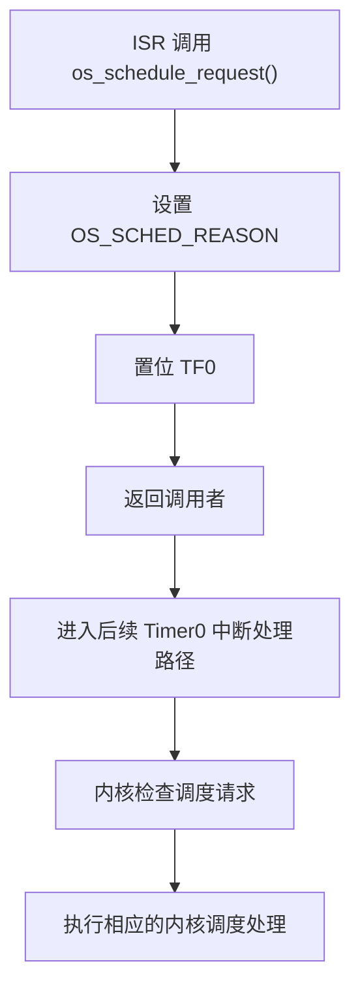
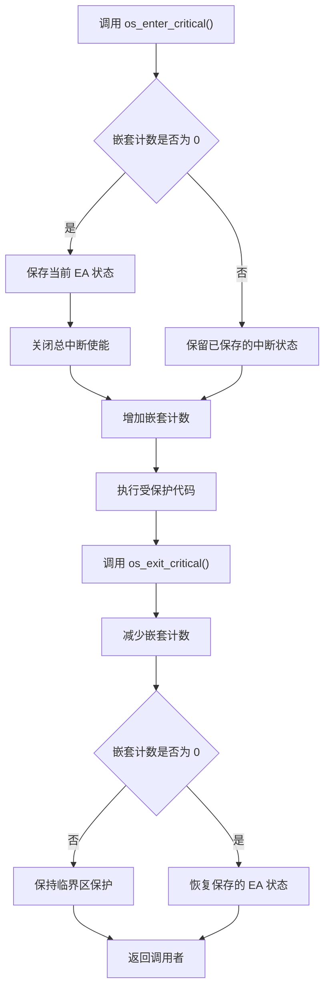
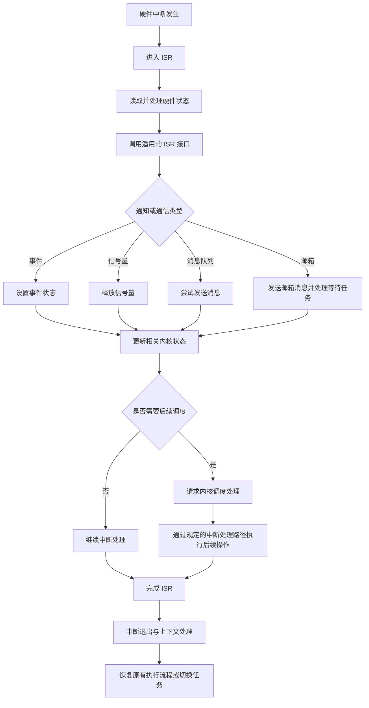

# HRTOS 中断设计

## 模块介绍

HRTOS 中断模块负责管理中断相关的内核操作，为临界区保护、ISR 上下文识别、中断 ID 获取、中断嵌套以及中断环境下的进程间通信提供基础支持。

中断处理程序与普通任务运行在不同的执行上下文中。ISR 需要快速完成硬件状态处理，并在必要时通知内核中的任务。如果中断处理程序直接执行不适合中断上下文的操作，可能导致任务调度异常、内核状态不一致或中断响应延迟。

因此，HRTOS 通过独立的中断接口、调度请求机制和中断相关状态管理，协调硬件中断处理与内核任务调度。

中断模块的设计重点是保护内核共享状态、识别当前执行上下文、提供适用于 ISR 的通知接口，并将需要执行的任务调度交由内核处理。

## 主要职责

### 临界区管理

提供临界区进入和退出接口，用于保护需要避免中断并发访问的共享数据。

### ISR 上下文识别

提供 ISR 上下文检测能力，使内核或应用程序能够区分中断处理环境与普通任务环境。

### 中断标识管理

提供中断 ID 查询接口，用于识别当前中断来源，为中断分发、调试和特定中断处理逻辑提供依据。

### ISR 环境下的进程间通信

提供适用于中断上下文的事件设置、消息发送、信号量释放以及邮箱发送等操作，支持 ISR 向任务传递通知或数据。

### 调度请求

允许 ISR 请求内核执行后续调度处理。调度请求与直接调用任务调度器不同，其目的是将调度操作交由内核规定的处理路径完成。

### 中断嵌套支持

配合内核中断状态、优先级和上下文管理机制，支持 HRTOS 设计中规定的嵌套中断处理流程。

## 主要文件

### 源文件

| 文件 | 主要职责 |
|---|---|
| `Src/interrupt/enter_critical.c` | 进入临界区 |
| `Src/interrupt/exit_critical.c` | 退出临界区 |
| `Src/interrupt/in_isr.c` | 检查当前是否处于 ISR 上下文 |
| `Src/interrupt/interrupt_id.c` | 获取当前中断 ID |
| `Src/interrupt/schedule_request.c` | 从 ISR 请求内核调度 |
| `Src/interrupt/event_set_from_isr.c` | 从 ISR 设置事件 |
| `Src/interrupt/msgq_send_from_isr.c` | 从 ISR 发送消息 |
| `Src/interrupt/msgq_recv_from_isr.c` | ISR 相关的消息接收实现，具体调用约束以接口实现为准 |
| `Src/interrupt/queue_send_from_isr.c` | ISR 环境下的邮箱发送与任务唤醒 |
| `Src/interrupt/semaphore_post_from_isr.c` | 从 ISR 释放信号量 |

其中，`queue_send_from_isr.c` 应描述为 ISR 环境下的邮箱发送与任务唤醒，不应将其误述为通用的 ISR 安全队列发送接口。

### 头文件

| 文件 | 主要职责 |
|---|---|
| `Inc/interrupt.h` | 中断相关 API 声明 |
| `Inc/config.h` | 临界区相关宏及配置 |
| `Inc/hrtos_internal.h` | 内核内部中断状态和变量声明 |

## 内部数据结构

### 临界区状态变量

临界区相关变量在 `Inc/hrtos_internal.h` 中声明。

```c
extern bit os_int_status;
extern unsigned char idata os_critical_nesting;
```

`os_int_status` 用于保存首次进入临界区时的中断使能状态。

`os_critical_nesting` 用于记录临界区嵌套深度。嵌套计数使多层调用能够共享同一套临界区保护机制，避免内部调用提前恢复中断。

由于这两个变量属于内核共享状态，使用临界区接口时应遵循成对进入和退出的原则，并确保嵌套关系正确。

### 中断控制变量

以下变量位于 `Src/kernel/os_core.c`，用于中断状态、上下文保护或中断处理流程中的内部控制。

```c
volatile bit OS_ISR_FLAG;
volatile bit OS_INTERRUPT_GAO;
volatile bit OS_INTERRUPT_GAO_BIAO;
volatile unsigned char data OS_INTERRUPT_PROTECT;
volatile unsigned char data OS_INT_BAO[6];
```

这些变量涉及 ISR 状态标记、高优先级中断处理标记、中断 ID 保护以及中断上下文信息保存等用途。

`OS_INT_BAO` 的注释所列内容包括 ACC、B、DPH、DPL、PSW 和 EA。实际保存、恢复顺序以及各变量的使用条件，应以对应的汇编代码和内核实现为准。

`volatile` 用于提示编译器，这些变量可能在当前代码路径之外被修改或观察。但它本身不提供互斥保护，也不能代替正确的中断同步机制。

### 中断处理地址

```c
volatile unsigned char xdata OS_INTERRUPT_ADDR[2];
volatile unsigned char xdata OS_INTERRUPT_ADDR2[2];
```

这两个数组用于保存中断处理相关的地址信息，分别对应普通中断处理和嵌套中断处理所涉及的地址。

具体地址的编码格式、写入时机、读取方式以及使用条件，应结合中断入口和嵌套中断处理代码理解。

## 核心函数

### os_enter_critical()

**源文件：** `Src/interrupt/enter_critical.c`

**功能：** 进入临界区，保护需要避免中断并发访问的内核或应用程序共享状态。

其基本处理逻辑如下：

```c
void os_enter_critical()
{
    if(os_critical_nesting == 0) {
        os_int_status = EA;
        EA = 0;
    }

    os_critical_nesting++;
}
```

首次进入临界区时，函数保存当前 EA 状态，并关闭总中断使能。再次进入时，只增加嵌套计数，不重复覆盖原始中断状态。

这种设计允许多个内部函数在嵌套调用过程中使用临界区保护，而不必各自独立保存和恢复中断状态。

**设计特点**

- 通过嵌套计数支持多层临界区调用。
- 仅在首次进入时保存中断状态并关闭中断。
- 保留进入临界区之前的 EA 状态。
- 避免内层临界区提前恢复中断。

**使用约束**

临界区进入和退出必须匹配。不能在未正确进入的情况下调用退出接口，也不能让嵌套计数因调用错误而失去一致性。

### os_exit_critical()

**源文件：** `Src/interrupt/exit_critical.c`

**功能：** 退出临界区，并在最外层临界区结束时恢复保存的中断状态。

其基本处理逻辑如下：

```c
void os_exit_critical()
{
    os_critical_nesting--;

    if(os_critical_nesting == 0) {
        EA = os_int_status;
    }
}
```

退出操作首先减少嵌套计数。当计数归零时，恢复首次进入临界区时保存的 EA 状态。

恢复的是原始状态，而不是无条件将 EA 设置为 1。因此，如果进入临界区之前总中断使能已经关闭，退出后仍应保持关闭状态。

**设计特点**

- 仅在最外层临界区退出时恢复中断状态。
- 保持嵌套调用之间的保护关系。
- 避免临界区结束后错误改变调用前的中断状态。

**使用约束**

必须保证进入和退出次数匹配。若在计数为零时错误调用退出接口，计数可能发生下溢，导致后续临界区行为异常。具体防护行为应以实际实现为准。

### os_in_isr()

**源文件：** `Src/interrupt/in_isr.c`

**功能：** 检查当前执行环境是否属于 ISR 上下文。

该接口用于区分普通任务执行路径与中断执行路径，可为接口调用约束、调试检查以及上下文相关的处理逻辑提供依据。

**返回值**

- `1`：当前处于 ISR 上下文。
- `0`：当前不处于 ISR 上下文。

具体的 ISR 状态判定方式由内部标志及其维护逻辑决定。使用该接口时，应结合 HRTOS 对中断入口、嵌套中断和中断退出的实现理解其语义。

### os_interrupt_id()

**源文件：** `Src/interrupt/interrupt_id.c`

**功能：** 获取当前中断 ID。

该接口用于识别当前中断来源，适用于需要根据中断编号执行不同处理逻辑的场景。

中断 ID 的具体取值由 HRTOS 的中断入口和编号映射规则决定。使用时应以当前版本源码中的实际映射为准，不能直接将传统 8051 的硬件向量顺序等同于 HRTOS 的中断 ID。

在当前实现的相关测试中，外部中断 INT0 对应 ID `0`，INT1 对应 ID `2`。其他中断源的编号应依据实际实现确认。

### os_schedule_request()

**源文件：** `Src/interrupt/schedule_request.c`

**功能：** 从 ISR 请求内核执行后续调度处理。

接口的基本逻辑如下：

```c
char os_schedule_request(char id)
{
    id = id;
    OS_SCHED_REASON = 1;
    TF0 = 1;

    return 1;
}
```

参数 `id` 为保留参数，当前实现中不参与实际调度决策。

函数通过设置调度触发标志，并置位 Timer0 溢出标志，触发后续的 Timer0 中断处理路径。

这种方式将调度请求与实际调度过程分离，使内核能够在规定的中断处理路径中完成后续操作，而不是在当前 ISR 中直接调用调度器。

**处理流程**



**设计特点**

- 调度请求与实际调度执行分离。
- 使用 Timer0 触发后续处理。
- 避免在调用接口的位置直接执行完整调度流程。
- 为中断环境下的任务通知和调度请求提供统一入口。

该机制并不意味着调度一定在当前硬件 ISR 返回后立即发生。实际执行时机取决于中断优先级、当前中断状态、Timer0 配置及内核中断处理流程。

## ISR 环境下的进程间通信

### os_event_set_from_isr()

**源文件：** `Src/interrupt/event_set_from_isr.c`

**功能：** 在 ISR 环境下设置事件，使任务能够通过相应的事件机制获知中断产生的状态变化。

**参数**

`id`：事件资源 ID。

**返回值**

按当前接口约定，成功返回 `1`，失败返回 `-1`。

**处理逻辑**

函数首先检查事件资源 ID 是否有效，然后更新对应的事件状态，并根据具体实现处理相关的挂起信号或唤醒请求。需要执行后续调度时，通过 `os_schedule_request()` 请求内核处理。

事件设置接口用于传递状态通知。若多个事件可能在任务处理前连续发生，应用程序应根据事件机制的实际语义设计处理逻辑，避免错误假定每一次事件都对应独立的计数记录。

### os_semaphore_post_from_isr()

**源文件：** `Src/interrupt/semaphore_post_from_isr.c`

**功能：** 在 ISR 环境下释放信号量，用于通知任务某项操作已经完成，或某个资源已具备继续处理的条件。

**参数**

`obj`：信号量资源 ID。

**返回值**

按当前接口约定，成功返回 `1`，失败返回 `-1`。

**处理逻辑**

函数检查信号量资源是否合法，然后根据信号量当前状态更新其计数或相关挂起信号。当操作需要引起任务调度时，通过调度请求机制交由内核进一步处理。

信号量释放与任务实际运行之间存在调度过程。调用成功表示接口接受了相应操作，不应据此假定被通知任务已在 ISR 返回前执行。

### os_msgq_send_from_isr()

**源文件：** `Src/interrupt/msgq_send_from_isr.c`

**功能：** 在 ISR 环境下向消息队列发送消息。

**参数**

- `q`：消息队列指针。
- `obj`：相关资源 ID。
- `_data`：待发送的消息数据。

**返回值**

按当前接口约定，发送成功返回 `1`；发送失败或队列已满时返回 `0`。

**处理逻辑**

函数根据消息队列当前状态判断是否可以发送消息。如果队列已满，则返回失败，不在 ISR 中等待队列空间。如果队列可用，则写入消息、更新队列相关状态，并根据实际实现请求后续调度处理。

**使用注意事项**

- 调用前应确保队列对象有效。
- ISR 中不应等待队列空间。
- 应明确消息队列满载时的处理策略。
- 如果消息不能丢失，应通过队列容量规划、硬件状态处理或其他应用层机制保证数据完整性。

### os_msgq_recv_from_isr()

**源文件：** `Src/interrupt/msgq_recv_from_isr.c`

该文件属于 ISR 相关的消息接收实现。

消息接收与消息发送具有不同的上下文约束。不能仅根据文件名就认定该接口可以在所有 ISR 中安全调用，也不能在未核对实现的情况下推断其是否阻塞、是否修改调度状态或适用于哪些中断场景。

使用该接口前，应检查实际函数声明、返回值、队列空状态处理及相关调用约束，并据此补充面向应用程序的具体说明。

### queue_send_from_isr.c

**源文件：** `Src/interrupt/queue_send_from_isr.c`

**功能：** ISR 环境下的邮箱发送与任务唤醒。

该文件涉及邮箱通信和等待任务的唤醒处理，不应将其描述为通用的 ISR 安全队列发送接口。

在中断环境下发送邮箱消息时，内核需要依据邮箱状态及等待关系处理相应的通信操作。若存在等待该邮箱的任务，还需要按照实际等待对象和内核调度机制执行唤醒处理。

邮箱发送、等待任务唤醒和后续任务调度是相互关联但不同的处理阶段。接口完成消息发送或唤醒操作，并不等于被唤醒任务立即开始运行。

具体的参数、返回值、消息存储方式和唤醒条件，应以该文件的函数实现及相关邮箱数据结构为准。

## 调用关系

### 临界区处理流程

临界区采用嵌套计数管理。首次进入时保存原始中断状态并关闭总中断使能；内层进入只增加计数；退出时逐层减少计数；只有计数归零时才恢复原始中断状态。



### ISR 通知与任务调度流程

ISR 安全接口负责在中断环境下完成允许的状态更新或通信操作。若需要执行后续任务调度，接口可以请求内核通过调度处理路径继续执行。



实际调度行为由内核实现决定。上图展示的是逻辑关系，并不意味着所有 ISR 接口都会无条件触发调度，也不意味着每次中断退出都会发生任务切换。

## 生命周期

### 临界区生命周期

临界区的完整生命周期由进入、嵌套保护、受保护代码执行以及退出组成。

- **进入临界区**：调用 `os_enter_critical()`。
- **检查嵌套状态**：判断当前是否为首次进入。
- **保存中断状态**：首次进入时保存当前 EA 状态。
- **关闭中断**：首次进入时关闭总中断使能。
- **执行受保护代码**：在临界区内访问需要保护的共享状态。
- **退出临界区**：调用 `os_exit_critical()`。
- **更新嵌套状态**：递减嵌套计数。
- **恢复中断状态**：嵌套计数归零时恢复进入前保存的状态。

### ISR 执行生命周期

ISR 的执行涉及硬件中断响应、处理程序执行以及内核对中断退出和调度请求的处理。

- **中断产生**：外设或处理器中断源产生中断请求。
- **进入中断处理程序**：处理器根据硬件配置转入相应中断入口。
- **处理硬件状态**：读取状态寄存器并按芯片要求处理或清除中断请求。
- **执行必要的通知操作**：根据需要调用适用的 ISR 相关接口。
- **提出调度请求**：当操作需要后续内核调度处理时，调用相应调度请求接口。
- **完成 ISR 处理**：完成当前中断源所需的处理。
- **执行内核中断退出流程**：由 HRTOS 的中断处理机制完成必要的状态处理。
- **继续原执行流程或切换任务**：根据中断状态和调度条件决定后续执行路径。

需要区分硬件中断返回与 HRTOS 内核调度处理。具体的上下文保存、恢复和任务切换顺序，应以目标芯片上的实际中断入口及内核代码为准。

## 设计原则

### 嵌套临界区

HRTOS 使用嵌套计数管理临界区的进入与退出。

- 首次进入时保存原始中断状态。
- 嵌套进入时不重复覆盖原始状态。
- 内层退出时不提前恢复中断。
- 最外层退出时恢复原始中断状态。
- 所有进入与退出操作必须保持匹配。

临界区的实际安全性还取决于共享状态的访问方式、调用上下文以及编译器和处理器对相关操作的实现。

### ISR 安全

ISR 相关接口应遵循中断上下文约束。

- 避免在 ISR 中执行阻塞操作。
- 避免在 ISR 中等待不可立即获得的资源。
- 只调用明确支持当前中断上下文的接口。
- 将复杂业务处理交给普通任务完成。
- 控制 ISR 执行时间，减少对其他中断和任务的影响。

“ISR 相关”或函数名包含 `_from_isr`，并不意味着可以忽略参数有效性、资源状态及具体接口的调用约束。

### 延迟调度

HRTOS 提供独立的调度请求接口，用于将调度请求交由内核处理。

当前 `os_schedule_request()` 实现通过设置 `OS_SCHED_REASON` 并置位 `TF0` 请求 Timer0 中断处理路径。

这种方式将请求发起与后续调度处理分离，但具体的响应时机仍取决于当前中断状态、Timer0 的配置以及内核的中断处理逻辑。

### 临界区宏

`Inc/config.h` 中的临界区宏用于统一调用临界区接口。

```c
#define OS_ENTER_CRITICAL() do { os_enter_critical(); } while (0)
#define OS_EXIT_CRITICAL()  do { os_exit_critical(); } while (0)
```

使用 `do { ... } while (0)` 可以让宏在语法上表现为单条语句，降低其嵌入条件语句或其他代码块时产生的语法问题。

调用宏时，仍需确保进入和退出操作匹配，并遵循临界区接口的调用约束。

## 约束与注意事项

### 临界区约束

- 嵌套计数使用 8 位变量，其可表示范围有限。
- 临界区进入与退出必须配对。
- 临界区内不应执行不必要的耗时操作。
- 关闭总中断使能会影响可响应中断的时机。
- 嵌套计数的有效范围和异常处理能力，应以实际实现为准。

### ISR 调用约束

- ISR 不应调用阻塞式延时或等待接口。
- 不应在 ISR 中等待互斥资源。
- 不应在 ISR 中执行长时间计算。
- 不应在 ISR 中进行不可控的动态内存操作。
- 不应在未确认接口约束前调用普通任务接口。
- 消息队列发送等操作应采用非阻塞处理方式。
- 消息接收接口的 ISR 使用条件必须根据具体实现确认。

### 调度约束

- ISR 不应自行绕过内核调度流程。
- 调度请求接口用于发起请求，不等于立即完成任务切换。
- 调度行为取决于内核状态及相应中断处理流程。
- Timer0 的使用方式应与系统时基和调度配置保持一致。

### 中断嵌套约束

嵌套中断涉及硬件优先级、内核中断状态和上下文保护机制。不能仅根据任务优先级或中断 ID 推断硬件中断一定可以抢占另一中断。

具体的嵌套条件、允许的调用范围以及退出要求，应以 HRTOS 中断入口、退出处理和目标芯片的中断配置为准。

## ISR 编程规范

### ISR 中适合执行的操作

- 读取必要的硬件寄存器。
- 按芯片要求处理或清除中断源。
- 更新简单的状态标志。
- 调用明确支持 ISR 上下文的事件接口。
- 调用明确支持 ISR 上下文的信号量接口。
- 调用符合约束的非阻塞消息发送接口。
- 调用适用的邮箱发送与任务唤醒接口。
- 在需要时请求内核进行后续调度处理。

上述操作是否适用，仍需结合对应接口的具体实现和调用条件判断。

### ISR 中应避免的操作

- 调用阻塞式延时或等待接口。
- 等待消息、信号量或其他资源变为可用。
- 使用需要阻塞等待的互斥机制。
- 执行耗时且无法预测的业务逻辑。
- 执行未经确认可在 ISR 中使用的动态内存操作。
- 递归调用内核接口。
- 在未确认安全性的情况下直接调用任务调度器。

### ISR 编程示例

以下示例用于说明常见的中断处理结构，实际寄存器名称、清除方式、事件 ID 和中断声明应根据目标芯片及项目配置调整。

```c
void example_isr(void) interrupt VECTOR
{
    u8 status;

    /* 读取硬件状态 */
    status = HW_STATUS_REG;

    /* 按芯片要求处理或清除中断源 */
    HW_CLEAR_REG = status;

    /* 使用适用的 ISR 接口通知任务 */
    if(status & EVENT_FLAG) {
        os_event_set_from_isr(EVENT_ID);
    }

    /* 完成本次中断处理 */
}
```

该示例不表示所有芯片都采用相同的中断标志清除方式，也不表示事件接口在所有配置下都会触发任务切换。具体行为应根据硬件手册及 HRTOS 接口实现确定。

## 性能考虑

### 临界区开销

临界区涉及中断状态保存、总中断使能控制以及嵌套计数更新。

首次进入和最终退出需要处理保存与恢复逻辑；嵌套进入和退出则涉及计数更新。实际开销取决于编译器生成的指令、目标芯片执行模式及具体代码路径。

### 中断响应延迟

关闭总中断使能期间，依赖 EA 控制的中断可能无法立即进入处理程序。因此，临界区持续时间会影响中断响应时机。

设计时应控制临界区长度，避免在临界区内执行长时间循环、等待操作或不必要的函数调用。

### 调度请求开销

基于 Timer0 的调度请求涉及调度标志更新和中断触发操作，后续还需要经过相应的中断处理路径。

这种机制能够将请求发起与调度处理分离，但会产生额外的中断处理开销。实际延迟应通过目标硬件测量，不宜仅凭函数结构推断。

### ISR 执行时间

ISR 的执行时间不仅影响当前中断源的处理延迟，也会影响其他中断的响应和任务的运行时机。

对实时性要求较高的应用，应尽可能将复杂处理放在任务上下文中执行，并通过事件、信号量、消息队列或邮箱等机制传递处理请求。

## 中断优先级与调度级别

### 8051 硬件中断优先级

传统 8051 系列处理器通常包含外部中断、定时器中断和串行口中断等中断源。具体中断源及其硬件优先级由芯片型号和中断配置决定。

不能将所有 8051 兼容芯片的中断优先级固定描述为同一顺序。部分增强型 8051 芯片还提供扩展中断源、额外优先级或特殊中断控制功能。

因此，实际中断优先级应以目标芯片的数据手册和项目配置为准。

### HRTOS 内核调度级别

HRTOS 使用内核调度级别区分普通任务、高优先级执行路径以及中断相关处理级别。

```c
#define OS_SCHED_LEVEL_MAX 10
```

当前内核设计中，调度级别的概念包括普通任务优先级、高优先级任务以及中断和嵌套中断相关级别。

需要注意，**内核调度级别不等同于 8051 硬件中断优先级**。两者作用于不同的控制机制，不能直接互换或简单对应。各级别的准确取值和语义，应以当前版本内核定义及实际调度实现为准。

## 与其他 RTOS 的设计差异

不同 RTOS 在临界区、中断嵌套和 ISR 延迟处理方面采用的策略可能不同，具体取决于处理器架构、实时性目标和内核设计。

### 临界区与中断屏蔽

HRTOS 的临界区接口通过保存 EA 状态并关闭总中断使能来实现相应的保护。

部分其他 RTOS 或处理器平台可能采用选择性中断屏蔽、优先级阈值或专用中断屏蔽寄存器。不同方案在保护范围、响应延迟和实现复杂度上存在差异。

### 中断嵌套

中断嵌套能力取决于硬件中断优先级配置、中断入口实现和内核上下文管理方式。

评价嵌套中断机制时，应关注允许的嵌套条件、上下文保存与恢复、共享状态保护和异常退出处理，而不宜仅以“支持”或“不支持”概括。

### ISR 延迟调度

HRTOS 提供通过调度请求接口发起后续内核处理的机制，当前实现通过 Timer0 触发相应处理路径。

其他 RTOS 可能使用软件中断、专用调度中断或其他架构相关机制。不同方案的实际性能应结合处理器架构、中断配置和测量结果比较，不能仅根据机制名称判断优劣。

## 总结

HRTOS 中断模块围绕临界区保护、ISR 上下文识别、中断 ID 管理、中断嵌套以及中断环境下的通信与调度请求展开。

临界区机制通过嵌套计数维护中断状态的保存与恢复；ISR 相关接口为事件通知、信号量释放、消息发送以及邮箱通信提供支持；调度请求机制则将调度请求与后续内核处理分离。

在应用设计中，应明确区分硬件中断优先级与内核调度级别，正确匹配临界区进入与退出，并严格遵循各接口的调用上下文约束。

对于邮箱发送、任务唤醒、嵌套中断和调度时机等实现细节，应以 HRTOS 当前版本源码和目标硬件测试结果为准，确保系统行为与实际实现一致。