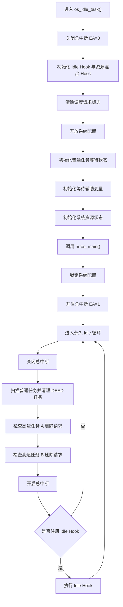
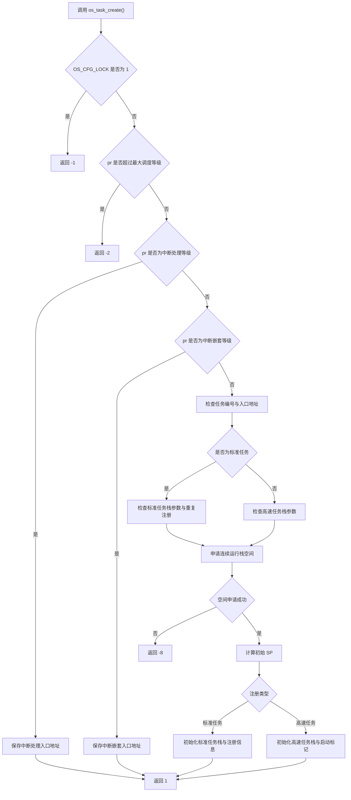
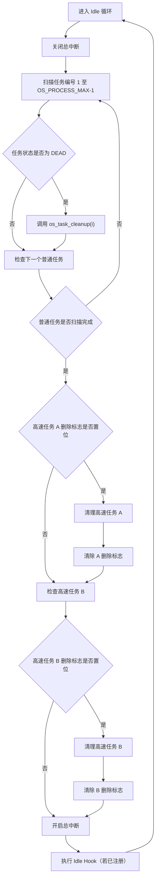
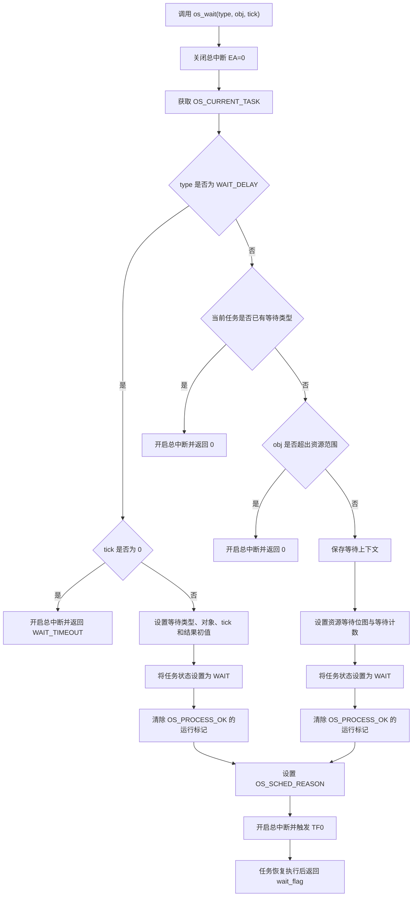
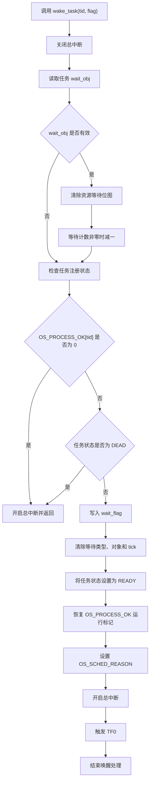
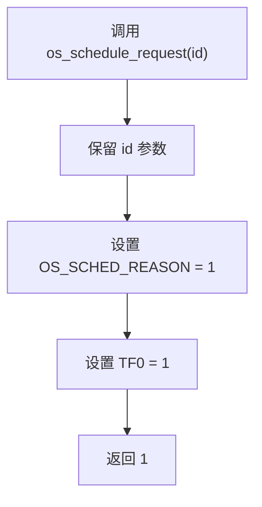

# HRTOS 调用流程

## 文档概述

HRTOS 内核通过任务注册、任务状态管理、等待与唤醒、调度请求以及任务资源回收等机制，组织系统的运行过程。

本文围绕内核关键调用链，介绍系统初始化、任务创建、任务清理、任务等待、任务唤醒和调度请求的执行流程，并说明普通任务与高速任务在等待处理和资源管理方面的区别。

本文涉及的核心机制包括：

- **系统初始化与配置管理**：初始化任务状态、等待信息及系统资源，并在用户初始化完成后锁定系统配置。
- **任务注册与运行栈管理**：为标准任务和高速任务分配运行栈，并初始化入口地址及相关上下文信息。
- **任务等待与唤醒**：通过任务控制信息记录等待条件、等待对象、超时计数及唤醒结果。
- **调度请求**：通过调度请求标志和 Timer0 中断触发任务重新调度。
- **任务清理与资源回收**：释放任务占用的运行栈空间，清除等待关系和互斥资源所有权，并重置任务状态。
- **Idle Hook**：在空闲任务循环中提供用户扩展入口。

## 核心文件与职责

| 文件 | 主要职责 |
|---|---|
| `idle_task.c` | 初始化运行环境、调用用户初始化入口、锁定配置、执行空闲循环及任务清理 |
| `task_create.c` | 注册标准任务、高速任务及中断处理函数，分配运行栈空间 |
| `task_cleanup.c` | 回收任务运行栈空间、清除资源等待关系、释放互斥资源所有权 |
| `wait.c` | 设置任务等待信息、建立资源等待关系、阻塞任务并触发调度 |
| `wake_task.c` | 清除等待信息、设置唤醒结果、恢复任务就绪状态并触发调度 |
| `schedule_request.c` | 设置调度请求标志并触发 Timer0 中断 |

## 系统初始化与运行入口

### 初始化流程

HRTOS 通过 `os_idle_task()` 初始化内核运行环境。初始化阶段首先关闭总中断，随后重置空闲钩子、资源溢出钩子、调度请求标志及配置锁，并初始化普通任务的等待状态和系统资源状态。

初始化完成后，系统调用 `hrtos_main()` 执行用户侧的系统配置和应用初始化。该阶段结束后，内核设置配置锁，禁止继续注册配置项，随后开启总中断并进入永久空闲循环。



### 初始化阶段的状态设置

`os_idle_task()` 对以下状态进行初始化：

1. 将 `g_idle_hook` 和 `g_slab_overflow_hook` 置空。
2. 将 `OS_SCHED_REASON` 清零，清除已有调度请求标志。
3. 将 `OS_CFG_LOCK` 置为 `0`，开放系统配置。
4. 将普通任务的 `wait_type` 初始化为 `WAIT_NONE`，`state` 初始化为 `READY`，`wait_tick` 清零，`wait_obj` 设置为 `OS_INVALID_ID`。
5. 清零 `OS_WAIT_DI2` 中两个高速任务的延时计数。
6. 将各系统资源的 `value`、`wait_cnt`、`wait_mask` 和 `pending_signal` 清零，并将 `owner` 设置为 `OS_INVALID_ID`。

这里的普通任务初始化循环覆盖任务编号 `0` 至 `OS_PROCESS_MAX - 1`。两个高速任务的运行状态和运行栈信息由其独立的注册及管理路径处理。

### 配置阶段与运行阶段

HRTOS 通过 `OS_CFG_LOCK` 区分系统配置阶段和正常运行阶段。

| 阶段 | `OS_CFG_LOCK` | 运行行为 |
|---|---:|---|
| 用户初始化阶段 | `0` | 允许执行任务注册等配置操作 |
| 正常运行阶段 | `1` | 禁止通过 `os_task_create()` 继续注册任务或中断处理函数 |

`hrtos_main()` 是系统配置与应用初始化的入口。该函数返回后，内核锁定配置、开启总中断，并开始执行 Idle 循环。

### Idle 循环与 Idle Hook

Idle 循环主要承担两项职责：

- 检查并处理任务删除请求。
- 调用用户注册的 `g_idle_hook`。

每轮循环首先关闭总中断，执行任务清理检查，然后重新开启总中断。只有在 `g_idle_hook` 非空时，才调用该钩子函数。

Idle Hook 在开启总中断之后执行，因此它运行期间系统中断处于开放状态。用户实现该钩子时，应合理控制执行时间，避免长时间占用空闲任务的执行机会。

## 任务创建流程

### 创建入口

`os_task_create(addr, id, pr, sd)` 用于注册标准任务、高速任务，以及设置中断处理函数和中断嵌套处理函数的入口地址。

参数含义如下：

| 参数 | 含义 |
|---|---|
| `addr` | 任务或处理函数入口地址 |
| `id` | 任务编号 |
| `pr` | 优先级及注册类型选择参数 |
| `sd` | 运行栈空间参数 |

函数通过 `pr` 判断注册类型。标准任务和高速任务需要分配运行栈空间；中断处理函数和中断嵌套处理函数则分别保存入口地址。

### 注册类型选择

函数首先检查配置锁和优先级参数，再根据 `pr` 选择对应的注册路径。



中断处理函数和中断嵌套处理函数的分支在任务编号及入口地址检查之前执行。标准任务和高速任务则继续进行任务编号、入口地址及栈参数检查。

### 运行栈空间申请

标准任务与高速任务共用基于 `OS_MEMORY` 位图的运行栈空间申请机制。

申请过程如下：

1. 将参数 `sd` 加一，得到本次申请所需的空间块数。
2. 从用户运行栈区域的起始位置开始扫描 `OS_MEMORY`。
3. 根据位图中的对应位判断当前空间块是否已被占用。
4. 连续遇到空闲块时，累积连续空闲块数量。
5. 当连续空闲块数量满足申请要求时，将对应位图全部标记为占用。
6. 根据分配位置计算初始栈指针 `SP`。
7. 初始化对应任务类型的运行栈记录及入口地址。

如果扫描过程中发现可用空间不足，函数返回 `-8`。

位图以每字节八个标志位管理空间块。分配时使用 `0x80 >> OS_R0_PROTECT` 定位相应位，并将成功分配的连续空间标记为已占用。

### 标准任务注册

标准任务的注册路径要求：

- `sd` 不大于 `6`。
- `OS_PROCESS_OK[id]` 为 `0`，即该编号未处于已注册状态。
- 运行栈空间申请成功。

注册成功后，函数更新以下信息：

- `OS_JINCHENG_SP[id]`：记录任务栈指针相关信息。
- `OS_JINCHENG_JILU_SP[id]`：记录初始栈指针。
- `OS_PROCESS_OK[id]`：记录优先级、启动标记和栈空间大小等信息。

随后，函数暂存当前系统栈指针，将 `SP` 切换到新任务的栈位置，把入口地址的低字节和高字节依次压入该任务的栈中，最后恢复原来的 `SP`。

这一步为任务后续的运行入口建立初始栈内容。

### 高速任务注册

高速任务的注册路径要求 `sd` 不大于 `25`。运行栈申请成功后，函数通过 `id %= OS_FAST_TASK_MAX` 将编号映射到高速任务槽位。

随后更新高速任务的栈指针、初始栈指针和栈空间记录，并根据任务槽位设置相应的启动标记：

- 槽位 `0` 对应 `OS_KUAI_PROCESS_A`。
- 其他槽位对应 `OS_KUAI_PROCESS_B`。

同时，函数初始化 `OS_FAST_CONTEXT` 中的相关寄存器组信息，并将任务入口地址压入高速任务的运行栈。

### 中断处理函数注册

当 `pr` 等于 `OS_SCHED_LEVEL_MAX - 1` 时，函数将入口地址的低字节和高字节分别保存到 `OS_INTERRUPT_ADDR[0]` 和 `OS_INTERRUPT_ADDR[1]`。

当 `pr` 等于 `OS_SCHED_LEVEL_MAX` 时，函数将入口地址保存到 `OS_INTERRUPT_ADDR2` 对应的两个字节中。

这两条路径保存中断处理入口地址，不执行标准任务或高速任务的运行栈分配流程。

### 创建操作的返回值

| 返回值 | 含义 |
|---:|---|
| `1` | 注册成功 |
| `-1` | 系统配置已锁定 |
| `-2` | 优先级参数超过最大调度等级 |
| `-3` | 任务编号无效 |
| `-4` | 任务入口地址为空 |
| `-5` | 标准任务栈参数无效 |
| `-6` | 标准任务重复注册 |
| `-7` | 高速任务栈参数无效 |
| `-8` | 用户运行栈空间不足 |

## 任务删除与清理流程

### 删除请求与实际清理

HRTOS 将任务删除后的资源回收放在 `os_task_cleanup()` 中执行。Idle 循环负责检查普通任务的 `DEAD` 状态，以及两个高速任务各自的删除请求标志。

普通任务与高速任务采用不同的删除请求表示方式：

- 普通任务通过 `OS_TASK[i].state == DEAD` 进入清理路径。
- 高速任务 A 通过 `OS_KUAI_PROCESS_A_DEL` 标记删除请求。
- 高速任务 B 通过 `OS_KUAI_PROCESS_B_DEL` 标记删除请求。



### 清理入口与合法性检查

`os_task_cleanup(id)` 根据任务编号选择相应的资源回收路径。

函数首先拒绝以下请求：

- `id` 大于 `OS_PROCESS_MAX + 1`。
- `id` 等于 `0`。

对于标准任务，函数要求 `OS_JINCHENG_JILU_SP[id]` 非零；对于两个高速任务，分别要求对应的 `OS_SP_KUAI_BEI` 记录非零。若相应运行栈记录不存在，则返回 `-1`。

合法任务进入清理流程后，函数暂存当前 `OS_HRTOS` 值，待资源回收完成后恢复该值。

### 运行栈与上下文清理

标准任务与高速任务分别使用独立的栈记录和上下文数组。

标准任务清理过程包括：

1. 调整栈记录中的兼容性计数。
2. 根据栈记录和用户 RAM 起始地址计算待释放空间范围。
3. 清除任务注册记录和初始栈指针记录。
4. 将 `OS_TASK_CONTEXT[id]` 对应的上下文内容清零。

高速任务清理过程则分别处理高速任务 A 或 B：

1. 调整对应高速任务的栈空间记录。
2. 根据初始栈指针计算待释放空间范围。
3. 清除对应高速任务的启动标记。
4. 清除高速任务栈指针及栈空间记录。
5. 将对应的 `OS_FAST_CONTEXT` 内容清零。

完成对应类型的记录清理后，函数根据计算出的空间范围遍历 `OS_MEMORY`，清除对应位图中的占用标记，从而释放运行栈空间。

### 等待关系与资源所有权清理

任务清理不仅回收运行栈，还要移除该任务在系统资源中的关联信息。

函数遍历全部系统资源，对每个资源执行两项检查。

**第一项：清除等待位图。**

如果资源的 `wait_mask` 中包含当前任务的位，则清除该位；如果 `wait_cnt` 非零，同时将等待计数减一。

**第二项：释放互斥资源所有权。**

如果资源的 `owner` 等于待清理任务编号，则将 `owner` 设置为 `OS_INVALID_ID`。

这一处理确保任务退出后，不再以等待者或资源所有者的身份保留在资源管理记录中。

### 清理任务等待状态

资源关系处理完成后，函数统一重置任务控制块中的等待字段：

| 字段 | 清理后的值 |
|---|---|
| `wait_type` | `WAIT_NONE` |
| `wait_flag` | `WAIT_TIMEOUT` |
| `wait_obj` | `OS_INVALID_ID` |
| `wait_tick` | `0` |
| `state` | `READY` |

对于高速任务，函数还会清零对应的 `OS_WAIT_DI2` 延时计数，防止遗留的延时状态再次激活该任务。

最后，函数恢复进入清理流程前保存的 `OS_HRTOS`，并返回 `1` 表示清理成功。

需要注意，`os_task_cleanup()` 完成的是任务资源与运行状态的重置；函数最终将任务状态设置为 `READY`，而不是 `DEAD`。

## 任务等待流程

### 等待机制概述

`os_wait(type, obj, tick)` 是 HRTOS 统一的任务等待入口。函数通过等待类型、等待对象和等待时长描述任务的等待条件，并将相应信息保存到任务控制块中。

对于普通任务，等待操作主要包括：

1. 关闭总中断，进入临界区。
2. 获取当前任务编号。
3. 检查等待参数及当前等待状态。
4. 保存等待类型、等待对象、等待时长和等待结果初值。
5. 必要时将任务加入资源等待位图。
6. 将任务状态设置为 `WAIT`，清除其运行资格标记。
7. 设置调度请求标志，开启总中断并触发 Timer0 中断。
8. 在任务后续恢复执行时，返回任务控制块中的等待结果。

### 普通任务等待流程



### 等待状态与资源等待位图

普通任务进入等待状态时，`os_wait()` 将以下字段写入 `OS_TASK[tid]`：

- `wait_type`：等待类型。
- `wait_obj`：等待对象编号。
- `wait_tick`：等待超时计数。
- `wait_flag`：等待结果，进入等待时初始化为 `0`。
- `state`：任务状态设置为 `WAIT`。

对于非 `WAIT_DELAY` 类型的等待，如果 `obj` 不等于 `OS_INVALID_ID`，函数会在对应资源的 `wait_mask` 中设置当前任务的位，并将 `wait_cnt` 加一。

纯时间等待不需要进入资源等待位图。资源等待则通过对象编号建立任务与系统资源之间的关联关系。

### 等待期间的调度触发

任务进入等待状态后，函数通过以下操作请求任务重新调度：

```c
OS_SCHED_REASON = 1;
EA = 1;
TF0 = 1;
```

`OS_SCHED_REASON` 用于记录调度请求，`TF0` 用于触发 Timer0 中断。`os_wait()` 本身不直接调用调度器。

等待函数在设置等待状态后，继续返回 `OS_TASK[tid].wait_flag`。任务实际恢复执行时，会从该调用点继续执行并取得等待结果。

### 等待结果

在普通任务的等待路径中，等待结果保存在 `wait_flag` 中。

| 返回值 | 含义 |
|---|---|
| `WAIT_TIMEOUT` | 等待超时 |
| `WAIT_SIGNAL` | 通过资源或事件正常唤醒 |
| `0` | 等待参数无效，或当前任务已经处于等待状态 |

对于 `WAIT_DELAY` 且 `tick == 0` 的调用，函数直接返回 `WAIT_TIMEOUT`，不建立等待状态。

### 高速任务的延时处理

当等待类型为 `WAIT_DELAY` 时，函数会单独判断当前任务是否属于高速任务。高速任务不使用普通任务的统一等待字段和资源等待位图来处理延时，而是使用独立的启动标记和 `OS_WAIT_DI2` 计数。

- 高速任务 A：清除 `OS_KUAI_PROCESS_A`，将延时时长写入 `OS_WAIT_DI2[0]`。
- 高速任务 B：清除 `OS_KUAI_PROCESS_B`，将延时时长写入 `OS_WAIT_DI2[1]`。

随后设置调度请求标志、开启总中断并触发 Timer0 中断。该分支在完成上述操作后直接返回 `WAIT_TIMEOUT`，延时计数由高速任务的独立管理路径处理。

## 任务唤醒流程

### 唤醒入口

`wake_task(tid, flag)` 用于唤醒指定的普通任务，并将唤醒原因写入任务控制块。

函数首先关闭总中断，读取任务原先关联的等待对象，并尝试清除该任务在对应资源中的等待位图及等待计数。随后检查任务是否已经删除或处于删除准备状态。

如果任务可以继续唤醒处理，函数将等待结果设置为调用者提供的 `flag`，清除等待上下文，将任务恢复为就绪状态，并请求系统重新调度。

### 唤醒流程图



### 清理等待上下文

对于允许唤醒的任务，`wake_task()` 会执行以下操作：

1. 将 `wait_flag` 设置为传入的 `flag`。
2. 将 `wait_type` 设置为 `WAIT_NONE`。
3. 将 `wait_obj` 设置为 `OS_INVALID_ID`。
4. 将 `wait_tick` 清零。
5. 将 `state` 设置为 `READY`。
6. 通过 `OS_PROCESS_OK[tid] |= 1` 恢复任务的运行资格标记。

随后，函数设置 `OS_SCHED_REASON`，开启总中断并将 `TF0` 置位，触发后续调度处理。

### 已删除任务的处理

当 `OS_PROCESS_OK[tid] == 0` 或 `OS_TASK[tid].state == DEAD` 时，函数不会继续修改任务的等待结果和就绪状态，而是开启总中断并直接返回。

在这两种情况下，函数前面已经执行的资源等待位图检查仍然会发生。因此，唤醒入口不仅检查任务状态，还会先处理与该任务相关的等待记录。

## 调度请求流程

### 调度请求接口

`os_schedule_request(id)` 用于通知系统重新进行任务调度。

该函数保留 `id` 参数供后续扩展使用，当前实现不根据该参数选择调度目标。函数的主要操作是设置调度请求标志并触发 Timer0 中断。



### 调度请求与任务切换的关系

HRTOS 将调度请求与调度执行分开处理。

| 阶段 | 主要操作 | 对应接口或机制 |
|---|---|---|
| 发起请求 | 设置调度请求标志 | `OS_SCHED_REASON = 1` |
| 触发处理 | 置位 Timer0 中断标志 | `TF0 = 1` |
| 执行调度 | 在中断处理链路中进行任务调度 | Timer0 中断处理路径 |

`os_wait()`、`wake_task()` 和 `os_schedule_request()` 均采用这一请求方式，不在函数内部直接调用调度器。这样，任务等待、任务唤醒和其他调度请求可以通过统一的中断触发机制进入后续调度流程。

## 任务延时、唤醒与清理之间的关系

任务延时、任务唤醒和任务清理都会影响任务的运行资格或等待状态，但它们承担不同的职责。

| 操作 | 主要状态变化 | 后续处理 |
|---|---|---|
| 普通任务进入等待 | `state = WAIT`，清除运行资格标记 | 请求调度 |
| 普通任务被唤醒 | `state = READY`，恢复运行资格标记 | 请求调度 |
| 普通任务进入删除准备状态 | `state = DEAD` | Idle 循环检查并调用清理函数 |
| 任务资源清理 | 清除等待关系、释放运行栈、重置控制块 | 恢复任务记录的初始状态 |
| 高速任务延时 | 清除相应高速任务启动标记，记录独立延时计数 | 通过高速任务专用管理路径处理 |

普通任务的等待和唤醒主要围绕任务控制块及资源等待位图展开；高速任务的延时则使用独立的计数与启动标记。任务清理负责解除任务与资源之间的关联，避免已退出任务继续保留等待记录或互斥资源所有权。

## 核心执行链总结

HRTOS 的核心运行过程可以归纳为以下几条链路：

1. **系统启动链路**：`os_idle_task()` 初始化内核状态，调用 `hrtos_main()` 完成用户配置，然后锁定配置并进入 Idle 循环。
2. **任务注册链路**：`os_task_create()` 检查配置与注册参数，为标准任务或高速任务分配运行栈，初始化任务运行记录；中断处理函数注册路径则保存对应入口地址。
3. **任务等待链路**：`os_wait()` 保存等待条件，必要时建立资源等待关系，将普通任务设置为等待状态，并通过 Timer0 中断请求调度。
4. **任务唤醒链路**：`wake_task()` 清理等待关系，设置唤醒结果，恢复任务就绪状态，并通过 Timer0 中断请求调度。
5. **任务清理链路**：Idle 循环检查删除状态或删除请求，调用 `os_task_cleanup()` 释放运行栈空间、清除资源关联并重置任务记录。
6. **调度请求链路**：调度请求接口设置 `OS_SCHED_REASON` 并触发 `TF0`，由后续中断处理链路执行调度。

这些机制共同构成 HRTOS 的任务生命周期管理框架：任务先完成注册，再根据运行需求进入就绪或等待状态；等待条件满足后，任务恢复就绪资格；任务进入删除处理后，Idle 循环负责回收运行资源并清理相关状态。

